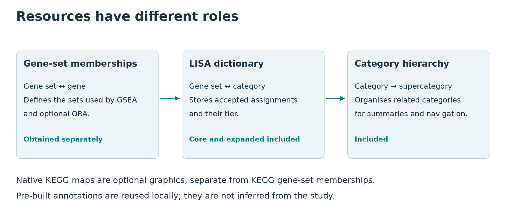

## Installation details {#advanced-installation--introduction}


For the ordinary installation, start with [Install lisaR](start-with-lisar.html#installation--introduction).
This page keeps the optional dependencies and installation diagnostics.
You need **R 4.1 or later**. RStudio is optional, but the steps below work in
its Console.

If you only need to read a portable HTML report, you do not need R. Keep the
report folder and its relative files together.

lisaR is installed from its GitHub repository. The installation includes the
LISA dictionaries and the synthetic sample project used in Quick Start.

<span id="install-the-required-packages"></span>

### Install the required packages {#advanced-installation--install-the-required-packages}

Run this once in R with internet access. `BiocManager` installs `fgsea` from a
Bioconductor release that is compatible with your R version, together with the
required CRAN packages.

```{r installation-dependencies, eval=FALSE}
install.packages(c("BiocManager", "remotes"))
BiocManager::install(
  c("digest", "fgsea", "fs", "ggplot2", "hommel", "jsonlite", "openxlsx", "readr",
    "withr", "yaml"),
  update = FALSE,
  ask = FALSE
)
```

The required `hommel` version is at least 1.8; the installer resolves this from
`DESCRIPTION`. Base and recommended Imports come with R. Install extra packages
only for the route you intend to use:

| Route | Additional packages |
|---|---|
| Shiny application with background figure jobs | `shiny`, `callr`, `ps` |
| Prepared Riaz project | `data.table` |
| Gene-level figures and FULL cards | `ggrepel`, `gridExtra`, `patchwork` |
| Native KEGG maps | `AnnotationDbi`, `KEGGREST`, `png`, plus `org.Hs.eg.db` for human or `org.Mm.eg.db` for mouse |
| Reconstructing Riaz upstream inputs | `data.table`, `readxl`, `DESeq2`, `AnnotationDbi`, `org.Hs.eg.db`, `SummarizedExperiment` |
| Building these HTML vignettes from source | `knitr`, `rmarkdown`, `edgeR`, plus Pandoc outside R |

Use the same `BiocManager::install()` form for these packages. For example,
install `data.table` before using the prepared Riaz project. Later,
`validate_lisa_config()` will report packages needed by the analysis and
report products you selected.

<span id="install-lisar-from-github"></span>

### Install lisaR from GitHub {#advanced-installation--install-lisar-from-github}

In R or the RStudio Console, run:

```{r install-github, eval=FALSE}
# If needed, install these optional guide-build packages manually:
install.packages(c("knitr", "rmarkdown"))
BiocManager::install("edgeR", update = FALSE, ask = FALSE)
# Confirm that Pandoc is available in your own build session:
rmarkdown::pandoc_available()
remotes::install_github(
  "DBM-OlmedaLab/lisaR",
  upgrade = "never",
  build_vignettes = TRUE
)
```
Building the local guides also needs the optional R packages `knitr`,
`rmarkdown` and `edgeR`, plus Pandoc outside R (often supplied by RStudio).
If these are missing, install the R packages manually before the build, as in
this unevaluated recipe; install or select Pandoc for your own R session.
The guide build executes the offline synthetic STANDARD demonstration once.
That compact run took about 60 seconds in the pinned reference environment;
this is an observation, not a speed promise for your computer.

The installation recipe builds the eight guides for local `vignette()`/
`browseVignettes()` access. To skip the build, choose `build_vignettes = FALSE`
and use the [online Getting started reader](https://olmedalab.org/lisaR/reader/start-with-lisar.html?lang=en);
that choice does not install the guides locally. Both choices can run analyses.


This installs the package and its included resources in one step. You do not
need to locate a separate source archive or install lisaR again to load its
dictionaries. The `build_vignettes = TRUE` recipe above builds the local guides;
choose `FALSE` only if you will read them online instead.

The source package includes the LISA dictionaries, category hierarchy and
synthetic sample project. It does **not** include the external MSigDB
TERM2GENE membership needed for a real study. Preparing that membership is a
separate step in [Resources and provenance](configuration-resources-and-execution.html#resources-and-provenance--introduction).

Source and release status are listed at
[DBM-OlmedaLab/lisaR](https://github.com/DBM-OlmedaLab/lisaR). Repository access
may remain restricted before publication. If GitHub reports that the repository
is unavailable, check your access with the project owner. Do not paste access
tokens into a chat or into this code.

<span id="check-that-r-loads-the-installed-copy"></span>

### Check that R loads the installed copy {#advanced-installation--check-that-r-loads-the-installed-copy}

Restart R if another lisaR version is already loaded, then run:

```{r confirm-installation, eval=TRUE}
library(lisaR)
packageVersion("lisaR")
find.package("lisaR")
system.file("extdata", "dictionaries", package = "lisaR")
system.file("examples", "quick-start", "study.yml", package = "lisaR")
```

`packageVersion()` identifies the installed package. `find.package()` shows
the R library from which it was loaded. If these checks complete, continue
with [Quick Start](start-with-lisar.html#quick-start--introduction). That synthetic project contains every
input needed for a first report and does not require MSigDB access.

For a real study, continue to
[Prepare differential-expression inputs](preparing-and-analysing-your-data.html#preparing-de-inputs--introduction), then
[run lisaR with your prepared files](preparing-and-analysing-your-data.html#getting-started--introduction).

<span id="read-the-guides"></span>

### Read the guides {#advanced-installation--read-the-guides}

The installation above builds HTML vignettes for local `vignette()` and
`browseVignettes()` access. If you chose `build_vignettes = FALSE`, read the
[guides online](https://olmedalab.org/lisaR/en/#guides), where each guide also
has a PDF download. You can open the Quick Start directly from R:

```{r open-online-guide, eval=FALSE}
browseURL("https://olmedalab.org/lisaR/reader/start-with-lisar.html?lang=en")
```

The source files are in the repository's `vignettes/` directory, in `.Rmd`
format. `vignette()` lists compiled HTML only when the package was built with
vignettes. You do not need those HTML files or another installation to run the
examples.

<span id="if-installation-fails"></span>

### If installation fails {#advanced-installation--if-installation-fails}

| Message or problem | Action |
|---|---|
| A package dependency is missing | Run the dependency step in the same R library, then install lisaR again. |
| R and Bioconductor versions are incompatible | Select the Bioconductor release supported by the active R version. |
| A source dependency requires compilation | Install the platform's R build tools: Rtools on Windows, the command-line tools on macOS, or the appropriate compiler packages on Linux. |
| Pandoc is missing during a vignette build | Use the Pandoc supplied by RStudio or install it before rebuilding documentation. Pandoc is not needed for an ordinary lisaR analysis. |
| An older lisaR version still appears | Restart R and check the library returned by `find.package("lisaR")`. |

See [Troubleshooting](reports-and-exploration.html#troubleshooting--introduction) for configuration and execution
errors after installation.

## Configure lisaR in R, YAML or JSON {#configuration-reference--introduction}


A study has the same configuration whether you write it as an R list, YAML or
JSON. Start with the complete example to compare the three formats, then use
the field tables when you need to change a report, execution, input or resource
decision.

You need lisaR installed. The first example uses only the installed synthetic
sample input and performs structural validation: it does **not** require
external scientific resources, run GSEA or establish execution readiness. For a
first complete run, follow [Quick Start](start-with-lisar.html#quick-start--introduction). For real DE tables,
start with [Preparing DE inputs](preparing-and-analysing-your-data.html#preparing-de-inputs--introduction).

<span id="compare-one-complete-configuration-in-three-formats"></span>

### Compare one complete configuration in three formats {#configuration-reference--compare-one-complete-configuration-in-three-formats}

A named R list, YAML and JSON describe the same study. Here is a complete R
list with two analyses, one contrast and four collections. Its resource
identifiers select the installed sample fixtures.

```{r reference-complete-config, eval=TRUE}
library(lisaR)

cfg <- list(
  pipeline = list(
    schema_version = "1.0.0",
    profile = "transcriptomic/genomic",
    evidence_mode = "full_de",
    output_dir = "results/minimal-study",
    dry_run = TRUE,
    workers = 4L,
    dictionary_resource = "lisa_dictionary_quickstart@1.1.0",
    term2gene_resource = "lisa_quickstart_term2gene@2.1.0",
    category_map_resource = "lisa_quickstart_category_map@1.1.0",
    run_kegg_maps = FALSE,
    run_hallmarks = FALSE,
    sufficiency_action = "ignore_with_reason",
    sufficiency_ignore_reason = "Bundled synthetic sample dataset; the restricted universe is intentional.",
    duplicate_policies = list(
      de_table_duplicate_policy = "error",
      matrix_duplicate_policy = "error",
      mapped_id_collision_policy = "error"
    )
  ),
  report = list(
    mode = "standard",
    category_evidence = TRUE,
    category_nes_variants = c("clean", "percentages", "direction", "dispersion"),
    legacy_gene_products = FALSE,
    evidence_max_sets = 25L,
    evidence_max_genes = 40L,
    formats = list(png = TRUE, svg = FALSE, pdf = FALSE),
    source_data = TRUE,
    recipes = FALSE
  ),
  collections = c("GOBP-C2", "GOMF", "GOCC", "PATHWAYS"),
  single_de = list(
    list(
    analysis_id = "treatment",
    de_path = system.file("extdata", "minimal", "de_A.tsv", package = "lisaR"),
    species = "Homo sapiens",
    symbol_col = "symbol",
    logfc_col = "log2FC",
    padj_col = "padj"),
    list(
    analysis_id = "control",
    de_path = system.file("extdata", "minimal", "de_B.tsv", package = "lisaR"),
    species = "Homo sapiens",
    symbol_col = "symbol",
    logfc_col = "log2FC",
    padj_col = "padj")
  ),
  contrasts = list(list(
    contrast_id = "treatment_vs_control",
    analysis_a = "treatment",
    analysis_b = "control",
    contrast_label = "Treatment versus control"
  ))
)

validation <- validate_lisa_config(cfg, check_files = FALSE)
stopifnot(validation$structural_valid, !validation$execution_ready)
validation$readiness
```

The structure passes, but inputs and resources remain `not_checked`, so this
check alone does not establish execution readiness. These sample tables use
their signed effect as the ranking because they have no separate signed
test-statistic column. For real DESeq2 or limma results, declare the appropriate
`rank_col` explicitly.

Before execution, validate with `check_files = TRUE` and require
`execution_ready` to be `TRUE`. Obtain and register real resources through the
[resource workflow](configuration-resources-and-execution.html#resources-and-provenance--introduction); do not substitute sample
fixtures into a scientific study.

<span id="inspect-what-lisar-actually-resolved"></span>

### Inspect what lisaR actually resolved {#configuration-reference--inspect-what-lisar-actually-resolved}

Validation, planning and configured execution share the same resolution rules.
Defaults and supplied values are visible without learning a new configuration
format:

```{r reference-resolved-config, eval=TRUE}
validation$config$report
validation$configuration_provenance[
  validation$configuration_provenance$field %in% c(
    "report.category_evidence", "report.category_nes_variants",
    "pipeline.gsea_padj_cutoff", "pipeline.cache_mode"
  ),
]
```

`validation$config` contains resolved values and paths;
`configuration_provenance` identifies defaults and explicit declarations.
A completed run records these as `config/pipeline_config.normalized.json`
and `config/configuration_provenance.tsv`. Preserve the original study file
as well. Resolved absolute paths are useful locally, but are not a portable
replacement for the original relative-path configuration.

Use strict validation, the default. Unknown fields raise an error rather than
silently changing the run. `strict = FALSE` is for inspecting older files; it
still checks known types and scientific contracts, and `run_lisa()` always
validates strictly.

The following YAML and JSON are complete equivalents of the R list. The R
list uses `system.file()` because it has no containing configuration file;
the two file formats use the same sample paths relative to the directory
that contains the saved configuration.

```yaml
pipeline:
  schema_version: "1.0.0"
  profile: "transcriptomic/genomic"
  evidence_mode: "full_de"
  output_dir: "results/minimal-study"
  workers: 4
  dry_run: true
  dictionary_resource: "lisa_dictionary_quickstart@1.1.0"
  term2gene_resource: "lisa_quickstart_term2gene@2.1.0"
  category_map_resource: "lisa_quickstart_category_map@1.1.0"
  run_kegg_maps: false
  run_hallmarks: false
  sufficiency_action: "ignore_with_reason"
  sufficiency_ignore_reason: "Bundled synthetic sample dataset; the restricted universe is intentional."
  duplicate_policies:
    de_table_duplicate_policy: "error"
    matrix_duplicate_policy: "error"
    mapped_id_collision_policy: "error"
report:
  mode: "standard"
  category_evidence: true
  category_nes_variants: [clean, percentages, direction, dispersion]
  legacy_gene_products: false
  evidence_max_sets: 25
  evidence_max_genes: 40
  formats: {png: true, svg: false, pdf: false}
  source_data: true
  recipes: false
collections: ["GOBP-C2", "GOMF", "GOCC", "PATHWAYS"]
single_de:
  - analysis_id: "treatment"
    de_path: "../extdata/minimal/de_A.tsv"
    species: "Homo sapiens"
    symbol_col: "symbol"
    logfc_col: "log2FC"
    padj_col: "padj"
  - analysis_id: "control"
    de_path: "../extdata/minimal/de_B.tsv"
    species: "Homo sapiens"
    symbol_col: "symbol"
    logfc_col: "log2FC"
    padj_col: "padj"
contrasts:
  - contrast_id: "treatment_vs_control"
    analysis_a: "treatment"
    analysis_b: "control"
    contrast_label: "Treatment versus control"
```

```json
{
  "pipeline": {
    "schema_version": "1.0.0",
    "profile": "transcriptomic/genomic",
    "evidence_mode": "full_de",
    "output_dir": "results/minimal-study",
    "workers": 4,
    "dry_run": true,
    "dictionary_resource": "lisa_dictionary_quickstart@1.1.0",
    "term2gene_resource": "lisa_quickstart_term2gene@2.1.0",
    "category_map_resource": "lisa_quickstart_category_map@1.1.0",
    "run_kegg_maps": false,
    "run_hallmarks": false,
    "sufficiency_action": "ignore_with_reason",
    "sufficiency_ignore_reason": "Bundled synthetic sample dataset; the restricted universe is intentional.",
    "duplicate_policies": {
      "de_table_duplicate_policy": "error",
      "matrix_duplicate_policy": "error",
      "mapped_id_collision_policy": "error"
    }
  },
  "report": {
    "mode": "standard",
    "category_evidence": true,
    "category_nes_variants": ["clean", "percentages", "direction", "dispersion"],
    "legacy_gene_products": false,
    "evidence_max_sets": 25,
    "evidence_max_genes": 40,
    "formats": {"png": true, "svg": false, "pdf": false},
    "source_data": true,
    "recipes": false
  },
  "collections": ["GOBP-C2", "GOMF", "GOCC", "PATHWAYS"],
  "single_de": [
    {"analysis_id": "treatment", "de_path": "../extdata/minimal/de_A.tsv", "species": "Homo sapiens", "symbol_col": "symbol", "logfc_col": "log2FC", "padj_col": "padj"},
    {"analysis_id": "control", "de_path": "../extdata/minimal/de_B.tsv", "species": "Homo sapiens", "symbol_col": "symbol", "logfc_col": "log2FC", "padj_col": "padj"}
  ],
  "contrasts": [
    {"contrast_id": "treatment_vs_control", "analysis_a": "treatment", "analysis_b": "control", "contrast_label": "Treatment versus control"}
  ]
}
```

<span id="choose-safe-paths-and-identifiers"></span>

### Choose safe paths and identifiers {#configuration-reference--choose-safe-paths-and-identifiers}

Paths in YAML or JSON start from the folder that contains the configuration
file. Paths in an R list start from the current working directory.
`pipeline.output_dir` tells lisaR where to save the finished analysis. Work in
progress stays separate and is promoted to the new final destination only after
all checks pass. It does not replace an existing completed run.

Technical identifiers that become directory or file-name components use one
portable ASCII grammar. These include `run_id`, `analysis_id`, `contrast_id`,
`output_id`, `file_label_prefix` and `source_data.target_subdir`.

| Identifier rule | Accepted | Rejected |
|---|---|---|
| First character | ASCII letter or number | Dot, hyphen or underscore |
| Later characters | ASCII letters, numbers, dot, hyphen and underscore | Spaces, path separators, traversal fragments and Unicode |
| Final character | ASCII letter, number, hyphen or underscore | Dot or space |
| Reserved names | Ordinary portable names | `CON`, `PRN`, `AUX`, `NUL`, `COM1` to `COM9` and `LPT1` to `LPT9`, including names with an extension |

lisaR rejects invalid identifiers instead of silently rewriting them. Keep
readable Unicode in the separate `label`, `contrast_label`, `report_title`,
`comparison` and other display-text fields.
External scientific keys are not relabelled: for example, a KEGG key such as
`hsa:1` remains `hsa:1` in the API and provenance, while lisaR derives a
deterministic ASCII-only component for its private cache path.

On Unix-like systems, lisaR keeps both areas private: staging and final result
directories are `0700`, and their files are `0600`. Existing ancestor
permissions are not changed. For a shared HPC project, require
`verify_lisa_run(...)$gate` to be `"PASS"` before deliberately granting group
access according to the institutional policy.

Use a new local output directory that other processes cannot modify while the
analysis is running. lisaR checks managed paths, builds the run in a private
staging directory and exposes it only after validation. Network and shared
filesystems can have different rename and locking behaviour; use them only when
your institution has validated that behaviour for lisaR. See
[Troubleshooting](reports-and-exploration.html#troubleshooting--introduction) for recovery and diagnostic
guidance.

<span id="set-pipeline-inputs-and-resources"></span>

### Set pipeline inputs and resources {#configuration-reference--set-pipeline-inputs-and-resources}

Required fields:

- `schema_version`: the configuration format, currently `"1.0.0"`.
  This is distinct from the package version and the release label “1.0.0”.
- `profile`: `transcriptomic/genomic`, `global proteomic`, `targeted` or
  `custom`.
- `evidence_mode`: `full_de`, `rank_only`, `effect_only` or `custom`.
- `output_dir`: new destination for the run.
- `duplicate_policies`: explicit policy for DE tables, expression matrices and
  mapped-identifier collisions.

`schema_version` is not a request to use the newest package release. It tells
lisaR how to interpret the fields in the file. Keep it fixed until you
deliberately migrate the configuration to a different schema.

`full_de` requires an effect and adjusted significance, `rank_only` requires a
ranking value, and `effect_only` requires an effect. Typical source-column
mappings are:

| Evidence role | Common columns | Interpretation |
|:---|:---|:---|
| `effect` | `log2FoldChange`, `logFC` | Signed effect size. |
| `significance` | `padj`, `FDR` | Multiple-testing-adjusted significance. |
| `rank` | `stat`, `t`, `z` | Signed statistic used to order genes. |

Do not use `padj` or FDR as a ranking value: it has no direction and often
contains ties. For DESeq2, a common `full_de` entry uses
`logfc_col: log2FoldChange`, `padj_col: padj` and `rank_col: stat`.

For the advanced `custom` mode, declare the evidence explicitly:

```yaml
pipeline:
  evidence_mode: custom
  evidence:
    required_columns: [effect, significance]
    products: []
```

The values in `required_columns` are evidence roles: `effect`, `significance`
and `rank`. Map them to real columns with `logfc_col`, `padj_col` and
`rank_col` in each `single_de` entry. `products` records your declared product
compatibility as provenance; it does not enable a product or override its own
data requirements.

Resource selection fields:

- `dictionary_resource`: versioned, registered LISA dictionary.
- `term2gene_resource`: versioned, registered gene-set memberships used by
  gene set enrichment analysis (GSEA).
- `category_map_resource`: registered LISA category-map resource.
- `lisa_dictionary`: optional `core` or `expanded` tier selector. Omit it when
  selecting a custom dictionary resource.

You may omit all three resource IDs in an ordinary configuration. lisaR then
selects `lisa_dictionary_core@1.0.0`, `msigdb_term2gene@2026.1` and
`lisa_category_map@1.0.0` by default. Leaving those IDs explicit is also valid
and can make review easier. The core and expanded dictionary resources are
bundled as `lisa_dictionary_core@1.0.0` and
`lisa_dictionary_expanded@1.0.0`. Both use the score-free
`lisa_dictionary@2` file schema. The bundled category map uses the
`category_map@1` schema. The default MSigDB TERM2GENE memberships are external:
obtain them through the authorised resource route, then register the exact
versioned file. The synthetic sample resources are also bundled, but are not
scientific substitutes for a study.

Use explicit `name@version` overrides for reviewed alternatives. Custom
dictionaries and supercategory maps must be registered and validated together
with their TERM2GENE resource; see
[Custom dictionaries and supercategories](custom-dictionaries-and-supercategories.html).

<span id="migrate-an-earlier-configuration-in-a-reviewed-copy"></span>

#### Migrate an earlier configuration in a reviewed copy {#configuration-reference--migrate-an-earlier-configuration-in-a-reviewed-copy}

Schema `1.0.0` records the current configuration contract. It does not rename
the R package or any scientific resource, and lisaR does not silently convert
an older file. Follow [Configuration migration](reports-and-exploration.html#troubleshooting--configuration-migration)
for the exact old-key mapping, copy command, validation and planning steps.
Keep the original file unchanged and choose a new output directory. A migrated
configuration is not evidence that an old result was rerun or revalidated.

<span id="look-up-exact-fields-and-defaults"></span>

### Look up exact fields and defaults {#configuration-reference--look-up-exact-fields-and-defaults}

This is the shared field reference for named R lists, YAML and JSON. `Required`
means required by schema 1.0.0, not merely recommended. A blank default means
the field is optional and has no parser-supplied value. A file path is resolved
from the YAML/JSON file's directory, or from the current working directory for
an R list.

| Field path | Required | Type and accepted values | Default / interaction |
|---|---:|---|---|
| `pipeline.schema_version` | yes | string: `1.0.0` | No other version is accepted. |
| `pipeline.profile` | yes | `transcriptomic/genomic`, `global proteomic`, `targeted`, `custom` | Selects modality-matched resources and sufficiency checks. |
| `pipeline.evidence_mode` | yes | `full_de`, `rank_only`, `effect_only`, `custom` | `custom` requires `pipeline.evidence`. |
| `pipeline.evidence.required_columns` | with `custom` | non-empty unique roles: `effect`, `significance`, `rank` | Roles are mapped by each analysis's column fields. |
| `pipeline.evidence.products` | no | unique non-empty strings | Provenance only; does not enable report products. |
| `pipeline.output_dir` | yes | non-empty path | New final run destination. |
| `pipeline.duplicate_policies.{de_table_duplicate_policy,matrix_duplicate_policy,mapped_id_collision_policy}` | yes | `error`, or a `select`, `aggregate` or `mapping_file` object | All three must be present. DE-table policy cannot be `aggregate`. |
| `pipeline.workers` | no | positive integer | `4`; Windows and macOS use the serial backend. |
| `pipeline.gsea_padj_cutoff` | no | finite number in `[0, 1]` | `0.25`; shared cutoff for summaries, contrasts and figures. |
| `pipeline.dry_run` | no | Boolean | `true`; returns planning evidence rather than a completed run. |
| `pipeline.resume` | no | Boolean | `false`; `true` is rejected in this release. |
| `pipeline.run_id`, `pipeline.file_label_prefix` | no | portable ASCII identifier | `file_label_prefix` defaults to `semantic`; display text belongs in labels or titles. |
| `pipeline.report_title` | no | string | `project.title`, otherwise `LISA report`. |
| `pipeline.base_dir` | no | path | `output_dir`; controls the managed working base. |
| `pipeline.sufficiency_action` | no | `warn`, `error`, `ignore_with_reason` | `warn`; the last choice requires a non-empty `sufficiency_ignore_reason`. |
| `pipeline.sufficiency_ignore_reason` | conditional | string | Recorded with the run when a restricted assay is intentionally accepted. |
| `pipeline.dictionary_resource`, `pipeline.term2gene_resource`, `pipeline.category_map_resource` | no | versioned `name@version` resource IDs | Defaults are the active core dictionary, MSigDB TERM2GENE and category map stated above. |
| `pipeline.lisa_dictionary` | no | `core` or `expanded` | `core`; omit for a custom dictionary resource. It must not conflict with an explicit tier resource. |
| `pipeline.run_ora` | no | Boolean | `false`; ORA is separate from ranked GSEA. |
| `pipeline.run_hallmarks` | no | Boolean | `true`; permits selected `HALLMARKS`, but never adds it to `collections`. |
| `pipeline.run_kegg_maps` | no | Boolean | `false`; if true, requires `kegg_access_mode: cache_only`, `kegg_cache_root` and `kegg_snapshot_id`. |
| `pipeline.kegg_access_mode` | no | `external`, `cache_only` | `external`; `cache_only` is compulsory for native maps. |
| `pipeline.kegg_cache_root`, `pipeline.kegg_snapshot_id` | conditional | non-empty path; portable ASCII identifier | Required only for native maps; local snapshot metadata is checked. |
| `pipeline.pathways_category_display` | no | `all` | `all`; no upstream PATHWAYS filter is accepted. |
| `pipeline.kegg_map_selection` | no | `significant_only` | `significant_only`; does not enable maps. |
| `pipeline.cache_mode` | no | `off`, `readwrite`, `readonly`, `refresh` | `off`; every active mode requires `cache_dir`. |
| `pipeline.cache_dir` | conditional | non-empty path or `null` when cache is off | Required when `cache_mode` is active. |
| `pipeline.cache_max_bytes` | no | positive exactly representable integer, up to `2^53 - 1` | `536870912`; cache capacity, not a resource registry. |

| Field path | Required | Type and accepted values | Default / interaction |
|---|---:|---|---|
| `project.title` | no | string | Used as `report_title` when that pipeline field is absent. |
| `project.output_dir` | no | non-empty path | Project metadata; use `pipeline.output_dir` for execution. |
| `report.mode` | no | `standard`, `full` | `standard`; `selected` belongs only to the extension API. |
| `report.formats.{png,svg,pdf}` | no | Boolean | `true`, `false`, `false`; all false suppresses static figures, not HTML or computation. |
| `report.source_data`, `report.recipes`, `report.category_evidence`, `report.legacy_gene_products` | no | Boolean | `true`, `false`, `true`, `false`, respectively. |
| `report.category_nes_variants` | no | one to four unique values: `clean`, `percentages`, `direction`, `dispersion` | All four, in that order. |
| `report.evidence_max_sets`, `report.evidence_max_genes` | no | positive integers | `25`, `40`; initial visible limits, not data filters. |
| `collections` | no | non-empty unique subset of `GOBP-C2`, `GOMF`, `GOCC`, `PATHWAYS`, `HALLMARKS` | All five. The first four are semantic universes; Hallmarks is direct. |
| `single_de` | yes | non-empty array of analysis objects | Use it, or the equivalent `de_index` / `de_index_path` parser aliases, to supply analyses. |
| `contrasts` | no | array of contrast objects | Equivalent parser aliases: `contrast_index`, `contrast_index_path`. |
| `source_data` | no | array of source objects | Each entry needs `path` or `source_path`, and an explicit non-empty study or entry allowlist. |
| `allowlisted_source_paths` | conditional | array of non-empty paths | Required for source-data entries unless every entry supplies `allowlisted_paths`. |

The schema rejects unknown fields. The parser recognises the older output keys
only to issue a migration error; do not use `plot_formats`, `export_formats`,
`run_reports` or `run_gene_level` in a 1.0.0 study.

<span id="choose-report-products"></span>

### Choose report products {#configuration-reference--choose-report-products}

`report` is a **top-level** section, alongside `pipeline`; do not nest it under
`pipeline`.

| Setting | Default | What it controls |
|---|---|---|
| `report.mode` | `standard` | Standard study or standard study plus a full extension |
| `report.category_evidence` | `true` | Category navigator, category evidence, global gene evidence and aligned evidence for declared semantic contrasts |
| `report.category_nes_variants` | `[clean, percentages, direction, dispersion]` | One to four distinct NES overview variants; at least one required |
| `report.legacy_gene_products` | `false` | Opt in to legacy gene-level products such as GeneCards |
| `report.evidence_max_sets` | `25` | Initial matrix limit for gene sets; positive integer |
| `report.evidence_max_genes` | `40` | Initial matrix limit for genes; positive integer |
| `report.formats.png` | `true` | Render PNG figures |
| `report.formats.svg` | `false` | Render SVG figures |
| `report.formats.pdf` | `false` | Render PDF figures |
| `report.source_data` | `true` | Save figure-specific sources, independently of canonical scientific tables |
| `report.recipes` | `false` | Request reproduction recipes; keep source data enabled to use them |

The matrix limits restrict the displayed view, not the complete evidence tables
or the recurrence counts. The report provides a shared navigation header, a
category navigator after the LISA overview graphics and a member-gene-set
chart at the end of the corresponding category sheet. There is no duplicate
visible category table or separate gallery of those member charts.

The Hommel category-significance view is a separate automatic product of a
completed `run_lisa()` analysis when applicable. Its four adjusted-P star
thresholds are presentation conventions, not an additional value of
`report.category_nes_variants` or a configurable inferential cutoff. The four
NES variants remain descriptive; `HALLMARKS` and A/B profile contrasts do not
gain category inference.

<span id="four-nes-views-one-scientific-result"></span>

#### Four NES views, one scientific result {#configuration-reference--four-nes-views-one-scientific-result}

| Variant | Additional information |
|---|---|
| `clean` | Mean NES, with the existing clean summary |
| `percentages` | The clean view plus concordance percentages beside each point |
| `direction` | Mean plus median and percentages of significant members with positive/negative NES |
| `dispersion` | The direction view plus type-7 P25-P75 |

All selected variants use the same member population, order and scale. For
contrasts, each side retains its own statistics and the original descriptive
delta. Percentiles show dispersion, **not confidence intervals**. Percentages
state their denominator; they do not measure independent evidence or
confidence. The denominator is the number of unique category members with
finite NES and adjusted P value at or below the cutoff; zero NES values stay
in that denominator and have a separate percentage. With no significant
members, percentages are unavailable. Concordance with the mean is also
unavailable when the mean is exactly zero. See
[Semantic categories](how-lisar-works.html#semantic-category-guide--introduction) for the collection and
category structure.

The selector accepts one to four unique names. **At least one must
remain selected**, but `clean` is not compulsory: `[dispersion]` alone is
valid. Unknown names, duplicates and an empty list are errors. Its order is
retained in the HTML selector. This controls the new NES overview family;
the LISA categories section presents these views together without a duplicated legacy gallery. Complementary gene-set overviews remain available.

For YAML, choose one of these alternative values under `report`:

```yaml
category_nes_variants: [clean, percentages, direction, dispersion]  # default: all four
```

```yaml
category_nes_variants: [clean]  # one clean overview
```

```yaml
category_nes_variants: [dispersion]  # one overview with all annotations
```

The JSON equivalent is, for example,
`"category_nes_variants": ["dispersion"]`. YAML and JSON describe the same
configuration; JSONL is not a study configuration format.

```{r reference-output-choices, eval=TRUE}
clean_only <- cfg
clean_only$report$category_nes_variants <- "clean"
clean_check <- validate_lisa_config(clean_only, check_files = FALSE)
stopifnot(identical(
  unlist(clean_check$config$report$category_nes_variants, use.names = FALSE),
  "clean"
))

dispersion_only <- cfg
dispersion_only$report$category_nes_variants <- "dispersion"
dispersion_check <- validate_lisa_config(dispersion_only, check_files = FALSE)
stopifnot(identical(
  unlist(dispersion_check$config$report$category_nes_variants, use.names = FALSE),
  "dispersion"
))

all_plan <- plan_lisa_outputs(cfg, category_counts = c(`GOBP-C2` = 2L))
clean_plan <- plan_lisa_outputs(clean_only, category_counts = c(`GOBP-C2` = 2L))
all_plan$summary
clean_plan$summary
```

The supplied count of two categories is an **illustrative planning assumption**,
not a claim about the installed resource. The two plans compare presentation
choices only; they do not perform sensitivity analysis or test different
scientific conclusions.

<span id="standard-full-and-no-static-figures"></span>

#### Standard, full and no static figures {#configuration-reference--standard-full-and-no-static-figures}

| Choice | What runs and what is added |
|---|---|
| `standard` | GSEA and canonical tables, overview graphics, linked category/gene evidence and evidence for declared compatible semantic contrasts; no mass full extension |
| `full` | The same canonical study plus a separate extension of applicable extra products; expensive figures may require additional inputs |
| All three format switches `false` | No static PNG/PDF/SVG figure files or their associated figure-only artefacts; scientific/evidence tables and HTML navigation remain |
| Selected extension | Existing R API for chosen additions to a verified run; **not** a study mode and not a “generate” button in the HTML |

Full is an output expansion, not a different GSEA method. It is not necessary
for evidence pages. Use `plan_lisa_outputs()` before choosing it; estimates
include the selected NES variants and standard member charts but are not a
hard upper bound on report size or memory. The shared gene explorer also grows
with the DE and full-membership tables.

To request no static figure files, change **all** switches explicitly; omitted
PNG defaults to `true`:

```{r reference-no-static-figures, eval=TRUE}
no_static <- cfg
no_static$report$formats <- list(png = FALSE, svg = FALSE, pdf = FALSE)
no_static_check <- validate_lisa_config(no_static, check_files = FALSE)
stopifnot(!any(unlist(no_static_check$config$report$formats)))
```

The offline navigator uses SVG as part of its interface even in this mode.
“No static figures” is not “no HTML” and does not cancel GSEA. If you want no
computation, use `dry_run`, described below.

The optional extension products are `member_gene_sets`, `gene_cards`,
`volcano`, `heatmap`, `kegg`, `contrast_profile` and `contrast_heatmap`.
Extensions leave their verified source run unchanged. The extension's `kegg`
product summarises KEGG gene-set evidence from the TERM2GENE memberships.
Native pathway maps are separate graphics, requested through
`pipeline.run_kegg_maps` with the local cache-only settings below. Selecting
the `kegg` extension product alone neither enables native maps nor retrieves
a map snapshot.

Other product controls live under `pipeline`:

- `run_ora`: default `false`. ORA is separate threshold-based enrichment,
  not the basis of the GSEA evidence matrix.
- `run_hallmarks`: default `true`. Permits `HALLMARKS` when explicitly
  selected; does not add it to a list that excludes it.
- `run_kegg_maps`: optional native pathway painting from existing gene-level
  evidence. It requires the explicit cache-only contract below.
- `kegg_access_mode`: must be `cache_only` when `run_kegg_maps` is true; the
  configured route never retrieves maps automatically.
- `kegg_cache_root` and `kegg_snapshot_id`: required with `run_kegg_maps`;
  identify the local snapshot whose files are checked against its metadata.
- `pathways_category_display`: currently `all`.
- `kegg_map_selection`: retained compatibility field, `significant_only`;
  does not enable painted maps.

GSEA tests the selected TERM2GENE source space, not just mapped sets.
`GOBP-C2`, `GOMF` and `GOCC` keep a dedicated `OTHER_UNCLASSIFIED` table;
`PATHWAYS` has no separate residual table. Unclassified rows are excluded
from figures. Direct `HALLMARKS` is not a semantic category universe.

<span id="choose-execution-and-output-controls"></span>

### Choose execution and output controls {#configuration-reference--choose-execution-and-output-controls}

- `workers`: distribute independent analysis, contrast and post-processing
  tasks while keeping their order and random seeds fixed; default `4`. Choose a
  positive integer no larger than the CPU cores allocated to the R process.
  Linux uses a bounded multicore backend. Windows and macOS run serially even
  when a larger value is requested. Each DE task uses one thread; shared-cache,
  report and final-verification steps remain serial.
- `gsea_padj_cutoff`: the single inclusive adjusted-P threshold used for
  member-set summaries, A/B support flags and figure endpoints; default `0.25`. Use a
  number from `0` to `1`. Changing it changes the descriptive category
  summaries and must therefore be recorded with the run.
- `dry_run`: validate and plan without enrichment; start with `true`. A
  successful plan returns `PLAN_PASS` and is stored in the separate directory
  reported as `result$plan_dir`. It does not create or reserve
  `pipeline.output_dir`. `verify_lisa_run(result$plan_dir)` returns `FAIL`
  because planning evidence is not a completed scientific run. Set
  `dry_run: false` to use the still-free scientific destination.
- `resume`: the default is `false`, and it must remain `false` in this release. lisaR
  cannot yet prove that a partial
  run was created with the same configuration, code and resources. If a run is
  interrupted, keep its staging tree for inspection and start a clean run with
  a new `run_id`. Setting `true` stops with `LISA-RESUME-001`.
- `run_id`: optional explicit portable ASCII technical identifier.
- `report_title`: title displayed in the report.
- `file_label_prefix`: portable ASCII filename prefix; display text belongs in
  `report_title` or analysis labels.
- `sufficiency_action`: what to do when the usable feature count is below the
  profile threshold. The default is `warn`; use `error` to stop, or
  `ignore_with_reason` for an intentionally restricted assay.
- `sufficiency_ignore_reason`: non-empty justification required with
  `ignore_with_reason`; it becomes part of the reproducible configuration.

For `transcriptomic/genomic`, lisaR warns below 5,000 usable unique features
and gives a strong warning below 2,000. For `global proteomic`, the corresponding
thresholds are 1,500 and 500. A `targeted` profile has no universal minimum and
records that limitation instead. These checks flag whether the input may be
too narrow for a useful enrichment analysis; they do not measure data quality
or statistical power.

For example, an intentionally restricted panel can record:

```yaml
pipeline:
  sufficiency_action: ignore_with_reason
  sufficiency_ignore_reason: "Targeted 84-gene immune panel; the restricted feature universe is intentional."
```

<span id="duplicate-policies"></span>

#### Duplicate policies {#configuration-reference--duplicate-policies}

Each input class requires one of:

- `error`: stop when duplicate identifiers are present; recommended default.
- `select`: retain an observed row using a declared criterion and deterministic
  tie breaker.
- `aggregate`: allowed for compatible matrix/mapping inputs, with explicit
  numeric and non-numeric methods; not allowed for DE effect/significance rows.
- `mapping_file`: use an explicit row-resolution mapping.

Implicit first-row selection is prohibited.

<span id="choose-collections"></span>

### Choose collections {#configuration-reference--choose-collections}

A list of registered gene-set collections:

| Collection | Biological scope |
|:---|:---|
| `GOBP-C2` | Broad biological programmes, combining GO Biological Process with selected curated pathway families from MSigDB C2:CP. |
| `GOMF` | Molecular activities represented by GO Molecular Function gene sets. |
| `GOCC` | Cellular locations, structures and complexes represented by GO Cellular Component gene sets. |
| `PATHWAYS` | A strict signalling view of the `GOBP-C2` gene-set space. |
| `HALLMARKS` | MSigDB Hallmark gene sets analysed directly, without semantic LISA remapping. |

The first four are the semantic LISA universes. `HALLMARKS` is the fifth
analysis option, but it is a direct collection rather than another semantic
universe. The examples use the four semantic collections and exclude
Hallmarks deliberately:

```yaml
pipeline:
  run_hallmarks: false

collections:
  - GOBP-C2
  - GOMF
  - GOCC
  - PATHWAYS
```

You may select a different supported subset for your study. Remember that
`run_hallmarks: true` keeps Hallmarks only when `HALLMARKS` is selected; it
does not add it to the list above. See
[How lisar works](how-lisar-works.html#how-lisar-works--introduction) for the relationship between
the universes, dictionaries and biological hierarchy. Availability depends on
the installed species-matched gene-set membership table.

<span id="describe-each-analysis"></span>

### Describe each analysis {#configuration-reference--describe-each-analysis}

One entry per differential-expression analysis:

- `analysis_id`: stable portable ASCII technical identifier.
- `de_path`: differential-expression table.
- `species`: `Homo sapiens` or `Mus musculus`.
- `symbol_col`: gene-symbol column.
- `logfc_col`: signed effect-size column.
- `pvalue_col`: optional raw p-value column.
- `padj_col`: adjusted p-value/FDR column.
- `rank_col`: optional precomputed ranking column.

The ranking column must retain direction. Use a signed statistic such as a
DESeq2 Wald `stat`, a limma `t` or another signed `z`-score; never use `padj`
or FDR as `rank_col`.

Presentation metadata is optional but strongly recommended:

- `label`: concise human-readable analysis title.
- `comparison`: the exact oriented comparison shown in plot subtitles.
- `positive_direction`: a plain-language definition of positive log2FC/NES.
- `model_note`: the fitted model, coefficient or contrast, and any pairing,
  blocking or adjustment variables.

These fields do not alter statistics. They prevent internal IDs from becoming
the only explanation of a figure.

Optional matrix paths and their identifier columns support heatmaps. Match the
field to the stored scale: `vst_matrix`/`vst_matrix_path` declare transformed
values (no further log transform); `counts_matrix`, `tpm_matrix` and their
`*_path` forms declare count-like values, which the heatmap displays as
`log2(x + 1)`. That display transform is not a substitute for DE normalisation.
Generic matrix fields retain a legacy filename-based scale inference, so
prefer an explicit typed field. Never declare one file under conflicting
scales. `matrix_id_col` identifies the gene column and sample columns retain
their input order. The input adapter's `matrix_scale` receipt alone does not
configure or transform this matrix.

<span id="look-up-analysis-contrast-and-source-data-fields"></span>

#### Look up analysis, contrast and source-data fields {#configuration-reference--look-up-analysis-contrast-and-source-data-fields}

| Field path | Required | Type / values | Default or condition |
|---|---:|---|---|
| `single_de[].analysis_id` | yes | portable ASCII identifier | Unique technical analysis identifier. |
| `single_de[].de_path` | yes | non-empty tabular-input path | YAML/JSON configurations do not accept RDS input. |
| `single_de[].species` | yes | `Homo sapiens` or `Mus musculus` | Must match the selected resources. |
| `single_de[].symbol_col`, `gene_id_col` | conditional | source-column names | Supply the identifier mapping required by the input contract. |
| `single_de[].logfc_col`, `padj_col`, `rank_col`, `pvalue_col` | conditional | source-column names | Required roles depend on `evidence_mode`; rank must be signed. |
| `single_de[].label`, `comparison`, `positive_direction`, `model_note` | no | display strings | Do not change statistical input. |
| `single_de[].msigdb_mode`, `term2gene_target_species` | no | strings | Advanced membership-input declarations. |
| `single_de[].matrix_path`, `expression_matrix_path`, `counts_matrix_path`, `vst_matrix_path`, `normalized_matrix_path`, `tpm_matrix_path`, `sample_counts_path` | no | paths | Pick the path that declares the stored scale; do not declare one file under conflicting scales. |
| `single_de[].expression_matrix`, `counts_matrix`, `vst_matrix`, `normalized_matrix`, `tpm_matrix`, `sample_counts` | no | paths | Backward-compatible matrix aliases; prefer the explicit `*_path` form. |
| `single_de[].matrix_id_col`, `matrix_feature_col` | no | source-column names | Identifies matrix features. |
| `single_de[].sample_include_regex`, `heatmap_sample_include_regex`, `sample_exclude_regex`, `heatmap_sample_exclude_regex` | no | regular-expression strings | Select samples for the stated view without changing DE. |
| `single_de[].mapped_id_path`, `mapped_id_col`, `source_id_col` | no | path and source-column names | Used for explicit identifier mapping and collision handling. |
| `contrasts[].contrast_id` | yes | portable ASCII identifier | Unique technical contrast identifier. |
| `contrasts[].analysis_a`, `analysis_b` | yes | `analysis_id` strings | Direction is A minus B. Both analyses must be compatible. |
| `contrasts[].output_id` | no | portable ASCII identifier | Optional output technical identifier. |
| `contrasts[].contrast_label`, `comparison`, `positive_direction` | no | display strings | Label and describe the descriptive profile difference. |
| `source_data[].path` or `source_path` | one required | non-empty path | One source path per entry. |
| `source_data[].role` or `source_role` | no | string | Provenance description. |
| `source_data[].target_subdir` | no | portable ASCII identifier | Destination beneath the source-data area. |
| `source_data[].allowlisted_paths` | conditional | non-empty path array | Overrides the study-level allowlist for that entry. |

For a non-`error` duplicate-policy object, `type` is required and may be
`select`, `aggregate` or `mapping_file`. `select` can use `criterion`
(`min_padj`, `max_abs_rank`, `max_quality`, `min`, `max`, `min_abs`,
`max_abs`), `column` and a `tie_breaker` string or `{column: ...}`. Aggregate
policies may declare `numeric_method` (`mean`, `sum`, `median`, `min`, `max`)
and `non_numeric_method` (`constant`, `collapse`); mapping policies identify
`mapping_file`, `source_row_col` and `output_id_col`. The parser rejects
unknown policy keys.

<span id="use-completed-deseq2-edger-and-trusted-rds-inputs"></span>

### Use completed DESeq2, edgeR and trusted RDS inputs {#configuration-reference--use-completed-deseq2-edger-and-trusted-rds-inputs}

YAML and JSON studies accept text DE tables. For a completed data frame,
`prepare_lisa_de_input()` provides an auditable route into the configured
workflow; see [Preparing DE inputs](preparing-and-analysing-your-data.html#preparing-de-inputs--introduction). For a supported
result object retained in memory, the lower-level `run_lisa_de()` is another
route:

- `DESeqResults` can be passed directly.
- `DESeqDataSet` requires exactly one result selector: `deseq2_name` for a
  named coefficient or `deseq2_contrast` for a contrast. Supplying neither or
  both is an error.
- Prepared edgeR `TopTags` is supported with explicit signed ranking and
  declared direction. `DGELRT`/`DGEExact` are rejected before output; convert
  explicitly with `edgeR::topTags(x, n = Inf, sort.by = "none",
  adjust.method = "<your choice>")`. P/FDR and all tested rows are preserved.
- A moderated limma `MArrayLM` requires `limma_coef` and
  `limma_adjust_method`; it is not an expression matrix.
- `DataFrame` requires explicit method/ID/statistic mappings.
  `SummarizedExperiment` additionally requires `results_location = "rowData"`
  containing already prepared DE results, never a counts/expression assay.
  These newly adapted classes are in-memory inputs, not new RDS permissions.
- `DGEList` is rejected because it contains counts and design information, not
  a completed differential-expression result.

For example, choose one DESeq2 coefficient from an object already in memory:

```{r config-deseq2-object-template, eval=FALSE}
result <- run_lisa_de(
  dds,
  output_dir = "results/treated-vs-control",
  comparison_name = "treated_vs_control",
  species = "Homo sapiens",
  symbol_col = "rowname",
  deseq2_name = "condition_treated_vs_control",
  universes = c("GOBP-C2", "GOMF", "GOCC", "PATHWAYS")
)
```

The contrast form uses `deseq2_contrast` instead of `deseq2_name`, for example
`c("condition", "treated", "control")`.

An `.rds` file is not a plain data table. Read it only when it is local, stable
and fully trusted, and make that decision explicit in the R call:

```{r config-trusted-rds-template, eval=FALSE}
result <- run_lisa_de(
  "dds.rds",
  output_dir = "results/treated-vs-control-rds",
  comparison_name = "treated_vs_control",
  species = "Homo sapiens",
  symbol_col = "rowname",
  trusted_rds = TRUE,
  deseq2_name = "condition_treated_vs_control",
  universes = c("GOBP-C2", "GOMF", "GOCC", "PATHWAYS")
)
```

The size limit is diagnostic, not a sandbox. YAML and JSON cannot set
`trusted_rds` or point a configured `de_path` at an RDS file. Export a TSV or
CSV first if you need the configuration-defined workflow. See
[Function reference](functions-and-workflows.html#function-reference--introduction) for the remaining
arguments and the trust receipt written for an accepted RDS input.

<span id="describe-profile-contrasts"></span>

### Describe profile contrasts {#configuration-reference--describe-profile-contrasts}

Each contrast contains:

- `contrast_id`: stable portable ASCII technical identifier.
- `analysis_a`, `analysis_b`: IDs declared in `single_de`.
- `contrast_label`: human-readable label.
- `comparison`: exact profile-level comparison for report text.
- `positive_direction`: interpretation of a positive category-profile delta.

Contrast direction follows `analysis_a` minus `analysis_b`. Both analyses must
be scientifically and technically compatible. A profile difference is
descriptive, not a new statistical test of category change. The paired
evidence view retains significance and leading edges separately for A and B;
missing evidence is not replaced by zero.

<span id="include-auditable-source-files"></span>

### Include auditable source files {#configuration-reference--include-auditable-source-files}

Optional source files can enter a run only through an explicit, non-empty
allowlist:

- every resolved source file must exactly match one listed file;
- allowing a directory does not allow its children;
- `allowlisted_source_paths` applies to the study, while `allowlisted_paths`
  applies to one entry and takes precedence;
- each entry declares its role and destination subdirectory; and
- lisaR checks every entry before copying any of them.

A missing, empty or mismatched allowlist therefore fails without leaving a
partial source import. Use this mechanism for auditable source material, not
for copying arbitrary directories.

<span id="reuse-exact-gsea-work-in-an-optional-cache"></span>

### Reuse exact GSEA work in an optional cache {#configuration-reference--reuse-exact-gsea-work-in-an-optional-cache}

This is a computation cache, **not** the registry of scientific resources.
It is off by default. This partial YAML block enables it in a local directory
relative to the study file:

```yaml
pipeline:
  cache_mode: readwrite
  cache_dir: cache/gsea
  cache_max_bytes: 536870912
```

| Mode | Read an exact hit? | On a miss |
|---|---|---|
| `off` | No | Compute normally; no cache access |
| `readonly` | Yes | Compute normally; do not write a cache entry |
| `readwrite` | Yes | Compute and attempt to store the result |
| `refresh` | No | Recompute and attempt to replace the cache entry |

An active mode requires an explicit local `cache_dir`. The default budget is
512 MiB (`536870912` bytes), supplied as a positive whole number no larger
than `9007199254740991` (the exact-integer limit of the configuration's numeric
representation). This bounds
the cache implementation, not R's total memory. If a changed budget conflicts
with existing slots, use a new directory or the original budget; a cached
result is disposable, but never delete resources or completed run artefacts
as though they were cache entries.

A hit requires the same ordered named ranking, complete selected memberships,
universe, gene-set-size limits, algorithm/parameters, seed and task identity,
and relevant software/runtime context. A renamed analysis can therefore miss
because its task identity changes. Corrupt or incompatible entries cannot be
accepted as equivalent results. The cache stores raw GSEA results, not
category annotations, report pages or figure files. Those are derived again
for the current run. No change in dictionary label or output option alone is
proof that reuse is possible.

Inspect `qc/<comparison>_content_cache.tsv` in each analysis/collection for
hit/miss status, reason and component hashes. The report also reuses prepared
downloads with identical content internally; that optimisation is separate
from this optional GSEA cache and requires no configuration.

The configuration and provenance records use the technical name `TERM2GENE`
for the membership table. Its schema has five columns:
`gs_collection`, `gs_subcollection`, `gs_name`, `gs_exact_source` and
`gene_symbol`. Together they record the source collection, subcollection,
gene-set identifier, exact source and one member gene per row.

See [Parallel execution](configuration-resources-and-execution.html#parallel-execution--introduction) to choose a worker
count, understand what happens when a task fails and compare serial with
parallel results.

## Resources for a study {#resources-and-provenance--introduction}


Start by deciding whether you are practising with the synthetic Quick Start or
preparing a real study. Quick Start includes its small sample dictionary,
category map and TERM2GENE table. A real study uses the installed LISA
dictionary and category map, but needs a separate species-matched TERM2GENE
membership resource.

<span id="decide-which-resources-your-study-needs"></span>

### Decide which resources your study needs {#resources-and-provenance--decide-which-resources-your-study-needs}

| Resource | Supplied with lisaR? | Needed for a real study? | Purpose |
|---|---|---|---|
| Core LISA dictionary | Yes | Yes, unless you select the bundled expanded dictionary or a reviewed custom dictionary | Assigns exact gene-set identifiers to core LISA categories. |
| Expanded LISA dictionary | Yes | Optional alternative to core | Includes the core assignments and the next accepted assignment tier. |
| LISA category map | Yes | Yes for semantic LISA collections | Names and orders categories and groups them into supercategories. |
| Species-matched TERM2GENE membership | No | Yes | Defines which genes belong to each gene set used by GSEA. |
| Native KEGG map snapshot | No | Optional | Supplies authorised KGML and base-map material for native pathway painting. |

The package also contains synthetic sample and format-validation resources.
They let you practise without provider access, but they are not memberships
for an unrelated study.

  
*lisaR combines a fixed gene-set-to-category assignment with a separate
gene-set-to-gene membership table. A native KEGG snapshot is needed only for
optional pathway painting. The diagram shows resource roles, not scientific
measurements or redistribution rights.*

<span id="keep-resource-identities-and-schemas-separate"></span>

### Keep resource identities and schemas separate {#resources-and-provenance--keep-resource-identities-and-schemas-separate}

| Configuration field | Current standard identity | Installed schema |
|---|---|---|
| `dictionary_resource` | `lisa_dictionary_core@1.0.0` | `lisa_dictionary@2` |
| `term2gene_resource` | `msigdb_term2gene@2026.1` | `term2gene@1` |
| `category_map_resource` | `lisa_category_map@1.0.0` | `category_map@1` |

The active expanded identity is
`lisa_dictionary_expanded@1.0.0`. The dictionary's `1.0.0` is its
first-publication resource version. It is not the `lisa_dictionary@2` file
schema, the lisaR package version or the external MSigDB `2026.1` release.
Keep these version spaces separate when recording a study.

A resource ID selects immutable registered bytes. It does not accept a
provider's terms or grant access or redistribution rights. The LISA dictionary
contains gene-set-to-category assignments. TERM2GENE contains gene-set-to-gene
memberships. lisaR runs GSEA with the latter and applies semantic organisation
with the former.

For the recorded construction history and its limits, see
[How LISA dictionaries were built](how-lisar-works.html#dictionary-construction--introduction). The current
technical reconstruction uses MSigDB 2026.1. The original historical
annotation retrieval release was not recorded, so the reconstruction must not
be presented as that missing historical release.

<span id="obtain-and-register-the-msigdb-membership"></span>

### Obtain and register the MSigDB membership {#resources-and-provenance--obtain-and-register-the-msigdb-membership}

`prepare_lisa_msigdb_resource()` supports the pinned Homo sapiens H, C2 and C5
MSigDB 2026.1 route. Before allowing it to acquire the archive, review the
[MSigDB terms and collection-specific conditions](https://www.gsea-msigdb.org/gsea/msigdb_license_terms.jsp),
the [KEGG terms](https://www.kegg.jp/kegg/legal.html), and the BioCarta
conditions linked from the MSigDB terms.

Only after you have reviewed and accepted the applicable conditions for your
institution and intended use, run:

```{r obtain-register-msigdb, eval=FALSE}
library(lisaR)

msigdb <- prepare_lisa_msigdb_resource(accept_terms = TRUE)
msigdb[c(
  "resource_id", "path", "registry_path", "acquired",
  "source_zip_sha256"
)]
```

The helper acquires only the pinned archive, verifies it, builds the canonical
TERM2GENE table and registers `msigdb_term2gene@2026.1` in lisaR's managed
resource cache. If that exact registered resource already exists, it is reused
without another download or terms assertion.

Setting `accept_terms = TRUE` permits that call's acquisition. It is not a
licence, a permission grant or acceptance for another person.

If you already have an authorised local copy of the exact pinned ZIP, select it
instead:

```{r register-local-msigdb, eval=FALSE}
source_zip <- file.choose()
msigdb <- prepare_lisa_msigdb_resource(source_zip = source_zip)
```

This local route makes no network request and does not request a new terms
assertion. It still checks the fixed archive identity before registration. The
helper is specific to the documented human release. Use the reviewed custom
resource route for another species or another authorised membership table.

<span id="select-the-registered-resources"></span>

### Select the registered resources {#resources-and-provenance--select-the-registered-resources}

Use explicit versioned identities in the study configuration:

```yaml
pipeline:
  dictionary_resource: "lisa_dictionary_core@1.0.0"
  term2gene_resource: "msigdb_term2gene@2026.1"
  category_map_resource: "lisa_category_map@1.0.0"
```

To use the installed expanded assignments, change only `dictionary_resource`
to `lisa_dictionary_expanded@1.0.0`. Keep the core choice unless the broader
accepted tier answers a deliberate study need.

The dictionary identifiers must match the gene-set identifiers present in the
selected TERM2GENE table. The membership must also match the study species and
gene-identifier convention. A registered name alone does not establish that
biological compatibility.

<span id="validate-the-resolved-selection"></span>

### Validate the resolved selection {#resources-and-provenance--validate-the-resolved-selection}

Validate the complete study configuration, rather than checking resource files
by hand:

The evaluated resource check below uses the installed offline sample. For
your own study, replace `resource_config` with your reviewed `study.yml`.
No MSigDB download or resource registration occurs in this example.

```{r validate-study-resources, eval=TRUE}
resource_project <- lisa_init_project(tempfile("lisa-resources-"))
resource_config <- file.path(resource_project, "study.yml")
validation <- validate_lisa_config(
  resource_config, check_files = TRUE, strict = TRUE
)

validation$resources[, c(
  "config_key", "configured_id", "resource_id", "species",
  "schema", "sha256", "ready", "message"
)]
stopifnot(validation$resources_ready)
stopifnot(validation$execution_ready)
```

The table distinguishes a missing resource, incompatible species or profile,
invalid schema and identity mismatch. Correct the installation or
configuration named in `message`, then validate again. Do not bypass the
registry by pointing a study at an arbitrary TSV.

<span id="install-a-reviewed-custom-resource"></span>

### Install a reviewed custom resource {#resources-and-provenance--install-a-reviewed-custom-resource}

`install_lisa_resource()` registers an already obtained local dictionary,
TERM2GENE table or category map. It requires a reviewed lower-case SHA-256 and
`approved_origin` metadata. The helper does not download data, accept terms or
self-certify unknown bytes.

Follow [Custom dictionaries and supercategories](custom-dictionaries-and-supercategories.html)
for the complete three-table construction, installation and compatibility
check. Prepared Riaz and CPTAC example bundles use the separate
`install_lisa_example_bundle()` route; they are not resource substitutes for
an unrelated study.

<span id="add-optional-native-kegg-maps"></span>

### Add optional native KEGG maps {#resources-and-provenance--add-optional-native-kegg-maps}

KEGG-derived gene sets can occur in the TERM2GENE membership and contribute to
enrichment. That membership is not a native pathway diagram.

Native painting is a separate optional product. It requires:

- `pipeline.run_kegg_maps: true`;
- `pipeline.kegg_access_mode: cache_only`;
- an existing local `pipeline.kegg_cache_root`; and
- an immutable `pipeline.kegg_snapshot_id`.

lisaR verifies the declared snapshot and its per-resource identities. It does
not fetch a native map automatically and provides no public snapshot
installer. Obtain and use the snapshot through a route authorised for the
recipient's institution and purpose. If you do not have one, leave native maps
disabled; KEGG gene-set enrichment remains a separate product.

<span id="keep-provenance-with-the-completed-run"></span>

### Keep provenance with the completed run {#resources-and-provenance--keep-provenance-with-the-completed-run}

A completed run records resolved identities in `resource_inventory.tsv` and
`config/resource_resolution.tsv`, alongside its run manifest and technical
environment records. Keep these files with the report.

Category-inference products also record their saved gene-set input identities,
the Hommel method/version and the per-analysis family. A presentation refresh
creates a new manifest-verified copy and keeps the original source-run identity;
it does not replace the source or calculate new P values. Retain both the
source and derived-copy manifests when auditing a four-star report. Resource
SHA-256 values identify bytes, not the validity of a biological conclusion.

The installed package also carries its resource manifest, migration ledger and
provenance statement:

```{r locate-resource-provenance, eval=TRUE}
system.file(
  "extdata", "dictionaries", "RESOURCE_BUNDLE_MANIFEST.tsv",
  package = "lisaR"
)
system.file(
  "extdata", "dictionaries", "RESOURCE_PROVENANCE.tsv",
  package = "lisaR"
)
system.file(
  "extdata", "dictionaries", "RESOURCE_MIGRATION_MANIFEST.tsv",
  package = "lisaR"
)
```

These records identify what was used. They do not establish biological
suitability, provider permission or a right to redistribute external material.
For the notices to retain when sharing, continue to
[Licence, attribution and citation](start-with-lisar.html#licence-and-citation--introduction).

## Parallel execution {#parallel-execution--introduction}


Use this guide to choose a worker request, confirm what the platform actually
used and prepare a clean retry after a failure. `pipeline.workers` controls
concurrent independent tasks in a configuration-defined study. It is a
resource request, not a speed or memory guarantee. See
[Configuration reference](configuration-resources-and-execution.html#configuration-reference--introduction) for the complete field
contract and [Troubleshooting](reports-and-exploration.html#troubleshooting--introduction) when a run stops.

<span id="choose-workers-and-check-the-actual-backend"></span>

### Choose workers and check the actual backend {#parallel-execution--choose-workers-and-check-the-actual-backend}

The configuration schema default is `workers: 4`. Quick Start deliberately
overrides this with one worker for its demonstration run; that does not change the
schema default. On Linux, lisaR can use its multicore
backend for independent tasks. On Windows, macOS and other platforms it uses a
serial backend even when a larger number is requested. The effective worker
count is limited by task count, visible cores, recognised scheduler allocation
and R-check limits.

```yaml
pipeline:
  workers: 1
```

Use `workers: 1` for a serial route. Request more workers only within the CPU
and memory allocation of the current machine or scheduler job. lisaR does not
measure per-task memory or reserve RAM. Shared report assembly, final
verification and some cache operations remain serial.

The post-LISA category-inference stage is also serial across the completed
semantic collections of one analysis. `pipeline.workers` does not create
separate Hommel families or make category P values comparable as an A/B test.

| Situation | Current behaviour |
|---|---|
| Linux and more than one effective worker | Independent tasks may use the multicore backend. |
| Windows, macOS or other platform | Serial backend. |
| Fewer tasks than requested workers | Effective count is reduced to task count. |
| Scheduler or visible-core limit | Effective count is capped and recorded. |
| Insufficient memory or a worker error | The run stops; no partial result is promoted as complete. |

The supported scheduler limits include `SLURM_CPUS_PER_TASK`, `PBS_NP`,
`NSLOTS`, `NCPUS` and `LSB_DJOB_NUMPROC`. The record, rather than the request
alone, identifies the effective backend and worker count.

<span id="use-one-worker-for-the-recorded-contrast-evidence-path"></span>

### Use one worker for the recorded contrast-evidence path {#parallel-execution--use-one-worker-for-the-recorded-contrast-evidence-path}

A Quick Start run with two DE analyses, one contrast, four semantic
collections and enabled category evidence failed with `workers: 4` while concurrently creating a contrast-evidence directory. The
recorded condition began:

```text
Could not create the destination parent ... report_pages/contrast_evidence/...
```

The same scientific scope completed with `workers: 1`, and
`verify_lisa_run()` returned `PASS`. Until this directory-creation issue is
resolved, use `workers: 1` for this contrast-evidence path. Other parallel
workloads were not covered by that check.

<span id="compare-seeds-order-and-execution-records"></span>

### Compare seeds, order and execution records {#parallel-execution--compare-seeds-order-and-execution-records}

lisaR derives a task seed from a root seed and stable task identifier, records
the planned task context, and sets one inner numerical thread for each outer
task. These controls support reproducible task setup, but do not by themselves
guarantee identical numerical output for every operating system, package
version, library or workload.

After a completed run, inspect the execution receipt and task seeds:

```{r parallel-record-template, eval=FALSE}
run_dir <- "results/study"
execution <- read.delim(file.path(run_dir, "parallel_execution.tsv"))
seeds <- read.delim(file.path(run_dir, "parallel_task_seeds.tsv"))
execution
head(seeds)
```

`parallel_execution.tsv` records requested and effective workers, backend,
platform and `cap_reason`. `parallel_task_seeds.tsv` records task IDs and
seeds. Keep these with the configuration and resource provenance when
comparing runs.

<span id="keep-cache-controls-separate-from-workers"></span>

### Keep cache controls separate from workers {#parallel-execution--keep-cache-controls-separate-from-workers}

The optional content cache stores reusable raw GSEA results. It is not a
resource registry and does not replace a completed run. Active cache modes
require an explicit local `pipeline.cache_dir`.

| `pipeline.cache_mode` | On a cache hit | On a miss |
|---|---|---|
| `off` | Does not read a cache | Computes without cache access. |
| `readonly` | Reuses the compatible entry | Computes without writing an entry. |
| `readwrite` | Reuses the compatible entry | Computes and attempts to store an entry. |
| `refresh` | Recomputes | Attempts to replace the entry. |

A hit requires the exact relevant ranking, selected memberships, task identity,
parameters, seed and runtime contract. Inspect
`qc/<comparison>_content_cache.tsv` for its recorded hit or miss reason. A
miss is not an analysis failure.

<span id="recover-after-a-failure-without-replacing-output"></span>

### Recover after a failure without replacing output {#parallel-execution--recover-after-a-failure-without-replacing-output}

If a task fails, retain its configuration, logs and staging tree for diagnosis.
Do not rename the staging tree as a result and do not delete an earlier output
to make room for a retry. lisaR does not resume interrupted runs:
`pipeline.resume: true` stops with `LISA-RESUME-001`. A completed final output
directory is immutable and cannot be reused as a destination.

Prepare a reviewed retry beside the original configuration. Use one worker if
you encountered the contrast-evidence limitation above; otherwise keep a
worker request supported by your allocation. Always give the retry a new run
ID and output directory:

The evaluated retry below plans from that temporary sample configuration;
it does not retry or overwrite a previous scientific run. Use your original
configuration and a fresh output path for a real recovery.

```{r parallel-retry-template, eval=TRUE}
retry <- yaml::read_yaml(resource_config)
retry$pipeline$workers <- 1L
retry$pipeline$run_id <- "study-retry-01"
retry$pipeline$output_dir <- file.path(resource_project, "study-retry-01")
retry$pipeline$resume <- FALSE

retry_config <- file.path(resource_project, "study-retry-01.yml")
stopifnot(!file.exists(retry_config))
yaml::write_yaml(retry, retry_config)

validation <- lisaR::validate_lisa_config(retry_config, check_files = TRUE)
stopifnot(validation$execution_ready)
plan <- lisaR::plan_lisa_outputs(retry_config)
plan$summary
```

Review the validation and plan before calling `run_lisa(retry_config)`. This
starts a new run; it does not continue or mutate the failed attempt.

```{r parallel-verify-template, eval=FALSE}
check <- lisaR::verify_lisa_run("results/study-retry-01")
stopifnot(identical(check$gate, "PASS"))
```

Verification applies to a completed run only. A dry-run planning directory is
not a scientific result and returns a failed verification gate by design.

## Advanced guides {#advanced--introduction}


Use these guides when you need to understand a method or change the default
workflow. For a first run, follow [Get started](start-with-lisar.html#quick-start--introduction).

<span id="methods-and-interpretation"></span>

### Methods and interpretation {#advanced--methods-and-interpretation}

- [Statistical analysis](how-lisar-works.html#statistical-analysis--introduction): gene-set tests, category
  inference and the limits of comparisons.
- [How lisaR works](how-lisar-works.html#how-lisar-works--introduction): dictionaries, categories and resources.
- [Category guide](how-lisar-works.html#semantic-category-guide--introduction): plot variants and their meaning.
- [Dictionary construction](how-lisar-works.html#dictionary-construction--introduction): how the saved
  assignments were produced.

<span id="inputs-and-configuration"></span>

### Inputs and configuration {#advanced--inputs-and-configuration}

- [Extended R workflow](preparing-and-analysing-your-data.html#getting-started--introduction): input objects, multiple DE
  analyses, contrasts and report options.
- [Prepare DE inputs](preparing-and-analysing-your-data.html#preparing-de-inputs--introduction): input conventions and provenance.
- [Resources and provenance](configuration-resources-and-execution.html#resources-and-provenance--introduction): membership resources
  and their registration.
- [Custom dictionaries](custom-dictionaries-and-supercategories.html): your own
  categories and supercategories.
- [Installation details](configuration-resources-and-execution.html#advanced-installation--introduction): optional dependencies,
  local environments and installation troubleshooting.

<span id="reports-and-worked-examples"></span>

### Reports and worked examples {#advanced--reports-and-worked-examples}

- [Reports and figures](reports-and-exploration.html#scientific-report--introduction): additional products and saved
  result workflows.
- [Shiny app](reports-and-exploration.html#shiny-app--introduction): explore saved results and generate selected figures.
- [Riaz PRE and ON](worked-examples.html#riaz-gse91061-worked-example--introduction): the complete prepared study.
- [CPTAC proteomics](worked-examples.html#cptac-ccrcc-proteomics--introduction): a proteomic example.
- [Synthetic example](start-with-lisar.html#quick-start--introduction): a self-contained offline demonstration.

<span id="reference"></span>

### Reference {#advanced--reference}

- [Configuration reference](configuration-resources-and-execution.html#configuration-reference--introduction)
- [Function reference](functions-and-workflows.html#function-reference--introduction)
- [Parallel execution](configuration-resources-and-execution.html#parallel-execution--introduction)
- [Troubleshooting](reports-and-exploration.html#troubleshooting--introduction)
- [Licence and citation](start-with-lisar.html#licence-and-citation--introduction)

## Read the bundled resource manifest

The manifest records actual distributed artifacts and their identities. This
inspection distinguishes a package version from a resource version; it does
not install or replace any resource.

```{r read-bundled-resource-manifest, eval=TRUE}
bundle_manifest <- utils::read.delim(system.file(
  "extdata", "dictionaries", "RESOURCE_BUNDLE_MANIFEST.tsv",
  package = "lisaR", mustWork = TRUE
), sep = "\t", check.names = FALSE, colClasses = "character")
print(bundle_manifest)
# Installed packages put inst/ contents directly in the package directory.
artifact_paths <- file.path(find.package("lisaR"), bundle_manifest$artifact)
stopifnot(all(file.exists(artifact_paths)))
```

## Session information

The evaluated examples use the R session recorded here. Manual network,
archive and GUI templates are not claimed as executed by this record.

```{r documentation-session-info, eval=TRUE}
sessionInfo()
```
