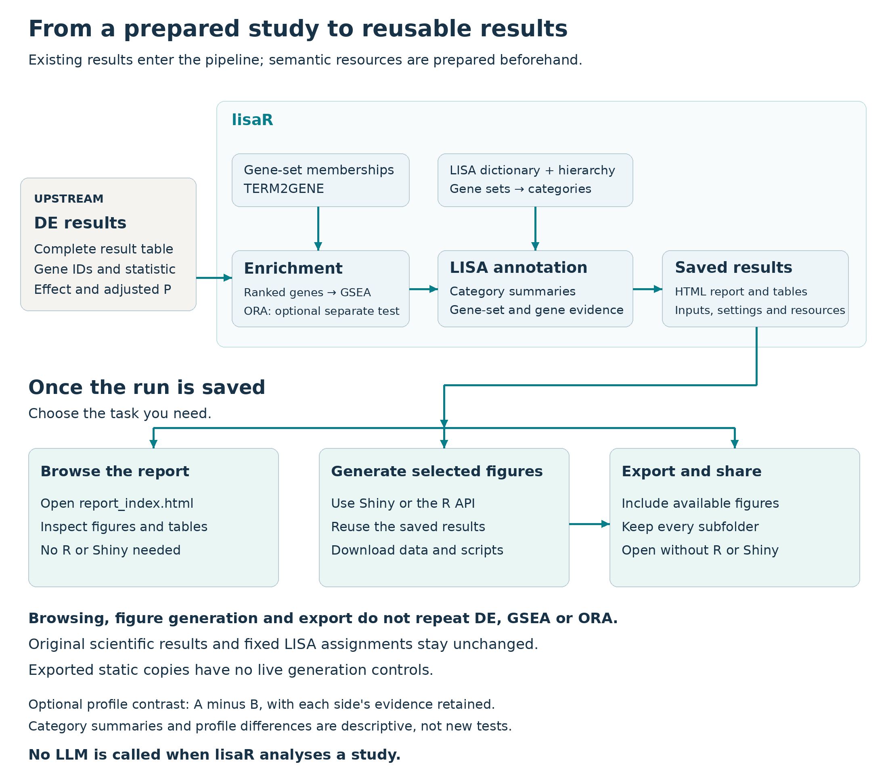

## How lisaR organises enrichment results {#how-lisar-works--introduction}


LISA means **LLM-Inferred Semantic Annotation**. lisaR uses a LISA dictionary
to organise gene-set enrichment results into broader biological themes. The
dictionary is prepared before your study is analysed. During an ordinary run,
lisaR applies the saved assignments locally and does not ask a language model
to classify your results.



*Differential expression is calculated upstream. lisaR runs the selected
gene-set analyses, organises their results with the dictionary and category map,
then saves the results and report. You can browse, generate selected figures
or export from that saved run without repeating enrichment or changing its
assignments. A comparison between two completed LISA profiles is descriptive;
it does not fit another differential-expression model.*

[Open the workflow at full size](figures/lisa-workflow.png).

<span id="from-gene-sets-to-biological-themes"></span>

### From gene sets to biological themes {#how-lisar-works--from-gene-sets-to-biological-themes}

A gene set is a defined group of genes, such as a Gene Ontology term or a named
pathway. GSEA tests each selected gene set against the prepared ranking and
reports quantities such as its normalised enrichment score (NES), adjusted
p-value and leading edge.

LISA adds two levels of organisation:

| Level | Meaning |
|---|---|
| Category | A biological label that brings together related gene sets. |
| Supercategory | A broader group of related categories, used to order and display the report. |

For example, several gene sets can be assigned to one biological category, and
several categories can appear under the same supercategory. A gene set may have
more than one accepted category assignment. These assignments help navigation;
they do not create independent statistical observations.

A category point summarises its significant assigned gene sets. `mean_NES` is
their descriptive mean at the configured GSEA cutoff. It is not a category-level
test. `min_padj` is the smallest adjusted p-value among the member gene sets,
not a category false-discovery rate.

A separate category-inference layer assesses statistical support using raw
gene-set P values. The category card reports its adjusted P and a lower bound
on the number of enriched member sets. These do not turn mean NES into a
significance test or establish a difference between conditions. See
[Statistical analysis](how-lisar-works.html#statistical-analysis--introduction) for the method, hypothesis
family and interpretation of d/N.

<span id="the-resources-have-different-jobs"></span>

### The resources have different jobs {#how-lisar-works--the-resources-have-different-jobs}

lisaR keeps biological membership and semantic organisation separate:

| Resource | What it supplies |
|---|---|
| TERM2GENE | The genes belonging to each gene set used by GSEA. |
| LISA dictionary | The accepted links from exact gene-set identifiers to categories. |
| Category map | Category names, their display order and their supercategories. |

The package includes core and expanded LISA dictionaries together with the
category map. TERM2GENE membership for a real study is obtained and registered
separately. A gene set can be tested by GSEA even if it has no LISA category;
the report keeps that unmapped status in its complete tables.

The collection identifiers describe different views of those gene sets:

| Identifier | What it covers |
|---|---|
| `GOBP-C2` | GO Biological Process together with selected curated pathways from MSigDB C2:CP. |
| `GOMF` | GO Molecular Function, describing molecular activities. |
| `GOCC` | GO Cellular Component, describing cellular locations and complexes. |
| `PATHWAYS` | A stricter signalling view of the GOBP-C2 gene-set space. |

`HALLMARKS` is a direct gene-set collection, not another LISA category
universe. Its results retain the original gene-set names rather than using
the semantic category assignments above.

<span id="how-the-built-in-dictionaries-were-constructed"></span>

### How the built-in dictionaries were constructed {#how-lisar-works--how-the-built-in-dictionaries-were-constructed}

The official LISA categories and gene-set assignments were defined before any
reader's study was run. For the GO-based collections, predefined category
descriptions and gene-set metadata were presented for annotation. Separately
recorded biological-fit scores from Qwen3.5, Gemma4, Mistral3.2 and Phi4-14b
were then combined by the documented GO-family selection rule. Qwen3.5 and
Gemma4 formed the anchor pair, while Mistral3.2 and Phi4-14b supplied supporting
scores. The construction records also identify how missing scores were handled
and where a small set of GOMF assignments received manual corrections.

In this context, a high score meant that a gene set fitted the category's
biological definition under its collection-specific rubric. For example, the
GOMF rubric used 3 for a major function and 4 for a primary or canonical
function, whereas GOCC assessed compartment identity. Under the ordinary rule,
before any recorded manual correction,
an assignment with anchor scores of 4 and 3 reached the core tier only when at
least one supporting score was also at least 3. An assignment with both anchor
scores of 3 reached the expanded tier, but not core.

PATHWAYS was built later with a different, name-first rule. A pathway's name
had to support the biological assignment; gene overlap alone was not enough.
The PATHWAYS selection therefore cannot be described as a simple reuse of the
GO-family rule.

The construction scores were ordinal judgements of biological fit. They were
not probabilities, votes, GSEA weights or measurements from a study. The core
dictionary retains the more stringent accepted assignments. The expanded
dictionary contains those assignments plus the next accepted tier. Current
runtime dictionaries keep the tier and gene-set-to-category links, not the
historical construction score.

Some historical limits remain. The available records support the selection
rules and their link to the distributed assignments, but they do not provide a
complete original prompt and response trail for every GO annotation. The
original MSigDB retrieval release is also unrecorded. These limits concern
historical reconstruction, not the need for an LLM during analysis.

The [dictionary construction guide](how-lisar-works.html#dictionary-construction--introduction) gives the
selection rules, the recorded corrections and the sources behind them. Use it
to examine how an assignment entered core or expanded; you do not need to
repeat that construction to analyse a study.

<span id="built-in-and-custom-dictionaries-are-different"></span>

### Built-in and custom dictionaries are different {#how-lisar-works--built-in-and-custom-dictionaries-are-different}

The built-in dictionaries are fixed package resources. Choosing core or
expanded selects one of those reviewed assignment sets; it does not rebuild the
dictionary.

A custom dictionary is useful when your study needs a different biological
classification, for example a laboratory-specific category system or a
specialised collection. A custom bundle supplies its own gene-set-to-category
table, category map and compatible TERM2GENE membership. It receives a separate
resource identity and does not replace or silently modify a built-in dictionary.

The [Custom dictionaries and supercategories](custom-dictionaries-and-supercategories.html)
guide shows the required table relationships and how to validate, register and
select a custom bundle.

<span id="what-happens-during-a-study-run"></span>

### What happens during a study run {#how-lisar-works--what-happens-during-a-study-run}

Differential expression is prepared upstream. Each analysis declares its
comparison and what a positive signed ranking value means. A positive NES means
enrichment towards that declared end of the ranking; it has no
direction-independent biological meaning.

lisaR runs GSEA on the selected TERM2GENE membership, applies the chosen
dictionary and writes the report. Over-representation analysis (ORA) is an
optional analysis of a thresholded gene list and background. Its overlap counts
and adjusted p-values are different from GSEA quantities and leading edges.

The report keeps the underlying GSEA results, complete differential-expression
records where supplied and gene-set memberships alongside the category views.
This lets you move from a category summary back to the gene sets and genes that
contribute to it.

<span id="reuse-a-saved-result-without-rerunning-the-analysis"></span>

### Reuse a saved result without rerunning the analysis {#how-lisar-works--reuse-a-saved-result-without-rerunning-the-analysis}

A saved standard report can be opened in a browser and explored without R. Keep
the report folder together so that its pages, figures and downloads retain
their relative links. The [static report guide](reports-and-exploration.html#scientific-report--introduction)
explains the category views, evidence tables and existing downloads.

For interactive work, open the saved run in R or RStudio:

```{r open-shiny, eval=FALSE}
library(lisaR)
explore_lisa_run("path/to/the/saved-run")
```

The Shiny interface lets you browse the saved report and choose the figure you
want to generate. Use **Generate** for that specific request. Opening a
category, searching for a gene or changing a selection does not generate a
figure. The generated figure can include image, data and R-script downloads
where available.

Saving an expanded report copies the standard report together with figures that
were already available when export began. The copied `report_index.html` can
then be opened without R or Shiny. Live Shiny controls are not part of that
static copy. These actions do not recompute differential expression, GSEA or
ORA, and they do not modify the original saved analysis. See the separate
[Shiny guide](reports-and-exploration.html#shiny-app--introduction) for the current workflow.

<span id="kegg-gene-sets-and-native-pathway-maps"></span>

### KEGG gene sets and native pathway maps {#how-lisar-works--kegg-gene-sets-and-native-pathway-maps}

KEGG-derived gene sets in TERM2GENE can contribute to enrichment like other
selected gene sets. A native KEGG pathway map is a separate optional product
that needs an authorised local snapshot. Having KEGG gene-set memberships does
not itself provide that map or permission to retrieve one.

Continue with [Quick Start](start-with-lisar.html#quick-start--introduction) for the installed sample
project, [Preparing DE inputs](preparing-and-analysing-your-data.html#preparing-de-inputs--introduction) for your own results or
[Resources and provenance](configuration-resources-and-execution.html#resources-and-provenance--introduction) for external
memberships and their terms.

## How LISA dictionaries were built {#dictionary-construction--introduction}


The built-in LISA dictionaries were prepared before any user's study was
analysed. During construction, model-specific annotations rated how closely a
gene set fitted a predefined biological category. lisaR now distributes the
accepted gene-set-to-category assignments and applies them locally. An
ordinary analysis does not ask a language model to classify the study.

This guide explains the recorded construction method and its limits. It does
not describe a new analysis or a method for interpreting one study's
enrichment scores.

<span id="what-the-four-collections-mean"></span>

### What the four collections mean {#dictionary-construction--what-the-four-collections-mean}

| Collection | Biological scope during construction |
|---|---|
| `GOBP-C2` | Broad biological programmes. It combines GO Biological Process gene sets with selected curated pathway families from MSigDB C2:CP. |
| `GOMF` | Molecular activities represented by GO Molecular Function gene sets. |
| `GOCC` | Cellular locations, structures and complexes represented by GO Cellular Component gene sets. |
| `PATHWAYS` | A stricter signalling classification of the GOBP-C2 gene-set space. |

`HALLMARKS` is separate. lisaR analyses Hallmark gene sets directly rather
than assigning them through a LISA semantic dictionary.

The biological categories and their definitions existed before scoring. The
inspected GOMF and GOCC annotation inputs contain the GO source identifier,
gene-set name, example genes and category definitions. Their description
fields are empty. The records therefore do not support a claim that every
model received a full gene membership list or a prose description for every
gene set.

<span id="four-recorded-model-streams"></span>

### Four recorded model streams {#dictionary-construction--four-recorded-model-streams}

The saved construction table has separate score and source columns for
Qwen3.5, Gemma4, Mistral3.2 and Phi4-14b. The selection code treats Qwen3.5 and
Gemma4 as the anchor pair. Mistral3.2 and Phi4-14b provide supporting scores.
This is not unrestricted majority voting.

The scores are ordinal judgements of biological fit. They are not
probabilities, confidence percentages, votes, GSEA weights or measurements
from a study.

The surviving records give the clearest collection-specific interpretation
for GOMF and GOCC:

* For GOMF, 0 means no relationship, 1 a weak or contextual relationship, 2 a
  supported secondary function, 3 a major function and 4 a primary or
  canonical function.
* The GOCC production rubric allows 0, 3 or 4 and asks whether the category
  describes compartment identity. It does not score molecular function or
  pathway activity.

The records support a common selection rule for `GOBP-C2`, `GOMF` and `GOCC`,
but they do not establish one identical production prompt for all three
collections. Prompt optimisation records are historical calibration material,
not proof of the final prompt used for every saved score.

<span id="exact-method-for-gobp-c2-gomf-and-gocc"></span>

### Exact method for GOBP-C2, GOMF and GOCC {#dictionary-construction--exact-method-for-gobp-c2-gomf-and-gocc}

The ordinary GO-family rule was named
`anchor_support_consensus_v0_1`. After any explicitly recorded imputation, the
four scores were combined as follows:

* A final score of 4 was assigned when both anchors were 4. It was also
  assigned when both anchors were at least 3, at least one anchor was 4, and
  at least one support model scored at least 3.
* Otherwise, a final score of 3 was assigned when both anchors were at least 3.
  It was also assigned when one anchor was at least 3, the other was at
  least 2, and at least one support model scored at least 3.

Core retained final score 4. Expanded retained core and final score 3.
`OTHER_UNCLASSIFIED`, `MF_UNKNOWN` and `CC_UNKNOWN_OTHER` were excluded.
Lower-score outputs remained in construction and sensitivity tables rather
than the default distributed dictionaries.

<span id="missing-go-family-scores"></span>

#### Missing GO-family scores {#dictionary-construction--missing-go-family-scores}

A derived `GOBP-C2` layer filled a missing model score with the mode of the
available model scores for that category. When modes tied, it chose the lower
value. The saved consensus contains 3,649 gene-set and category pairs with an
imputed value. Source fields distinguish these derived values from raw scores.
The inspected builder applies this imputation layer to `GOBP-C2`, not to GOMF
or GOCC.

An imputed value is not another independent model annotation.

<span id="eleven-recorded-gomf-overrides"></span>

#### Eleven recorded GOMF overrides {#dictionary-construction--eleven-recorded-gomf-overrides}

Eleven GOMF pairs have an explicit manual validation score recorded under
David Olmeda's review. That score replaced the ordinary rule result before
tier selection.

| Gene-set ID | Category ID | Rule score | Recorded override |
|---|---:|---:|---:|
| `GOMF_ANAPHASE_PROMOTING_COMPLEX_BINDING` | `MF_CELL_CYCLE_REG` | 3 | 4 |
| `GOMF_ATP_DEPENDENT_PROTEIN_FOLDING_CHAPERONE` | `MF_STRESS_RESPONSE` | 2 | 3 |
| `GOMF_CHEMOREPELLENT_ACTIVITY` | `MF_DEVELOPMENT_REG` | 3 | 3 |
| `GOMF_CLATHRIN_ADAPTOR_ACTIVITY` | `MF_VESICLE_TRAFFIC` | 3 | 4 |
| `GOMF_CYCLIN_BINDING` | `MF_CELL_CYCLE_REG` | 3 | 4 |
| `GOMF_CYSTEINE_TYPE_ENDOPEPTIDASE_REGULATOR_ACTIVITY_INVOLVED_IN_APOPTOTIC_PROCESS` | `MF_APOPTOSIS_REG` | 3 | 4 |
| `GOMF_DOUBLE_STRANDED_RNA_BINDING` | `MF_VIRAL_HOST` | 2 | 3 |
| `GOMF_EXOGENOUS_PROTEIN_BINDING` | `MF_VIRAL_HOST` | 2 | 3 |
| `GOMF_HEAT_SHOCK_PROTEIN_BINDING` | `MF_STRESS_RESPONSE` | 3 | 4 |
| `GOMF_NOTCH_BINDING` | `MF_DEVELOPMENT_REG` | 3 | 3 |
| `GOMF_PEPTIDASE_ACTIVATOR_ACTIVITY_INVOLVED_IN_APOPTOTIC_PROCESS` | `MF_APOPTOSIS_REG` | 3 | 4 |

An override that retains the same numerical score is still part of the
recorded manual validation layer.

<span id="exact-method-for-the-current-pathways-assignments"></span>

### Exact method for the current PATHWAYS assignments {#dictionary-construction--exact-method-for-the-current-pathways-assignments}

PATHWAYS was selected later under the historical v0.7 name-first method dated
3 July 2026. A pathway's name had to support the biological assignment.
Canonical genes could support a name-supported call, but gene overlap alone
was not enough for a score of 3 or 4. Models could assign zero to every
PATHWAYS category.

The current PATHWAYS core contains 921 pairs:

* 824 have Qwen=4 and Gemma=4.
* 97 have anchor scores 4 and 3 in either order, with both Mistral and Phi
  observed at 4.

The expanded PATHWAYS dictionary contains those core pairs and 134 additional
pairs:

* 100 have anchor scores 4 and 3, both support scores at least 3, and exactly
  one support score equal to 4.
* 34 have both anchors at 3 and both support scores observed at 4.

A score of 4 from one anchor with the other below 3 was not admitted by these
core or strict-expanded rules. A further 152 review-only rows are outside the
production ledgers. The broad PATHWAYS sensitivity set was identical to the
expanded set, not an additional permissive tier.

The distinction between observed and imputed support matters. The core 4/3
branch and the expanded 3/3 branch explicitly require observed support. The
expanded 4/3 branch does not carry that same explicit source condition, so it
must not be described as if it did.

<span id="missing-pathways-scores"></span>

#### Missing PATHWAYS scores {#dictionary-construction--missing-pathways-scores}

The PATHWAYS build records eight missing Phi gene-set responses, covering 576
category score cells. A derived layer filled those cells with the median of
the available model scores. This is different from the lower-tied mode used
for missing `GOBP-C2` scores. The audit verified the source code and saved
report for this step but did not replay every raw PATHWAYS record.

<span id="how-historical-selections-reach-current-v1"></span>

### How historical selections reach current v1 {#dictionary-construction--how-historical-selections-reach-current-v1}

The located source ledgers contain all assignments in the current package
tables:

| Tier | GO-family rows | PATHWAYS rows | Current total |
|---|---:|---:|---:|
| Core | 14,592 | 921 | 15,513 |
| Expanded | 22,171 | 1,055 | 23,226 |

The source-to-package comparison found the same seven-field rows and values,
with no unmatched or duplicate projected rows. It was a multiset comparison,
not a byte-for-byte replay of the historical build order.

The current first-publication resource identities are
`lisa_dictionary_core@1.0.0` and
`lisa_dictionary_expanded@1.0.0`. The historical construction names
`v0_1` and `v0_7` describe archived stages. They are not the version numbers
of the current distributed resources. Older package resource pins also remain
distinct historical identities.

Current runtime tables retain `universe`, gene-set identity and label,
category identity and label, source identity, and `tier`. They do not retain
`LISA_score`. The removal of that historical construction field did not change
the accepted assignments or tiers.

<span id="calibration-evidence-and-limits"></span>

### Calibration evidence and limits {#dictionary-construction--calibration-evidence-and-limits}

The manual calibration record describes 123 validated rows. Three
unclassified rows were excluded, leaving 120. The saved summary reports
120/120 recovered by the expanded rule and 118/120 by the core rule. This was
a development and calibration recovery check. It was not an independent
held-out study, a whole-genome accuracy estimate or validation for every
possible biological classification.

The available records do not support a complete historical replay. In
particular:

* The original MSigDB retrieval release was not recorded.
* Complete production prompts, responses and successful execution receipts
  were not recovered for every GO model and gene set.
* One aggregate raw GO score file named by the builder is absent at its
  recorded location, although the downstream consensus table and imputation
  layer are present.
* Two exact historical hierarchy inputs named by the technical rebuild
  contract were not identified through the inspected construction chain.

These limits concern reconstruction of the historical annotation process.
They do not make an LLM necessary for an ordinary lisaR analysis.

<span id="sources-available-with-lisar"></span>

### Sources available with lisaR {#dictionary-construction--sources-available-with-lisar}

The installed package includes its current resource manifest, migration
ledger and technical reconstruction notes. Locate them without relying on a
private project path:

```{r packaged-provenance, eval=TRUE}
system.file(
  "extdata", "dictionaries", "RESOURCE_PROVENANCE.tsv",
  package = "lisaR"
)
system.file(
  "extdata", "dictionaries", "TECHNICAL_REBUILD_PROVENANCE.md",
  package = "lisaR"
)
system.file(
  "extdata", "dictionaries", "RESOURCE_MIGRATION_MANIFEST.tsv",
  package = "lisaR"
)
```

The detailed method above was checked against the archived records named
`build_lisa_dictionaries.py`, `lisa_consensus_scores_all_universes_v0_1.tsv`,
`consensus_rule_scores_long.tsv`,
`gobpc2_missing_model_scores_imputed_mode_long.tsv`,
`derive_pathways_v0_7_core_extended_rules.py`,
`pathways_v0_7_final_core_inclusions.tsv` and
`pathways_v0_7_final_core_plus_extended_strict_inclusions.tsv`. Those archive
files are not currently distributed with lisaR. Their absence is why this
page states the limits explicitly rather than claiming complete replay.

For ordinary resource selection, see
[Resources and provenance](configuration-resources-and-execution.html#resources-and-provenance--introduction). To build and
register your own classification, continue to
[Custom dictionaries and supercategories](custom-dictionaries-and-supercategories.html).

## Statistical analysis {#statistical-analysis--introduction}


lisaR separates gene-set enrichment from category-level inference. The
quantities answer different questions and should not be used interchangeably.

<span id="differential-expression-and-gene-set-enrichment"></span>

### Differential expression and gene-set enrichment {#statistical-analysis--differential-expression-and-gene-set-enrichment}

Differential expression is calculated upstream. lisaR uses the supplied signed
ranking and gene-set memberships to run GSEA with `fgsea`. It retains the
gene-set normalised enrichment score (NES), raw P value, adjusted P value and
leading edge. The adjusted P values are supplied by `fgsea`; they are not
category-level P values.

By default, GSEA uses the multilevel route. The selected ranking, gene-set size
limits and other settings are recorded in the run. Gene-level DE adjusted P
values, gene-set adjusted P values and category adjusted P values refer to
different hypotheses.

<span id="descriptive-category-summaries"></span>

### Descriptive category summaries {#statistical-analysis--descriptive-category-summaries}

A category's `mean_NES` is the mean of its distinct individually significant
assigned sets with finite NES, at the configured gene-set cutoff. It is not a
category significance test. Likewise, `min_padj`, the smallest member-set
adjusted P value, is not a category false-discovery rate.

Gene sets can overlap and belong to several categories. These assignments do
not create independent observations. Point size counts gene sets, not samples
or independent biological mechanisms.

<span id="category-inference"></span>

### Category inference {#statistical-analysis--category-inference}

For each DE analysis, lisaR applies robust Hommel closed testing
(`hommel(..., simes = FALSE)`) to the raw gene-set P values.
The family contains all eligible unique gene-set hypotheses across the
configured semantic collections, including unclassified sets.
HALLMARKS is excluded and retains its direct gene-set results.
Eligibility, not the GSEA significance cutoff or NES direction, defines this
family.

Repeated instances of the same hypothesis across collections count once, using
the largest P value conservatively. Hypothesis identity preserves the pathway
identifier, analysis, ranked universe, effective membership and scoring
settings. Eligible hypotheses without a usable raw P value remain in the
family with P = 1; they are not silently dropped.

Robust closed testing allows arbitrary dependence, assuming valid individual
input P values. It does not correct an inappropriate upstream design or an
invalid individual test.

<span id="adjusted-category-p-and-supported-extent"></span>

### Adjusted category P and supported extent {#statistical-analysis--adjusted-category-p-and-supported-extent}

The adjusted category P tests the null that none of the category's evaluable
member sets is enriched. It is already family-adjusted; lisaR does not apply
another BH correction to it.

The category card reports the exact value. Stars show only the strongest
threshold reached:

| Mark | Adjusted category P |
|---|---:|
| `*` | ≤ 0.05 |
| `**` | ≤ 0.01 |
| `***` | ≤ 0.001 |
| `****` | ≤ 0.0001 |

A significant category supports at least one enriched member set. It does not
establish coherent activation of the whole category or the direction of its
effect. An unmarked category can be nonsignificant or not evaluable.

At the default alpha of 0.05, **d/N** gives a simultaneous 95% lower confidence
bound: at least d of N eligible member hypotheses with usable raw P values
are supported as enriched. The tests use the conservative deduplicated family
P values described above. A zero bound does not demonstrate absence; N = 0
means not evaluable.

This is a minimum supported count, not the exact true count or the number
passing the GSEA display cutoff. Do not add these bounds across overlapping
categories. Check the card's analysed/total coverage and missing-P information.

<span id="comparing-analyses"></span>

### Comparing analyses {#statistical-analysis--comparing-analyses}

Each DE analysis has its own inference family. A difference in mean NES,
or significance in one analysis but not another, does not establish a
between-analysis difference. ON minus PRE and other LISA profile comparisons
remain descriptive. Testing a condition difference requires an appropriate
upstream statistical model.

<span id="methods-references"></span>

### Methods references {#statistical-analysis--methods-references}

Goeman et al. (2019), *Simultaneous control of all false discovery proportions
in large-scale multiple hypothesis testing*, Biometrika 106, 841-856.
[doi:10.1093/biomet/asz041](https://doi.org/10.1093/biomet/asz041).

See the [hommel documentation](https://cran.r-project.org/package=hommel) and
[fgsea documentation](https://bioconductor.org/packages/fgsea/) for their
algorithms. The [licence and citation guide](start-with-lisar.html#licence-and-citation--introduction)
provides the software and study attribution.

Return to [Advanced guides](configuration-resources-and-execution.html#advanced--introduction).

<!-- BEGIN SEMANTIC CATALOGUE SECTION -->

## Semantic categories and supercategories {#semantic-category-guide--introduction}


Use this guide to find one of the 158 LISA categories and understand the
biological scope in which the fixed dictionary places it. The catalogue
records dictionary assignments and representative member gene sets, not the
enrichment result of a particular study.

<span id="search-for-a-category"></span>

### Search for a category {#semantic-category-guide--search-for-a-category}

In R or RStudio, read the installed catalogue as an ordinary data frame:

```{r semantic-lookup, eval=TRUE}
catalog_path <- system.file(
  "extdata", "semantic-catalog", "semantic_category_catalog.tsv",
  package = "lisaR", mustWork = TRUE
)
semantic_catalog <- read.delim(
  catalog_path, sep = "\t", quote = "", comment.char = "",
  colClasses = "character", check.names = FALSE
)

head(semantic_catalog[c(
  "universe", "category_id", "category_display_name", "macrogroup_name"
)])
```

Filter by words in the display name or description when you do not yet know an
ID:

```{r semantic-search, eval=TRUE}
query <- "repair|checkpoint"
matches <- grepl(
  query,
  paste(
    semantic_catalog$category_display_name,
    semantic_catalog$category_description
  ),
  ignore.case = TRUE
)
semantic_catalog[matches, c(
  "universe", "category_id", "category_display_name",
  "macrogroup_name", "core_member_gene_sets"
)]
```

Once you have an exact ID, select it together with its collection. This avoids
matching a similar label in the wrong biological scope:

```{r semantic-select, eval=TRUE}
chosen <- semantic_catalog[
  semantic_catalog$universe == "GOBP-C2" &
    semantic_catalog$category_id == "DNA_DAMAGE_REPAIR_CHECKPOINTS",
  c("category_display_name", "macrogroup_name", "core_member_gene_sets",
    "example_gene_set_1", "example_gene_set_2", "example_gene_set_3")
]
stopifnot(nrow(chosen) == 1L)
print(chosen, row.names = FALSE)
```

`View(semantic_catalog)` opens the data frame in RStudio's viewer; the examples above print
subsets in the R console. The count is membership in the core dictionary. The
one to three examples illustrate the category's scope. They are not its full
membership list or the strongest results from your study. The report's
evidence sheet, not this catalogue, supplies NES, FDR, leading edges and
gene-level DE.

<span id="member-sets-and-category-assignments"></span>

### Member sets and category assignments {#semantic-category-guide--member-sets-and-category-assignments}

A gene set may be assigned to two categories in one supercategory. It then
contributes **one distinct set but two assignments**. The bundled count table
lets you check that distinction directly:

```{r semantic-distinct-support, eval=TRUE}
semantic_counts <- read.delim(system.file(
  "extdata", "semantic-catalog", "semantic_supercategory_counts.tsv",
  package = "lisaR", mustWork = TRUE
), sep = "\t", check.names = FALSE)
pi3k <- semantic_counts[
  semantic_counts$macrogroup_id == "PI3K_AKT_MTOR",
  c("universe", "macrogroup_id", "core_distinct_gene_sets",
    "core_member_assignments")
]
stopifnot(nrow(pi3k) == 1L,
          pi3k$core_distinct_gene_sets == 59L,
          pi3k$core_member_assignments == 88L)
print(pi3k, row.names = FALSE)
```

The 59 distinct gene sets have 88 assignments across categories in this
supercategory. Assignment counts and distinct gene-set counts therefore
measure different properties of the dictionary.

To open the corresponding study evidence, use the category navigator or
gene search described in the [report guide](reports-and-exploration.html#scientific-report--introduction).

<span id="catalogue-sources-and-scope"></span>

### Catalogue sources and scope {#semantic-category-guide--catalogue-sources-and-scope}

The four semantic collections are `GOBP-C2`, `GOMF`, `GOCC` and `PATHWAYS`.
`HALLMARKS` is a separate direct gene-set collection, not another LISA category
catalogue. Category descriptions and one to three exact member identifiers
were checked against `lisa_dictionary_core@1.0.0`. The existing provenance also
checks the same category vocabulary in
`lisa_dictionary_expanded@1.0.0`; this guide does not compare tiers or study
results.

The biological summary before each table describes the supercategory. Within a
table, read the exact category label and representative member IDs together.
The installed catalogue also includes a `category_description` field for text
searches. Its descriptions restate the category labels.

Descriptions and examples delimit a theme; they do not assert activation,
inhibition or causality. Example selection uses semantic representativeness
and stable tie-breaking on specificity, lexical match and gene-set identifier.
Dictionary membership supplies no numerical weight or gene-priority score.
Study evidence uses the member gene sets' enrichment and gene-level results.

Unassigned gene sets remain in the complete tested universe. The
`OTHER_UNCLASSIFIED` residual is tabular, not a biological category or figure.
For `GOBP-C2`, `GOMF` and `GOCC` it has dedicated residual tables; `PATHWAYS`
retains the complete GSEA ledger without a separate residual table.

The core and expanded classification dictionaries and category map are
included in lisaR. Gene-set-to-gene memberships are a separate external
resource. Source conditions are recorded in `THIRD_PARTY_NOTICES.md`. See
[Resources and provenance](configuration-resources-and-execution.html#resources-and-provenance--introduction) for those resource
roles; no additional resource installation is needed to read this catalogue.

Source versions and checksums accompany the installed catalogue in
`extdata/semantic-catalog/SEMANTIC_CATALOG_PROVENANCE.tsv`.

The active category map contains only categories with at least one exact
assignment in the core or expanded dictionary. Supercategories without a
retained category are absent from the active map.

| Collection | Supercategories | Categories | Core member assignments |
|---|---:|---:|---:|
| `GOBP-C2` | 10 | 40 | 11729 |
| `GOMF` | 9 | 37 | 1860 |
| `GOCC` | 6 | 12 | 1003 |
| `PATHWAYS` | 17 | 69 | 921 |

<span id="catalogue"></span>

## Catalogue {#semantic-category-guide--catalogue}

<span id="gobp-c2"></span>

### `GOBP-C2` {#semantic-category-guide--gobp-c2}

Use this collection for biological processes and programmes. It combines Gene
Ontology Biological Process with selected curated C2 pathway families, so one
supercategory can span cellular mechanisms, tissues and organismal
development. Read the exact member IDs before narrowing a broad category to
one experimental mechanism.

<span id="developmental-and-neural-programs-development_neural"></span>

#### Developmental and neural programs (`DEVELOPMENT_NEURAL`) {#semantic-category-guide--developmental-and-neural-programs-development_neural}

Groups developmental, morphogenetic, neurogenic and synaptic biological programmes.

Verified membership: 2 categories, 1738 distinct core gene sets and 1801 category assignments.

| Category | Core members | Representative member gene sets |
|---|---:|---|
| Development and morphogenesis (`DEVELOPMENT_MORPHOGENESIS`) | 1010 | `GOBP_DEVELOPMENTAL_GROWTH_INVOLVED_IN_MORPHOGENESIS`<br>`GOBP_EAR_DEVELOPMENT`<br>`WP_HEART_DEVELOPMENT` |
| Neurogenesis and synapse (`NEUROGENESIS_SYNAPSE`) | 791 | `GOBP_NEUROGENESIS`<br>`GOBP_REGULATION_OF_NEUROGENESIS`<br>`GOBP_SYNAPSE_PRUNING` |

<span id="genome-and-gene-expression-genome_gene_expression"></span>

#### Genome and gene expression (`GENOME_GENE_EXPRESSION`) {#semantic-category-guide--genome-and-gene-expression-genome_gene_expression}

Groups genome maintenance and the transcriptional, post-transcriptional and translational control of gene expression.

Verified membership: 4 categories, 1076 distinct core gene sets and 1090 category assignments.

| Category | Core members | Representative member gene sets |
|---|---:|---|
| DNA damage, repair and checkpoints (`DNA_DAMAGE_REPAIR_CHECKPOINTS`) | 295 | `GOBP_REGULATION_OF_DNA_DAMAGE_CHECKPOINT`<br>`GOBP_DNA_REPAIR`<br>`REACTOME_DNA_REPAIR` |
| RNA processing and RNP biology (`RNA_PROCESSING_SPLICING_RNP`) | 263 | `GOBP_RNA_PROCESSING`<br>`GOBP_MITOCHONDRIAL_RNA_PROCESSING`<br>`GOBP_RNA_3_END_PROCESSING` |
| Transcription, chromatin and epigenetics (`TRANSCRIPTION_CHROMATIN_EPIGENETICS`) | 416 | `GOBP_CHROMATIN_LOOPING`<br>`GOBP_MRNA_TRANSCRIPTION`<br>`GOBP_RRNA_TRANSCRIPTION` |
| Translation and ribosome (`TRANSLATION_RIBOSOME`) | 116 | `KEGG_RIBOSOME`<br>`GOBP_TRANSLATION`<br>`REACTOME_TRANSLATION` |

<span id="immune-and-inflammatory-biology-immune_inflammation"></span>

#### Immune and inflammatory biology (`IMMUNE_INFLAMMATION`) {#semantic-category-guide--immune-and-inflammatory-biology-immune_inflammation}

Groups adaptive, innate, cytokine, complement and antigen-presentation programmes in immune and inflammatory biology.

Verified membership: 4 categories, 1321 distinct core gene sets and 1356 category assignments.

| Category | Core members | Representative member gene sets |
|---|---:|---|
| Adaptive immunity and antigen presentation (`IMMUNE_ADAPTIVE_ANTIGEN_MHC`) | 328 | `GOBP_ANTIGEN_PROCESSING_AND_PRESENTATION`<br>`KEGG_ANTIGEN_PROCESSING_AND_PRESENTATION`<br>`GOBP_REGULATION_OF_ANTIGEN_PROCESSING_AND_PRESENTATION` |
| Cytokine and inflammatory signaling (`IMMUNE_CYTOKINE_INFLAMMATORY`) | 535 | `WP_CYTOKINES_AND_INFLAMMATORY_RESPONSE`<br>`BIOCARTA_INFLAM_PATHWAY`<br>`BIOCARTA_CYTOKINE_PATHWAY` |
| Immune core (`IMMUNE_CORE`) | 185 | `GOBP_REGULATION_OF_IMMUNE_RESPONSE`<br>`GOBP_IMMUNE_EFFECTOR_PROCESS`<br>`GOBP_ACTIVATION_OF_IMMUNE_RESPONSE` |
| Innate immunity, complement and PRR (`IMMUNE_INNATE_COMPLEMENT_PRR`) | 308 | `WP_COMPLEMENT_SYSTEM`<br>`WP_COMPLEMENT_ACTIVATION`<br>`GOBP_COMPLEMENT_ACTIVATION` |

<span id="metabolism-and-bioenergetics-metabolism_bioenergetics"></span>

#### Metabolism and bioenergetics (`METABOLISM_BIOENERGETICS`) {#semantic-category-guide--metabolism-and-bioenergetics-metabolism_bioenergetics}

Groups amino-acid, carbohydrate, lipid, nucleotide, mitochondrial and detoxification programmes that support metabolism and energy balance.

Verified membership: 8 categories, 1560 distinct core gene sets and 1576 category assignments.

| Category | Core members | Representative member gene sets |
|---|---:|---|
| Amino acid and one-carbon metabolism (`METABOLISM_AA_ONECARBON`) | 251 | `WP_AMINO_ACID_METABOLISM`<br>`GOBP_AMINO_ACID_METABOLIC_PROCESS`<br>`GOBP_ONE_CARBON_METABOLIC_PROCESS` |
| Carbohydrate metabolism and glycolysis (`METABOLISM_CARBOHYDRATE_GLYCOLYSIS`) | 172 | `GOBP_CARBOHYDRATE_METABOLIC_PROCESS`<br>`GOBP_REGULATION_OF_CARBOHYDRATE_METABOLIC_PROCESS`<br>`GOBP_CARBOHYDRATE_DERIVATIVE_METABOLIC_PROCESS` |
| Detoxification and xenobiotic metabolism (`DETOX_XENOBIOTIC_METABOLISM`) | 126 | `GOBP_XENOBIOTIC_METABOLIC_PROCESS`<br>`GOBP_DETOXIFICATION`<br>`REACTOME_XENOBIOTICS` |
| General metabolism (`METABOLISM_CORE`) | 51 | `GOBP_ATP_METABOLIC_PROCESS`<br>`GOBP_RECEPTOR_METABOLIC_PROCESS`<br>`REACTOME_METABOLISM_OF_COFACTORS` |
| Lipid and fatty acid metabolism (`METABOLISM_LIPID_FA`) | 637 | `KEGG_FATTY_ACID_METABOLISM`<br>`REACTOME_FATTY_ACID_METABOLISM`<br>`GOBP_FATTY_ACID_METABOLIC_PROCESS` |
| Mitochondria, OXPHOS and ETC (`MITOCHONDRIA_OXPHOS_ETC`) | 143 | `BIOCARTA_ETC_PATHWAY`<br>`GOBP_MITOCHONDRIAL_FUSION`<br>`GOBP_MITOCHONDRIAL_FISSION` |
| Nucleotide metabolism (`METABOLISM_NUCLEOTIDE`) | 175 | `WP_NUCLEOTIDE_METABOLISM`<br>`GOBP_NUCLEOBASE_METABOLIC_PROCESS`<br>`GOBP_NUCLEOSIDE_METABOLIC_PROCESS` |
| Peroxisome and fatty acid oxidation (`PEROXISOME_FAO`) | 21 | `GOBP_FATTY_ACID_ALPHA_OXIDATION`<br>`KEGG_PEROXISOME`<br>`GOBP_FATTY_ACID_BETA_OXIDATION_USING_ACYL_COA_OXIDASE` |

<span id="microenvironment-vascular-and-ecm-microenvironment_vascular_ecm"></span>

#### Microenvironment, vascular and ECM (`MICROENVIRONMENT_VASCULAR_ECM`) {#semantic-category-guide--microenvironment-vascular-and-ecm-microenvironment_vascular_ecm}

Groups extracellular-matrix remodelling, vascular, angiogenic and lymphatic programmes in the tissue microenvironment.

Verified membership: 2 categories, 333 distinct core gene sets and 334 category assignments.

| Category | Core members | Representative member gene sets |
|---|---:|---|
| ECM and matrix remodeling (`ECM_MATRIX_REMODELING`) | 183 | `REACTOME_ECM_PROTEOGLYCANS`<br>`WP_MATRIX_METALLOPROTEINASES`<br>`KEGG_ECM_RECEPTOR_INTERACTION` |
| Vascular, angiogenic and lymphatic biology (`VASCULAR_LYMPHATIC`) | 151 | `WP_ANGIOGENESIS`<br>`GOBP_VASCULOGENESIS`<br>`GOBP_REGULATION_OF_VASCULOGENESIS` |

<span id="proliferation-and-cell-cycle-proliferation_cell_cycle"></span>

#### Proliferation and cell cycle (`PROLIFERATION_CELL_CYCLE`) {#semantic-category-guide--proliferation-and-cell-cycle-proliferation_cell_cycle}

Groups programmes governing DNA replication, mitosis and cell proliferation.

Verified membership: 1 category, 555 distinct core gene sets and 555 category assignments.

| Category | Core members | Representative member gene sets |
|---|---:|---|
| Cell cycle and proliferation (`CELL_CYCLE_PROLIFERATION`) | 555 | `WP_CELL_CYCLE`<br>`GOBP_CELL_CYCLE`<br>`KEGG_CELL_CYCLE` |

<span id="signaling-and-cell-communication-signaling_communication"></span>

#### Signaling and cell communication (`SIGNALING_COMMUNICATION`) {#semantic-category-guide--signaling-and-cell-communication-signaling_communication}

Groups broad growth-factor, hormonal and developmental pathways used for intercellular communication.

Verified membership: 5 categories, 1964 distinct core gene sets and 2015 category assignments.

| Category | Core members | Representative member gene sets |
|---|---:|---|
| Core cell signaling (`SIGNALING_CORE`) | 714 | `GOBP_CELL_CELL_SIGNALING`<br>`GOBP_CELL_ACTIVATION`<br>`GOBP_NEGATIVE_REGULATION_OF_CELL_COMMUNICATION` |
| Endocrine and hormonal pathways (`ENDOCRINE_HORMONAL`) | 497 | `GOBP_ENDOCRINE_HORMONE_SECRETION`<br>`GOBP_ENDOCRINE_PROCESS`<br>`GOBP_REGULATION_OF_ENDOCRINE_PROCESS` |
| Growth factor and RTK pathways (`GROWTH_FACTOR_RTK`) | 412 | `GOBP_RESPONSE_TO_GROWTH_FACTOR`<br>`GOBP_NERVE_GROWTH_FACTOR_SIGNALING_PATHWAY`<br>`GOBP_GROWTH` |
| TGF-beta and SMAD signaling (`TGFB_SMAD`) | 129 | `KEGG_TGF_BETA_SIGNALING_PATHWAY`<br>`REACTOME_TGFBR3_REGULATES_TGF_BETA_SIGNALING`<br>`KEGG_MEDICUS_REFERENCE_TGF_BETA_SIGNALING_PATHWAY` |
| Wnt, Notch, Hedgehog and Hippo (`WNT_NOTCH_HEDGEHOG_HIPPO`) | 263 | `WNT_SIGNALING`<br>`WP_WNT_SIGNALING`<br>`PID_NOTCH_PATHWAY` |

<span id="stress-proteostasis-and-cell-death-stress_death_proteostasis"></span>

#### Stress, proteostasis and cell death (`STRESS_DEATH_PROTEOSTASIS`) {#semantic-category-guide--stress-proteostasis-and-cell-death-stress_death_proteostasis}

Groups stress adaptation, autophagy, proteostasis and regulated cell-death programmes.

Verified membership: 7 categories, 879 distinct core gene sets and 901 category assignments.

| Category | Core members | Representative member gene sets |
|---|---:|---|
| Apoptosis and regulated cell death (`APOPTOSIS_CELL_DEATH`) | 321 | `SA_PROGRAMMED_CELL_DEATH`<br>`GOBP_PYROPTOTIC_CELL_DEATH`<br>`GOBP_B_CELL_APOPTOTIC_PROCESS` |
| Autophagy, lysosome and phagosome maturation (`AUTOPHAGY_LYSOSOME`) | 154 | `GOBP_PHAGOSOME_MATURATION`<br>`GOBP_AUTOPHAGOSOME_MATURATION`<br>`GOBP_REGULATION_OF_AUTOPHAGOSOME_MATURATION` |
| ER stress and unfolded protein response (`ER_STRESS_UPR`) | 48 | `WP_UNFOLDED_PROTEIN_RESPONSE`<br>`REACTOME_UNFOLDED_PROTEIN_RESPONSE_UPR`<br>`GOBP_CELLULAR_RESPONSE_TO_UNFOLDED_PROTEIN` |
| Heat shock and acute stress response (`HEAT_SHOCK_STRESS_RESPONSE`) | 17 | `REACTOME_CELLULAR_RESPONSE_TO_HEAT_STRESS`<br>`REACTOME_REGULATION_OF_HSF1_MEDIATED_HEAT_SHOCK_RESPONSE` |
| Hypoxia and HIF programs (`HYPOXIA_HIF`) | 31 | `BIOCARTA_HIF_PATHWAY`<br>`REACTOME_CELLULAR_RESPONSE_TO_HYPOXIA`<br>`GOBP_REGULATION_OF_CELLULAR_RESPONSE_TO_HYPOXIA` |
| Oxidative stress, redox and ROS (`OXIDATIVE_STRESS_REDOX_ROS`) | 116 | `WP_OXIDATIVE_STRESS_RESPONSE`<br>`GOBP_RESPONSE_TO_OXIDATIVE_STRESS`<br>`GOBP_REGULATION_OF_RESPONSE_TO_OXIDATIVE_STRESS` |
| Proteostasis, ubiquitin and proteasome (`PROTEOSTASIS_UBIQUITIN_PROTEASOME`) | 214 | `KEGG_UBIQUITIN_MEDIATED_PROTEOLYSIS`<br>`KEGG_PROTEASOME`<br>`GOBP_PROTEOLYSIS` |

<span id="structure-motility-and-plasticity-structure_motility_plasticity"></span>

#### Structure, motility and plasticity (`STRUCTURE_MOTILITY_PLASTICITY`) {#semantic-category-guide--structure-motility-and-plasticity-structure_motility_plasticity}

Groups adhesion, polarity, cytoskeletal, migratory and cell-state-plasticity programmes.

Verified membership: 4 categories, 911 distinct core gene sets and 928 category assignments.

| Category | Core members | Representative member gene sets |
|---|---:|---|
| Adhesion, junctions and polarity (`ADHESION_JUNCTION_POLARITY`) | 260 | `KEGG_GAP_JUNCTION`<br>`WP_FOCAL_ADHESION`<br>`GOBP_CELL_ADHESION` |
| Cytoskeleton and contractility (`CYTOSKELETON_CONTRACTILITY`) | 419 | `GOBP_MUSCLE_CONTRACTION`<br>`REACTOME_MUSCLE_CONTRACTION`<br>`GOBP_CYTOSKELETON_ORGANIZATION` |
| EMT and cell-state plasticity (`EMT_PLASTICITY`) | 34 | `GOBP_MESENCHYMAL_CELL_MIGRATION`<br>`GOBP_MESENCHYMAL_CELL_DIFFERENTIATION`<br>`GOBP_NEURAL_CREST_CELL_DIFFERENTIATION` |
| Migration, invasion and motility programs (`MIGRATION_INVASION`) | 215 | `GOBP_CELL_MOTILITY`<br>`GOBP_CELL_MIGRATION`<br>`GOBP_NEURON_MIGRATION` |

<span id="transport-trafficking-and-homeostasis-transport_trafficking_homeostasis"></span>

#### Transport, trafficking and homeostasis (`TRANSPORT_TRAFFICKING_HOMEOSTASIS`) {#semantic-category-guide--transport-trafficking-and-homeostasis-transport_trafficking_homeostasis}

Groups membrane transport, localisation, vesicle traffic and ionic homeostasis programmes.

Verified membership: 3 categories, 1150 distinct core gene sets and 1173 category assignments.

| Category | Core members | Representative member gene sets |
|---|---:|---|
| Ion transport and homeostasis (`ION_TRANSPORT_HOMEOSTASIS`) | 382 | `REACTOME_ION_HOMEOSTASIS`<br>`GOBP_IRON_ION_TRANSPORT`<br>`GOBP_ZINC_ION_TRANSPORT` |
| Transport and localization (`TRANSPORT_LOCALIZATION`) | 418 | `GOBP_REGULATION_OF_TRANSPORT`<br>`GOBP_ADP_TRANSPORT`<br>`GOBP_ATP_TRANSPORT` |
| Vesicle, endocytosis, exocytosis and secretion (`VESICLE_SECRETORY_TRAFFICKING`) | 373 | `GOBP_SYNAPTIC_VESICLE_EXOCYTOSIS`<br>`GOBP_ACROSOMAL_VESICLE_EXOCYTOSIS`<br>`GOBP_REGULATION_OF_SYNAPTIC_VESICLE_EXOCYTOSIS` |

<span id="gomf"></span>

### `GOMF` {#semantic-category-guide--gomf}

Use this collection for the molecular activity performed by a gene product,
such as binding, catalysis, transport or receptor activity. It does not by
itself say which broader biological process is active. Categories can overlap
when one GO molecular-function set fits more than one functional grouping.

<span id="catalytic-and-metabolic-enzyme-functions-mf_catalytic_metabolic"></span>

#### Catalytic and metabolic enzyme functions (`MF_CATALYTIC_METABOLIC`) {#semantic-category-guide--catalytic-and-metabolic-enzyme-functions-mf_catalytic_metabolic}

Groups molecular functions carried out by metabolic, redox, detoxification and other catalytic enzymes.

Verified membership: 7 categories, 358 distinct core gene sets and 368 category assignments.

| Category | Core members | Representative member gene sets |
|---|---:|---|
| Amino-acid metabolic enzyme activity (`MF_AMINO_ACID_METAB`) | 7 | `GOMF_ACID_AMINO_ACID_LIGASE_ACTIVITY`<br>`GOMF_L_AMINO_ACID_N_ACETYLTRANSFERASE_ACTIVITY` |
| Antioxidant and redox activity (`MF_ANTIOX_REDOX`) | 54 | `GOMF_ANTIOXIDANT_ACTIVITY`<br>`GOMF_PEROXIREDOXIN_ACTIVITY`<br>`GOMF_THIOL_OXIDASE_ACTIVITY` |
| Carbohydrate metabolic enzyme activity (`MF_CARBOHYDRATE_METAB`) | 58 | `GOMF_CARBOHYDRATE_KINASE_ACTIVITY`<br>`GOMF_CARBOHYDRATE_PHOSPHATASE_ACTIVITY`<br>`GOMF_RACEMASE_AND_EPIMERASE_ACTIVITY_ACTING_ON_CARBOHYDRATES_AND_DERIVATIVES` |
| Detoxification and xenobiotic activity (`MF_DETOX_XENOBIOTIC`) | 6 | `GOMF_ARYL_SULFOTRANSFERASE_ACTIVITY`<br>`GOMF_ESTROGEN_2_HYDROXYLASE_ACTIVITY` |
| General catalytic activity (`MF_CATALYTIC`) | 134 | `GOMF_CATALYTIC_ACTIVITY_ACTING_ON_DNA`<br>`GOMF_CATALYTIC_ACTIVITY_ACTING_ON_RNA`<br>`GOMF_CATALYTIC_ACTIVITY_ACTING_ON_A_RRNA` |
| General metabolic enzyme activity (`MF_METABOLIC_ENZ`) | 23 | `GOMF_COA_TRANSFERASE_ACTIVITY`<br>`GOMF_SULFOTRANSFERASE_ACTIVITY`<br>`GOMF_SULFURTRANSFERASE_ACTIVITY` |
| Lipid metabolic enzyme activity (`MF_LIPID_METAB`) | 86 | `GOMF_LIPASE_ACTIVITY`<br>`GOMF_DEACYLASE_ACTIVITY`<br>`GOMF_COA_LIGASE_ACTIVITY` |

<span id="cell-cycle-and-developmental-regulatory-functions-mf_cell_cycle_development"></span>

#### Cell-cycle and developmental regulatory functions (`MF_CELL_CYCLE_DEVELOPMENT`) {#semantic-category-guide--cell-cycle-and-developmental-regulatory-functions-mf_cell_cycle_development}

Groups molecular regulators of cell-cycle progression, differentiation and developmental decisions.

Verified membership: 2 categories, 4 distinct core gene sets and 4 category assignments.

| Category | Core members | Representative member gene sets |
|---|---:|---|
| Cell-cycle regulatory activity (`MF_CELL_CYCLE_REG`) | 3 | `GOMF_CYCLIN_DEPENDENT_PROTEIN_KINASE_REGULATOR_ACTIVITY` |
| Developmental regulator activity (`MF_DEVELOPMENT_REG`) | 1 | `GOMF_MORPHOGEN_ACTIVITY` |

<span id="gene-expression-molecular-functions-mf_gene_expression"></span>

#### Gene-expression molecular functions (`MF_GENE_EXPRESSION`) {#semantic-category-guide--gene-expression-molecular-functions-mf_gene_expression}

Groups chromatin, transcription, RNA-processing and translation-related molecular functions.

Verified membership: 4 categories, 170 distinct core gene sets and 170 category assignments.

| Category | Core members | Representative member gene sets |
|---|---:|---|
| Epigenetic and chromatin activity (`MF_EPIGENETIC`) | 73 | `GOMF_CHROMATIN_DNA_BINDING`<br>`GOMF_CHROMATIN_PROTEIN_ADAPTOR_ACTIVITY`<br>`GOMF_PROMOTER_SPECIFIC_CHROMATIN_BINDING` |
| RNA processing activity (`MF_RNA_PROCESSING`) | 47 | `GOMF_RNA_NUCLEASE_ACTIVITY`<br>`GOMF_RNA_POLYMERASE_ACTIVITY`<br>`GOMF_RNA_EXONUCLEASE_ACTIVITY` |
| Transcription regulation activity (`MF_TRANSCRIPTION_REG`) | 41 | `GOMF_TRANSCRIPTION_REGULATOR_ACTIVITY`<br>`GOMF_TRANSCRIPTION_COACTIVATOR_ACTIVITY`<br>`GOMF_TRANSCRIPTION_COREGULATOR_ACTIVITY` |
| Translation regulation activity (`MF_TRANSLATION_REG`) | 9 | `GOMF_TRANSLATION_FACTOR_ACTIVITY`<br>`GOMF_TRANSLATION_ACTIVATOR_ACTIVITY` |

<span id="generic-or-host-interaction-functions-mf_generic_other"></span>

#### Generic or host-interaction functions (`MF_GENERIC_OTHER`) {#semantic-category-guide--generic-or-host-interaction-functions-mf_generic_other}

Groups broad binding or host-interaction molecular functions that do not fit a more specific functional class.

Verified membership: 2 categories, 525 distinct core gene sets and 526 category assignments.

| Category | Core members | Representative member gene sets |
|---|---:|---|
| Binding activity (`MF_BINDING`) | 525 | `GOMF_ADP_BINDING`<br>`GOMF_AMP_BINDING`<br>`GOMF_BMP_BINDING` |
| Viral-host molecular function (`MF_VIRAL_HOST`) | 1 | `GOMF_VIRION_BINDING` |

<span id="immune-ligand-and-receptor-functions-mf_immune_ligand_receptor"></span>

#### Immune, ligand and receptor functions (`MF_IMMUNE_LIGAND_RECEPTOR`) {#semantic-category-guide--immune-ligand-and-receptor-functions-mf_immune_ligand_receptor}

Groups immune recognition, complement, receptor and extracellular ligand molecular functions.

Verified membership: 3 categories, 53 distinct core gene sets and 53 category assignments.

| Category | Core members | Representative member gene sets |
|---|---:|---|
| Complement molecular function (`MF_COMPLEMENT`) | 3 | `GOMF_COMPLEMENT_BINDING` |
| Cytokine, chemokine, growth-factor and hormone ligand activity (`MF_CYTOKINE_GROWTH`) | 12 | `GOMF_GROWTH_FACTOR_ACTIVITY`<br>`GOMF_HORMONE_ACTIVITY` |
| Immune receptor and antigen-recognition activity (`MF_IMMUNE_RECEPTOR`) | 38 | `GOMF_IMMUNE_RECEPTOR_ACTIVITY`<br>`GOMF_PATTERN_RECOGNITION_RECEPTOR_ACTIVITY`<br>`GOMF_PEPTIDOGLYCAN_IMMUNE_RECEPTOR_ACTIVITY` |

<span id="proteostasis-stress-and-cell-death-functions-mf_proteostasis_stress_death"></span>

#### Proteostasis, stress and cell-death functions (`MF_PROTEOSTASIS_STRESS_DEATH`) {#semantic-category-guide--proteostasis-stress-and-cell-death-functions-mf_proteostasis_stress_death}

Groups molecular functions involved in proteostasis, stress responses, proteolysis and regulated cell death.

Verified membership: 5 categories, 82 distinct core gene sets and 84 category assignments.

| Category | Core members | Representative member gene sets |
|---|---:|---|
| Apoptosis and cell-death regulatory activity (`MF_APOPTOSIS_REG`) | 3 | `GOMF_DEATH_RECEPTOR_ACTIVITY` |
| Protease and protease inhibitor activity (`MF_PROTEASE_INHIB`) | 40 | `GOMF_PEPTIDASE_INHIBITOR_ACTIVITY`<br>`GOMF_METALLOENDOPEPTIDASE_INHIBITOR_ACTIVITY`<br>`GOMF_MOLECULAR_FUNCTION_INHIBITOR_ACTIVITY` |
| Protein folding and degradation activity (`MF_PROTEIN_FOLDING_DEG`) | 11 | `GOMF_PROTEIN_FOLDING_CHAPERONE`<br>`GOMF_PROTEIN_FOLDING_CHAPERONE_BINDING` |
| Stress-response molecular activity (`MF_STRESS_RESPONSE`) | 2 | `GOMF_HEAT_SHOCK_PROTEIN_BINDING` |
| Ubiquitin and SUMO ligase activity (`MF_LIGASE_SUMOYL`) | 28 | `GOMF_SUMO_LIGASE_ACTIVITY`<br>`GOMF_UBIQUITIN_UBIQUITIN_LIGASE_ACTIVITY`<br>`GOMF_HISTONE_UBIQUITIN_LIGASE_ACTIVITY` |

<span id="signaling-and-regulatory-functions-mf_signaling_regulation"></span>

#### Signaling and regulatory functions (`MF_SIGNALING_REGULATION`) {#semantic-category-guide--signaling-and-regulatory-functions-mf_signaling_regulation}

Groups receptors, kinases, phosphatases, adaptors and enzyme regulators that control signalling.

Verified membership: 5 categories, 306 distinct core gene sets and 313 category assignments.

| Category | Core members | Representative member gene sets |
|---|---:|---|
| Enzyme regulator activity (`MF_ENZYME_REG`) | 59 | `GOMF_ENZYME_REGULATOR_ACTIVITY`<br>`GOMF_ATPASE_REGULATOR_ACTIVITY`<br>`GOMF_ENZYME_ACTIVATOR_ACTIVITY` |
| Intracellular signaling activity (`MF_SIGNALING`) | 12 | `GOMF_GTPASE_ACTIVITY`<br>`GOMF_G_PROTEIN_ACTIVITY` |
| Kinase and phosphatase activity (`MF_KINASE_PHOSPHATASE`) | 104 | `GOMF_PHOSPHATIDYLINOSITOL_KINASE_ACTIVITY`<br>`GOMF_MAP_KINASE_PHOSPHATASE_ACTIVITY`<br>`GOMF_INOSITOL_PHOSPHATE_KINASE_ACTIVITY` |
| Receptor activity (`MF_RECEPTOR`) | 122 | `GOMF_BMP_RECEPTOR_ACTIVITY`<br>`GOMF_WNT_RECEPTOR_ACTIVITY`<br>`GOMF_GABA_RECEPTOR_ACTIVITY` |
| Scaffold and adaptor activity (`MF_SCAFFOLD_ADAPTER`) | 16 | `GOMF_SIGNALING_ADAPTOR_ACTIVITY`<br>`GOMF_CARGO_ADAPTOR_ACTIVITY` |

<span id="structure-adhesion-and-ecm-functions-mf_structure_adhesion_ecm"></span>

#### Structure, adhesion and ECM functions (`MF_STRUCTURE_ADHESION_ECM`) {#semantic-category-guide--structure-adhesion-and-ecm-functions-mf_structure_adhesion_ecm}

Groups structural, motor, adhesion and extracellular-matrix molecular functions.

Verified membership: 4 categories, 54 distinct core gene sets and 55 category assignments.

| Category | Core members | Representative member gene sets |
|---|---:|---|
| Adhesion molecular function (`MF_ADHESION`) | 12 | `GOMF_CELL_ADHESION_MOLECULE_BINDING`<br>`GOMF_CELL_ADHESION_MEDIATOR_ACTIVITY` |
| Cytoskeleton and motor activity (`MF_CYTOSKELETON_MOTOR`) | 13 | `GOMF_CYTOSKELETAL_MOTOR_ACTIVITY`<br>`GOMF_MICROTUBULE_MOTOR_ACTIVITY` |
| Extracellular matrix molecular function (`MF_EXTRACELL_MATRIX`) | 13 | `GOMF_EXTRACELLULAR_MATRIX_BINDING`<br>`GOMF_EXTRACELLULAR_MATRIX_PROTEIN_BINDING` |
| Structural constituent activity (`MF_STRUCTURAL_CONSTITUENT`) | 17 | `GOMF_STRUCTURAL_CONSTITUENT_OF_MUSCLE`<br>`GOMF_STRUCTURAL_CONSTITUENT_OF_SYNAPSE` |

<span id="transport-vesicle-traffic-and-sensing-functions-mf_transport_sensing"></span>

#### Transport, vesicle traffic and sensing functions (`MF_TRANSPORT_SENSING`) {#semantic-category-guide--transport-vesicle-traffic-and-sensing-functions-mf_transport_sensing}

Groups channels, pumps, transporters, vesicle-trafficking factors and physicochemical sensors.

Verified membership: 5 categories, 285 distinct core gene sets and 287 category assignments.

| Category | Core members | Representative member gene sets |
|---|---:|---|
| Ion and physicochemical sensing activity (`MF_ION_SENSING`) | 4 | `GOMF_METAL_ION_SENSOR_ACTIVITY` |
| Ion channel and pump activity (`MF_ION_CHANNEL_PUMP`) | 86 | `GOMF_ATP_GATED_ION_CHANNEL_ACTIVITY`<br>`GOMF_POTASSIUM_ION_LEAK_CHANNEL_ACTIVITY`<br>`GOMF_MONOATOMIC_ION_GATED_CHANNEL_ACTIVITY` |
| Olfactory and taste receptor activity (`MF_OLFACTORY`) | 6 | `GOMF_TASTE_RECEPTOR_ACTIVITY`<br>`GOMF_OLFACTORY_RECEPTOR_ACTIVITY` |
| Transporter activity (`MF_TRANSPORTER`) | 188 | `GOMF_TRANSPORTER_ACTIVITY`<br>`GOMF_LIPID_TRANSPORTER_ACTIVITY`<br>`GOMF_PROTEIN_TRANSPORTER_ACTIVITY` |
| Vesicle trafficking activity (`MF_VESICLE_TRAFFIC`) | 3 | `GOMF_SNARE_BINDING` |

<span id="gocc"></span>

### `GOCC` {#semantic-category-guide--gocc}

Use this collection for cellular locations, structures and complexes. A GOCC
category can support a compartment-level interpretation, but enrichment is not
direct evidence that a protein moved to that compartment or that the structure
changed in abundance.

<span id="cell-surface-adhesion-and-ecm-compartments-cc_surface_adhesion_ecm"></span>

#### Cell surface, adhesion and ECM compartments (`CC_SURFACE_ADHESION_ECM`) {#semantic-category-guide--cell-surface-adhesion-and-ecm-compartments-cc_surface_adhesion_ecm}

Covers plasma-membrane, cell-junction, cytoskeletal and extracellular-matrix compartments.

Verified membership: 3 categories, 343 distinct core gene sets and 348 category assignments.

| Category | Core members | Representative member gene sets |
|---|---:|---|
| Extracellular matrix compartment (`CC_EXTRACELLULAR_MATRIX`) | 24 | `GOCC_SPECIALIZED_EXTRACELLULAR_MATRIX`<br>`GOCC_SYNAPSE_ASSOCIATED_EXTRACELLULAR_MATRIX`<br>`GOCC_INTERSTITIAL_MATRIX` |
| Junction, adhesion and cytoskeletal compartment (`CC_JUNCTION_ADHESION_CYTOSKELETON`) | 209 | `GOCC_GAP_JUNCTION`<br>`GOCC_TIGHT_JUNCTION`<br>`GOCC_ADHERENS_JUNCTION` |
| Plasma membrane and cell-surface compartment (`CC_PLASMA_MEMBRANE_CELL_SURFACE`) | 115 | `GOCC_CELL_SURFACE`<br>`GOCC_CELL_BODY_MEMBRANE`<br>`GOCC_PLASMA_MEMBRANE_RAFT` |

<span id="immune-and-signaling-complexes-cc_immune_complexes"></span>

#### Immune and signaling complexes (`CC_IMMUNE_COMPLEXES`) {#semantic-category-guide--immune-and-signaling-complexes-cc_immune_complexes}

Covers cellular complexes that assemble immune and inflammatory signalling machinery.

Verified membership: 1 category, 29 distinct core gene sets and 29 category assignments.

| Category | Core members | Representative member gene sets |
|---|---:|---|
| Immune signaling and inflammatory complex compartment (`CC_IMMUNE_SIGNALING_COMPLEX`) | 29 | `GOCC_NLRP1_INFLAMMASOME_COMPLEX`<br>`GOCC_NLRP3_INFLAMMASOME_COMPLEX`<br>`GOCC_CANONICAL_INFLAMMASOME_COMPLEX` |

<span id="metabolic-organelles-cc_metabolic_organelles"></span>

#### Metabolic organelles (`CC_METABOLIC_ORGANELLES`) {#semantic-category-guide--metabolic-organelles-cc_metabolic_organelles}

Covers organelles that host energy production and intermediary metabolism, especially mitochondria and peroxisomes.

Verified membership: 1 category, 46 distinct core gene sets and 46 category assignments.

| Category | Core members | Representative member gene sets |
|---|---:|---|
| Mitochondrial and metabolic organelle compartment (`CC_MITOCHONDRIAL_METABOLIC`) | 46 | `GOCC_MITOCHONDRION`<br>`GOCC_ORGANELLAR_RIBOSOME`<br>`GOCC_MITOCHONDRIAL_CRISTA` |

<span id="nuclear-and-gene-expression-compartments-cc_nuclear_gene_expression"></span>

#### Nuclear and gene-expression compartments (`CC_NUCLEAR_GENE_EXPRESSION`) {#semantic-category-guide--nuclear-and-gene-expression-compartments-cc_nuclear_gene_expression}

Covers nuclear, chromatin, transcriptional, RNA-processing and ribosomal compartments.

Verified membership: 2 categories, 275 distinct core gene sets and 277 category assignments.

| Category | Core members | Representative member gene sets |
|---|---:|---|
| Nuclear and chromatin compartment (`CC_NUCLEAR_CHROMATIN`) | 137 | `GOCC_CHROMATIN`<br>`GOCC_NUCLEAR_BODY`<br>`GOCC_NUCLEAR_PORE` |
| Transcription, RNA and ribosome complexes (`CC_TRANSCRIPTION_RNA_RIBOSOME`) | 140 | `GOCC_RNA_DECAPPING_COMPLEX`<br>`GOCC_RNA_POLYMERASE_COMPLEX`<br>`GOCC_TRANSCRIPTION_EXPORT_COMPLEX` |

<span id="proteostasis-and-generic-complexes-cc_proteostasis_generic_complexes"></span>

#### Proteostasis and generic complexes (`CC_PROTEOSTASIS_GENERIC_COMPLEXES`) {#semantic-category-guide--proteostasis-and-generic-complexes-cc_proteostasis_generic_complexes}

Covers macromolecular complexes involved in protein folding, degradation and other general protein assemblies.

Verified membership: 2 categories, 76 distinct core gene sets and 76 category assignments.

| Category | Core members | Representative member gene sets |
|---|---:|---|
| Other generic protein/macromolecular complex (`CC_OTHER_GENERIC_COMPLEX`) | 42 | `GOCC_PROTEIN_KINASE_COMPLEX`<br>`GOCC_MEMBRANE_PROTEIN_COMPLEX`<br>`GOCC_PROTEIN_PHOSPHATASE_4_COMPLEX` |
| Proteostasis complex compartment (`CC_PROTEOSTASIS_COMPLEX`) | 34 | `GOCC_3M_COMPLEX`<br>`GOCC_RQC_COMPLEX`<br>`GOCC_PREFOLDIN_COMPLEX` |

<span id="secretory-and-endomembrane-compartments-cc_secretory_endomembrane"></span>

#### Secretory and endomembrane compartments (`CC_SECRETORY_ENDOMEMBRANE`) {#semantic-category-guide--secretory-and-endomembrane-compartments-cc_secretory_endomembrane}

Covers endoplasmic-reticulum, Golgi, vesicular, endolysosomal and secretory compartments.

Verified membership: 3 categories, 226 distinct core gene sets and 227 category assignments.

| Category | Core members | Representative member gene sets |
|---|---:|---|
| Endolysosome, autophagy and intracellular vesicle compartment (`CC_ENDOLYSOSOME_AUTOPHAGY_VESICLE`) | 116 | `GOCC_ENDOLYSOSOME`<br>`GOCC_AUTOPHAGOSOME`<br>`GOCC_VESICLE_COAT` |
| ER, Golgi and secretory-route compartment (`CC_ER_GOLGI_SECRETORY`) | 96 | `GOCC_ENDOPLASMIC_RETICULUM_GOLGI_INTERMEDIATE_COMPARTMENT`<br>`GOCC_GOLGI_LUMEN`<br>`GOCC_GOLGI_STACK` |
| Extracellular vesicle and secretome compartment (`CC_EXTRACELLULAR_VESICLE_SECRETOME`) | 15 | `GOCC_CHYLOMICRON`<br>`GOCC_MICROVESICLE` |

<span id="pathways"></span>

### `PATHWAYS` {#semantic-category-guide--pathways}

Use this stricter signalling collection to distinguish named receptors,
branches and downstream cascades within the broader GOBP-C2 space. Categories
can share a gene set when a curated pathway crosses more than one branch. A
category label organises the saved enrichment evidence; it is not a claim that
the named pathway is activated.

<span id="rtkrasmapk-signaling-rtk_ras_mapk"></span>

#### RTK/RAS/MAPK signaling (`RTK_RAS_MAPK`) {#semantic-category-guide--rtkrasmapk-signaling-rtk_ras_mapk}

Groups receptor-tyrosine-kinase signalling through RAS and the RAF-MEK-ERK cascade.

Verified membership: 12 categories, 252 distinct core gene sets and 279 category assignments.

| Category | Core members | Representative member gene sets |
|---|---:|---|
| EGFR/ERBB signaling (`EGFR_ERBB_SIGNALING`) | 67 | `WP_ERBB_SIGNALING`<br>`GOBP_ERBB_SIGNALING_PATHWAY`<br>`KEGG_ERBB_SIGNALING_PATHWAY` |
| FGFR signaling (`FGFR_SIGNALING`) | 42 | `REACTOME_SIGNALING_BY_FGFR`<br>`KEGG_MEDICUS_REFERENCE_FGF_FGFR_PI3K_SIGNALING_PATHWAY`<br>`KEGG_MEDICUS_REFERENCE_FGF_FGFR_RAS_ERK_SIGNALING_PATHWAY` |
| VEGF/VEGFR signaling (`VEGF_VEGFR_SIGNALING`) | 11 | `PID_VEGF_VEGFR_PATHWAY`<br>`BIOCARTA_VEGF_PATHWAY` |
| PDGF/PDGFR signaling (`PDGF_PDGFRA_B_SIGNALING`) | 15 | `WP_PDGF_PATHWAY`<br>`BIOCARTA_PDGF_PATHWAY` |
| MET/HGF signaling (`MET_HGF_SIGNALING`) | 15 | `PID_MET_PATHWAY`<br>`BIOCARTA_MET_PATHWAY` |
| KIT signaling (`KIT_SIGNALING`) | 8 | `PID_KIT_PATHWAY`<br>`WP_KIT_RECEPTOR_SIGNALING` |
| RET signaling (`RET_SIGNALING`) | 6 | `PID_RET_PATHWAY`<br>`REACTOME_RET_SIGNALING` |
| Insulin/IGF signaling (`INSULIN_IGF_SIGNALING`) | 25 | `PID_INSULIN_PATHWAY`<br>`WP_INSULIN_SIGNALING`<br>`BIOCARTA_INSULIN_PATHWAY` |
| RAS activation (`RAS_ACTIVATION`) | 16 | `PID_RAS_PATHWAY`<br>`WP_RAS_SIGNALING` |
| RAF-MEK-ERK cascade (`RAF_MEK_ERK_CASCADE`) | 43 | `BIOCARTA_ERK_PATHWAY`<br>`WP_MAPK_CASCADE`<br>`REACTOME_RAF_ACTIVATION` |
| ALK signaling (`ALK_SIGNALING`) | 7 | `BIOCARTA_ALK_PATHWAY`<br>`REACTOME_SIGNALING_BY_ALK` |
| NTRK/TRK signaling (`NTRK_TRK_SIGNALING`) | 24 | `PID_MAPK_TRK_PATHWAY`<br>`PID_PI3K_PLC_TRK_PATHWAY`<br>`GOBP_NEUROTROPHIN_TRK_RECEPTOR_SIGNALING_PATHWAY` |

<span id="stress-mapk-signaling-stress_mapk"></span>

#### Stress MAPK signaling (`STRESS_MAPK`) {#semantic-category-guide--stress-mapk-signaling-stress_mapk}

Groups stress-responsive p38 and JNK mitogen-activated protein kinase pathways.

Verified membership: 2 categories, 21 distinct core gene sets and 21 category assignments.

| Category | Core members | Representative member gene sets |
|---|---:|---|
| p38 MAPK signaling (`P38_MAPK_SIGNALING`) | 12 | `WP_P38_MAPK_SIGNALING`<br>`PID_P38_MK2_PATHWAY` |
| JNK signaling (`JNK_SIGNALING`) | 9 | `GOBP_JNK_CASCADE`<br>`KEGG_MEDICUS_REFERENCE_FAS_JNK_SIGNALING_PATHWAY` |

<span id="pi3kaktmtor-signaling-pi3k_akt_mtor"></span>

#### PI3K/AKT/mTOR signaling (`PI3K_AKT_MTOR`) {#semantic-category-guide--pi3kaktmtor-signaling-pi3k_akt_mtor}

Groups PI3K, AKT, mTOR and AMPK pathways that coordinate growth, survival and nutrient sensing.

Verified membership: 5 categories, 59 distinct core gene sets and 88 category assignments.

| Category | Core members | Representative member gene sets |
|---|---:|---|
| Class I PI3K signaling (`PI3K_CLASS_I_SIGNALING`) | 33 | `REACTOME_PI3K_AKT_ACTIVATION`<br>`KEGG_MEDICUS_REFERENCE_P4_PR_PI3K_SIGNALING_PATHWAY`<br>`KEGG_MEDICUS_REFERENCE_HGF_MET_PI3K_SIGNALING_PATHWAY` |
| AKT signaling (`AKT_SIGNALING`) | 37 | `BIOCARTA_AKT_PATHWAY`<br>`PID_PI3KCI_AKT_PATHWAY`<br>`REACTOME_PI3K_AKT_ACTIVATION` |
| mTORC1 signaling (`MTORC1_SIGNALING`) | 11 | `REACTOME_MTORC1_MEDIATED_SIGNALLING`<br>`REACTOME_AMINO_ACIDS_REGULATE_MTORC1` |
| mTORC2 signaling (`MTORC2_SIGNALING`) | 1 | `GOBP_TORC2_SIGNALING` |
| AMPK signaling (`AMPK_SIGNALING`) | 6 | `GOBP_CAMKK_AMPK_SIGNALING_CASCADE`<br>`REACTOME_ACTIVATION_OF_AMPK_DOWNSTREAM_OF_NMDARS` |

<span id="rho-gtpase-and-cytoskeletal-signaling-rho_gtpase_cytoskeleton"></span>

#### RHO GTPase and cytoskeletal signaling (`RHO_GTPASE_CYTOSKELETON`) {#semantic-category-guide--rho-gtpase-and-cytoskeletal-signaling-rho_gtpase_cytoskeleton}

Groups RHO-family GTPase, adhesion and actin-regulatory pathways that organise cell shape and movement.

Verified membership: 6 categories, 33 distinct core gene sets and 37 category assignments.

| Category | Core members | Representative member gene sets |
|---|---:|---|
| RAC1 signaling (`RAC1_SIGNALING`) | 10 | `PID_RAC1_PATHWAY`<br>`BIOCARTA_RAC1_PATHWAY` |
| RHOA-ROCK signaling (`RHOA_ROCK_SIGNALING`) | 11 | `PID_RHOA_PATHWAY`<br>`REACTOME_RHOA_GTPASE_CYCLE` |
| CDC42 signaling (`CDC42_SIGNALING`) | 8 | `PID_CDC42_PATHWAY`<br>`PID_CDC42_REG_PATHWAY` |
| PAK signaling (`PAK_SIGNALING`) | 2 | `KEGG_MEDICUS_REFERENCE_RAC_CDC42_PAK_ERK_SIGNALING_PATHWAY` |
| FAK/SRC adhesion signaling (`FAK_SRC_SIGNALING`) | 5 | `PID_FAK_PATHWAY` |
| Actin regulatory signaling (`ACTIN_REGULATORY_SIGNALING`) | 1 | `REACTOME_RHO_GTPASES_ACTIVATE_WASPS_AND_WAVES` |

<span id="tgf-betasmad-signaling-tgf_beta_smad"></span>

#### TGF-beta/SMAD signaling (`TGF_BETA_SMAD`) {#semantic-category-guide--tgf-betasmad-signaling-tgf_beta_smad}

Groups TGF-beta-family ligands and their SMAD-dependent developmental and homeostatic pathways.

Verified membership: 3 categories, 31 distinct core gene sets and 31 category assignments.

| Category | Core members | Representative member gene sets |
|---|---:|---|
| TGF-beta/SMAD signaling (`TGF_BETA_SMAD_SIGNALING`) | 17 | `KEGG_TGF_BETA_SIGNALING_PATHWAY`<br>`REACTOME_TGFBR3_REGULATES_TGF_BETA_SIGNALING` |
| BMP/SMAD signaling (`BMP_SMAD_SIGNALING`) | 8 | `PID_BMP_PATHWAY`<br>`REACTOME_SIGNALING_BY_BMP` |
| Activin/Nodal signaling (`ACTIVIN_NODAL_SIGNALING`) | 6 | `GOBP_NODAL_SIGNALING_PATHWAY`<br>`REACTOME_SIGNALING_BY_NODAL` |

<span id="wnt-notch-and-hedgehog-signaling-wnt_notch_hedgehog"></span>

#### Wnt, Notch and Hedgehog signaling (`WNT_NOTCH_HEDGEHOG`) {#semantic-category-guide--wnt-notch-and-hedgehog-signaling-wnt_notch_hedgehog}

Groups WNT, NOTCH and Hedgehog developmental signalling, including canonical and non-canonical branches.

Verified membership: 4 categories, 94 distinct core gene sets and 94 category assignments.

| Category | Core members | Representative member gene sets |
|---|---:|---|
| WNT/beta-catenin signaling (`WNT_BETA_CATENIN_SIGNALING`) | 37 | `WNT_SIGNALING`<br>`PID_BETA_CATENIN_DEG_PATHWAY`<br>`PID_BETA_CATENIN_NUC_PATHWAY` |
| Non-canonical WNT/PCP signaling (`NONCANONICAL_WNT_PCP_SIGNALING`) | 6 | `GOBP_NON_CANONICAL_WNT_SIGNALING_PATHWAY`<br>`REACTOME_PCP_CE_PATHWAY` |
| NOTCH signaling (`NOTCH_SIGNALING`) | 34 | `PID_NOTCH_PATHWAY`<br>`BIOCARTA_NOTCH_PATHWAY`<br>`GOBP_NOTCH_SIGNALING_PATHWAY` |
| Hedgehog signaling (`HEDGEHOG_SIGNALING`) | 17 | `KEGG_HEDGEHOG_SIGNALING_PATHWAY`<br>`PID_HEDGEHOG_2PATHWAY` |

<span id="hippo-and-mechanosignaling-hippo_mechanosignaling"></span>

#### Hippo and mechanosignaling (`HIPPO_MECHANOSIGNALING`) {#semantic-category-guide--hippo-and-mechanosignaling-hippo_mechanosignaling}

Groups Hippo/YAP/TAZ and mechanotransduction pathways that connect tissue mechanics to cell-state regulation.

Verified membership: 2 categories, 7 distinct core gene sets and 8 category assignments.

| Category | Core members | Representative member gene sets |
|---|---:|---|
| Hippo/YAP/TAZ signaling (`HIPPO_YAP_TAZ_SIGNALING`) | 7 | `GOBP_HIPPO_SIGNALING`<br>`WP_HIPPO_SIGNALING_REGULATION` |
| Mechanotransduction signaling (`MECHANOTRANSDUCTION_SIGNALING`) | 1 | `WP_MECHANOREGULATION_AND_PATHOLOGY_OF_YAPTAZ_VIA_HIPPO_AND_NONHIPPO_MECHANISMS` |

<span id="cytokinejakstat-signaling-cytokine_jak_stat"></span>

#### Cytokine/JAK/STAT signaling (`CYTOKINE_JAK_STAT`) {#semantic-category-guide--cytokinejakstat-signaling-cytokine_jak_stat}

Groups cytokine pathways that transmit signals through JAK kinases and STAT transcription factors.

Verified membership: 6 categories, 52 distinct core gene sets and 52 category assignments.

| Category | Core members | Representative member gene sets |
|---|---:|---|
| Type I interferon signaling (`TYPE_I_INTERFERON_SIGNALING`) | 10 | `WP_INTERFERON_TYPE_I_SIGNALING`<br>`GOBP_TYPE_I_INTERFERON_MEDIATED_SIGNALING_PATHWAY` |
| Type II interferon signaling (`TYPE_II_INTERFERON_SIGNALING`) | 6 | `WP_TYPE_II_INTERFERON_SIGNALING`<br>`GOBP_TYPE_II_INTERFERON_MEDIATED_SIGNALING_PATHWAY` |
| IL6/JAK/STAT3 signaling (`IL6_JAK_STAT3_SIGNALING`) | 9 | `WP_IL6_SIGNALING`<br>`BIOCARTA_IL6_PATHWAY` |
| IL2/STAT5 signaling (`IL2_STAT5_SIGNALING`) | 11 | `PID_IL2_STAT5_PATHWAY`<br>`WP_IL2_SIGNALING` |
| IL10/STAT3 signaling (`IL10_STAT3_SIGNALING`) | 5 | `BIOCARTA_IL10_PATHWAY` |
| IL12/IL23 signaling (`IL12_IL23_STAT4_3_SIGNALING`) | 11 | `PID_IL23_PATHWAY`<br>`BIOCARTA_IL12_PATHWAY` |

<span id="inflammatory-nf-kb-signaling-inflammatory_nfkb"></span>

#### Inflammatory NF-kB signaling (`INFLAMMATORY_NFKB`) {#semantic-category-guide--inflammatory-nf-kb-signaling-inflammatory_nfkb}

Groups canonical and non-canonical NF-kB pathways downstream of inflammatory receptors.

Verified membership: 4 categories, 54 distinct core gene sets and 55 category assignments.

| Category | Core members | Representative member gene sets |
|---|---:|---|
| TNF/NF-kB signaling (`TNF_NFKB_SIGNALING`) | 17 | `PID_TNF_PATHWAY`<br>`REACTOME_TNF_SIGNALING` |
| IL1/TLR-NF-kB signaling (`IL1_TLR_NFKB_SIGNALING`) | 17 | `PID_IL1_PATHWAY`<br>`WP_IL1_SIGNALING` |
| Canonical NF-kB signaling (`CANONICAL_NFKB_SIGNALING`) | 15 | `REACTOME_TRAF6_MEDIATED_NF_KB_ACTIVATION`<br>`GOBP_CANONICAL_NF_KAPPAB_SIGNAL_TRANSDUCTION` |
| Non-canonical NF-kB signaling (`NONCANONICAL_NFKB_SIGNALING`) | 6 | `REACTOME_TNFR2_NON_CANONICAL_NF_KB_PATHWAY`<br>`GOBP_NON_CANONICAL_NF_KAPPAB_SIGNAL_TRANSDUCTION` |

<span id="innate-immune-signaling-innate_immune_signaling"></span>

#### Innate immune signaling (`INNATE_IMMUNE_SIGNALING`) {#semantic-category-guide--innate-immune-signaling-innate_immune_signaling}

Groups pattern-recognition, nucleic-acid sensing and inflammasome pathways of innate immunity.

Verified membership: 4 categories, 54 distinct core gene sets and 54 category assignments.

| Category | Core members | Representative member gene sets |
|---|---:|---|
| TLR signaling (`TLR_SIGNALING`) | 30 | `BIOCARTA_TOLL_PATHWAY`<br>`GOBP_TOLL_SIGNALING_PATHWAY`<br>`PID_TOLL_ENDOGENOUS_PATHWAY` |
| RIG-I/MDA5 signaling (`RIG_I_MDA5_SIGNALING`) | 9 | `GOBP_RIG_I_SIGNALING_PATHWAY`<br>`KEGG_RIG_I_LIKE_RECEPTOR_SIGNALING_PATHWAY` |
| cGAS-STING signaling (`CGAS_STING_SIGNALING`) | 7 | `GOBP_CGAS_STING_SIGNALING_PATHWAY`<br>`KEGG_MEDICUS_REFERENCE_CGAS_STING_SIGNALING_PATHWAY` |
| NLRP3 inflammasome signaling (`NLRP3_INFLAMMASOME_SIGNALING`) | 8 | `REACTOME_THE_NLRP3_INFLAMMASOME`<br>`REACTOME_INFLAMMASOMES` |

<span id="gpcr-and-second-messenger-signaling-gpcr_second_messenger"></span>

#### GPCR and second-messenger signaling (`GPCR_SECOND_MESSENGER`) {#semantic-category-guide--gpcr-and-second-messenger-signaling-gpcr_second_messenger}

Groups GPCR and phospholipase pathways that use cyclic nucleotides, calcium and other second messengers.

Verified membership: 5 categories, 64 distinct core gene sets and 69 category assignments.

| Category | Core members | Representative member gene sets |
|---|---:|---|
| GPCR-cAMP-PKA signaling (`GPCR_CAMP_PKA_SIGNALING`) | 31 | `BIOCARTA_GPCR_PATHWAY`<br>`GOBP_CAMP_PKA_SIGNAL_TRANSDUCTION`<br>`KEGG_MEDICUS_REFERENCE_PKA_HOLOENZYME` |
| GPCR-PLC-calcium signaling (`GPCR_PLC_CALCIUM_SIGNALING`) | 16 | `BIOCARTA_GPCR_PATHWAY`<br>`KEGG_MEDICUS_REFERENCE_GPCR_PLCB_ITPR_SIGNALING_PATHWAY` |
| PLC-gamma signaling (`PLC_GAMMA_SIGNALING`) | 2 | `KEGG_MEDICUS_REFERENCE_TCR_PLCG_ITPR_SIGNALING_PATHWAY` |
| Calcium/calcineurin/NFAT signaling (`CALCIUM_CALMODULIN_CALCINEURIN`) | 12 | `REACTOME_CALCINEURIN_ACTIVATES_NFAT`<br>`BIOCARTA_NFAT_PATHWAY` |
| S1P/EDG receptor signaling (`S1P_EDG_SIGNALING`) | 8 | `WP_S1P_RECEPTOR_SIGNAL_TRANSDUCTION`<br>`PID_S1P_META_PATHWAY` |

<span id="t--and-b-cell-receptor-signaling-t_cell_b_cell_receptor_signaling"></span>

#### T- and B-cell receptor signaling (`T_CELL_B_CELL_RECEPTOR_SIGNALING`) {#semantic-category-guide--t--and-b-cell-receptor-signaling-t_cell_b_cell_receptor_signaling}

Groups antigen-receptor and costimulatory signalling in T and B lymphocytes.

Verified membership: 3 categories, 36 distinct core gene sets and 37 category assignments.

| Category | Core members | Representative member gene sets |
|---|---:|---|
| T-cell receptor signaling (`TCR_SIGNALING`) | 17 | `GOBP_T_CELL_RECEPTOR_SIGNALING_PATHWAY`<br>`KEGG_T_CELL_RECEPTOR_SIGNALING_PATHWAY` |
| B-cell receptor signaling (`BCR_SIGNALING`) | 13 | `WP_B_CELL_RECEPTOR_SIGNALING`<br>`GOBP_B_CELL_RECEPTOR_SIGNALING_PATHWAY` |
| CD28 costimulation signaling (`CD28_COSTIMULATION_SIGNALING`) | 7 | `REACTOME_CD28_DEPENDENT_VAV1_PATHWAY`<br>`REACTOME_CO_STIMULATION_BY_CD28` |

<span id="death-receptor-signaling-death_receptor_signaling"></span>

#### Death-receptor signaling (`DEATH_RECEPTOR_SIGNALING`) {#semantic-category-guide--death-receptor-signaling-death_receptor_signaling}

Groups extrinsic cell-death pathways initiated by death receptors and their proximal signalling complexes.

Verified membership: 2 categories, 14 distinct core gene sets and 16 category assignments.

| Category | Core members | Representative member gene sets |
|---|---:|---|
| FAS/death receptor signaling (`FAS_DEATH_RECEPTOR_SIGNALING`) | 10 | `REACTOME_DEATH_RECEPTOR_SIGNALING`<br>`PID_FAS_PATHWAY` |
| TRAIL death receptor signaling (`TRAIL_DEATH_RECEPTOR_SIGNALING`) | 6 | `REACTOME_DEATH_RECEPTOR_SIGNALING`<br>`PID_TRAIL_PATHWAY` |

<span id="nuclear-receptor-signaling-nuclear_receptor_signaling"></span>

#### Nuclear-receptor signaling (`NUCLEAR_RECEPTOR_SIGNALING`) {#semantic-category-guide--nuclear-receptor-signaling-nuclear_receptor_signaling}

Groups signalling and transcriptional programmes controlled by steroid and metabolic nuclear receptors.

Verified membership: 3 categories, 22 distinct core gene sets and 22 category assignments.

| Category | Core members | Representative member gene sets |
|---|---:|---|
| Estrogen receptor signaling (`ESTROGEN_RECEPTOR_SIGNALING`) | 9 | `WP_ESTROGEN_RECEPTOR_PATHWAY`<br>`GOBP_ESTROGEN_RECEPTOR_SIGNALING_PATHWAY` |
| Androgen receptor signaling (`ANDROGEN_RECEPTOR_SIGNALING`) | 5 | `WP_ANDROGEN_RECEPTOR_SIGNALING` |
| PPAR signaling (`PPAR_SIGNALING`) | 8 | `WP_PPAR_SIGNALING`<br>`KEGG_PPAR_SIGNALING_PATHWAY` |

<span id="stress-response-signaling-stress_response_signaling"></span>

#### Stress-response signaling (`STRESS_RESPONSE_SIGNALING`) {#semantic-category-guide--stress-response-signaling-stress_response_signaling}

Groups NRF2 antioxidant and unfolded-protein-response branches that manage oxidative and endoplasmic-reticulum stress.

Verified membership: 4 categories, 24 distinct core gene sets and 26 category assignments.

| Category | Core members | Representative member gene sets |
|---|---:|---|
| NRF2/KEAP1 signaling (`NRF2_KEAP1_SIGNALING`) | 11 | `WP_NRF2_PATHWAY`<br>`KEGG_MEDICUS_REFERENCE_KEAP1_NRF2_SIGNALING_PATHWAY` |
| PERK/ATF4 UPR signaling (`UPR_PERK_ATF4_SIGNALING`) | 8 | `KEGG_MEDICUS_VARIANT_SCRAPIE_CONFORMATION_PRPSC_TO_PERK_ATF4_SIGNALING_PATHWAY`<br>`KEGG_MEDICUS_VARIANT_MUTATION_CAUSED_ABERRANT_SNCA_TO_PERK_ATF4_SIGNALING_PATHWAY` |
| IRE1/XBP1 UPR signaling (`IRE1_XBP1_SIGNALING`) | 3 | `GOBP_IRE1_MEDIATED_UNFOLDED_PROTEIN_RESPONSE` |
| ATF6 UPR signaling (`ATF6_UPR_SIGNALING`) | 4 | `GOBP_ATF6_MEDIATED_UNFOLDED_PROTEIN_RESPONSE` |

<span id="rtk-matrix-and-guidance-signaling-rtk_matrix_guidance_signaling"></span>

#### RTK, matrix and guidance signaling (`RTK_MATRIX_GUIDANCE_SIGNALING`) {#semantic-category-guide--rtk-matrix-and-guidance-signaling-rtk_matrix_guidance_signaling}

Groups receptor and guidance pathways that connect extracellular cues, matrix interactions and directed cell behaviour.

Verified membership: 3 categories, 20 distinct core gene sets and 20 category assignments.

| Category | Core members | Representative member gene sets |
|---|---:|---|
| Ephrin/EPH signaling (`EPHRIN_EPH_SIGNALING`) | 11 | `REACTOME_EPH_EPHRIN_SIGNALING`<br>`REACTOME_EPHRIN_SIGNALING` |
| DDR1/DDR2 collagen receptor signaling (`DDR1_DDR2_COLLAGEN_RECEPTOR_SIGNALING`) | 1 | `GOBP_COLLAGEN_ACTIVATED_TYROSINE_KINASE_RECEPTOR_SIGNALING_PATHWAY` |
| Semaphorin/Plexin/Neuropilin signaling (`SEMAPHORIN_PLEXIN_NEUROPILIN_SIGNALING`) | 8 | `GOBP_SEMAPHORIN_PLEXIN_SIGNALING_PATHWAY`<br>`REACTOME_SEMAPHORIN_INTERACTIONS` |

<span id="chemokine-gpcr-signaling-chemokine_gpcr_signaling"></span>

#### Chemokine GPCR signaling (`CHEMOKINE_GPCR_SIGNALING`) {#semantic-category-guide--chemokine-gpcr-signaling-chemokine_gpcr_signaling}

Groups chemokine-receptor and related GPCR signalling axes that guide cell positioning and communication.

Verified membership: 1 category, 12 distinct core gene sets and 12 category assignments.

| Category | Core members | Representative member gene sets |
|---|---:|---|
| CXCR4/CXCL12 signaling (`CXCR4_CXCL12_SIGNALING`) | 12 | `GOBP_CXCL12_ACTIVATED_CXCR4_SIGNALING_PATHWAY`<br>`PID_CXCR4_PATHWAY` |

<span id="use-a-category-in-study-evidence"></span>

## Use a category in study evidence {#semantic-category-guide--use-a-category-in-study-evidence}

The catalogue describes the dictionary. Study-specific NES, adjusted
P values and leading edges are available in the report's category evidence.
In a single-analysis report, choose the analysis and collection, then select
**Category evidence** in **Section** and the exact category in **Category**.
See the [report guide](reports-and-exploration.html#scientific-report--introduction) for the complete navigation and
download distinctions.
For custom resources and schema requirements, see
[Custom dictionaries and supercategories](custom-dictionaries-and-supercategories.html).

<!-- END SEMANTIC CATALOGUE SECTION -->

## Session information

The evaluated examples use the R session recorded here. Manual network,
archive and GUI templates are not claimed as executed by this record.

```{r documentation-session-info, eval=TRUE}
sessionInfo()
```
