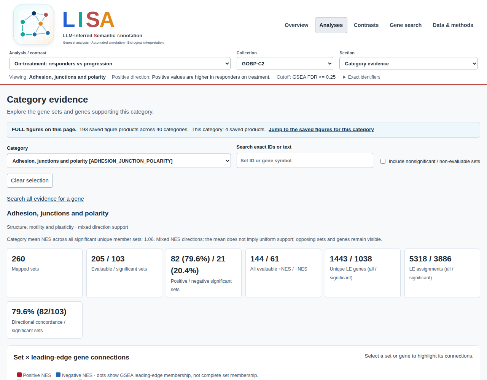

## Read and share a saved lisaR report {#scientific-report--introduction}


Start with a completed lisaR report folder. You can open it, inspect its saved
evidence and copy it for review without running differential expression, GSEA
or ORA again.

<span id="open-the-saved-report"></span>

### Open the saved report {#scientific-report--open-the-saved-report}

Open `report_index.html` inside the saved folder in your browser. You do not
need R to read its pages or use existing downloads. Keep the folder intact
because its pages, figures and downloads use relative paths.

If you produced the analysis, you can verify its original completed folder
in R before sharing or adding figures. The R examples below use that original
folder, not just an exported static copy. Set `run_dir` to the folder, not to
the HTML file:

```{r open-saved-report, eval=TRUE}
# For your own completed study: run_dir <- "path/to/your/saved-run"
# Extract the shipped complete saved run to a new temporary directory.
fixture_dir <- tempfile("lisa-saved-fixture-")
dir.create(fixture_dir)
utils::untar(system.file("extdata", "p5-tiny-scientific-run.tar.gz",
  package = "lisaR", mustWork = TRUE), exdir = fixture_dir)
run_dir <- file.path(fixture_dir, "p5-tiny-scientific-run", "run")
check <- lisaR::verify_lisa_run(run_dir)
stopifnot(identical(check$gate, "PASS"))
file.exists(file.path(run_dir, "report_index.html"))
# Open manually in an ordinary R session:
# browseURL(file.path(run_dir, "report_index.html"))
```

If verification does not pass, inspect `check$findings` before sharing or
extending the analysis.

Most readers start with a saved `report.mode: standard` run. Its overview,
category evidence, gene search and applicable contrast evidence are the normal
scientific report, not a reduced enrichment calculation.

**Overview** shows the number of DE analyses and contrasts, with a card to open
each result. The **Analysis map** below those cards links directly to its
collections. Open **Report details** for summary tables and output counts.

If you do not yet have a completed report, follow [Quick Start](start-with-lisar.html#quick-start--introduction)
or [Run lisaR with your prepared files](preparing-and-analysing-your-data.html#getting-started--introduction). A dry run or
`plan_lisa_outputs()` describes intended products but does not create a
completed scientific report.

<span id="open-category-evidence"></span>

### Open category evidence {#scientific-report--open-category-evidence}

The shared header links to **Overview**, **Analyses**, **Contrasts**, **Gene
search** and **Data & methods** when those sections are applicable. Status and
coverage tables distinguish completed, not requested, skipped and inapplicable
products. An absent product is not a negative biological result.

| Report area | What it contains | Direct route |
|---|---|---|
| LISA overview | Category plots for each completed analysis and selected collection | In **Section**, select **Category evidence**, then choose a category in **Category**. |
| Category evidence | Exact category scope, mapped sets, leading edges and DE measurements | Use the category page's downloads for its complete tables. |
| Gene search | Per-analysis DE measurements and complete TERM2GENE membership | Follow a category link to retain the same analysis, collection and tier. |
| Contrasts | Aligned A/B category, set and gene evidence | Click a category head or name on the original contrast figure to open its evidence. |
| Data & methods | Configuration, provenance, source data and recipes selected by the output policy | Use the linked files, rather than reconstructing a path from a screenshot. |

For a single analysis, choose the analysis and collection first. In the
**Section** selector, select **Category evidence**, then choose the category in
the **Category** selector. The category PNG is not clickable.

When saved category inference is present, **Category significance** is the
default view. It marks the highest adjusted-P threshold reached: `*` ≤0.05,
`**` ≤0.01, `***` ≤0.001 or `****` ≤0.0001. No star may mean either not
significant or not evaluable. Open **Category evidence** for that status, the
exact adjusted P, minimum supported count **d/N** at 95% simultaneous
confidence, and coverage. The mean-NES panel and profile contrasts remain
descriptive. The SVG, PNG and PDF downloads and the standalone SVG recipe,
where supplied by the output policy, use the same saved P values and legend.
Historical reports without category inference retain descriptive navigation;
their absence of stars must not be interpreted as a negative result.

For a contrast, category names and category heads have separate links that
open the aligned A/B evidence. Both routes retain the selected scope, not only
the rows currently displayed. Where the output policy supplies them, use the
**PNG** link for the static figure and the **R script** link for its companion
recipe. Keep the linked source TSV and settings with either download.


*Category evidence for Adhesion, junctions and polarity in the saved Riaz
on-treatment CR/PR-minus-PD analysis, GOBP-C2. This is an existing selected
FULL report with two analyses and one contrast, not a new calculation. The
analysis and collection selectors keep the current scope visible; the
FULL-figure link leads to saved products for this category. This historical
capture is a navigation example, not evidence of a four-star result.*

From the page shown above, **Search all evidence for a gene** opens the gene
explorer. **Jump to the saved figures for this category** opens its FULL
products; a figure thumbnail opens the available preview. These routes retain
the selected category rather than starting a separate analysis. Products depend on the
inputs and report settings.

<span id="category-and-gene-evidence"></span>

### Category and gene evidence {#scientific-report--category-and-gene-evidence}

The category-evidence page keeps the distinct data layers separate. Gene-set
NES and GSEA adjusted P values belong to a set. Log fold change and DE adjusted
P values belong to a gene. A leading-edge mark records a contributor for that
GSEA result; complete TERM2GENE membership is broader and remains available in
the gene view.

The evidence matrix has display limits, but its downloadable tables retain the
configured category scope. `tables/sets.tsv` records mapped set states,
`leading_edges.tsv` records the available links, and `genes.tsv` records the
shared DE values for that evidence page. `*_GSEA_universe_ledger.tsv` records
the selected source space, including size-ineligible sets. `GOBP-C2`, `GOMF`
and `GOCC` also have tabular `*_GSEA_OTHER_UNCLASSIFIED.tsv` rows. `PATHWAYS`
does not. These residual rows are not plotted categories.

Gene search starts from a recorded symbol or biological identifier. Its default
membership view uses complete TERM2GENE, not only leading edges. A member can
therefore appear in a significant gene set without being in its recorded
leading edge. The report does not create a combined gene-importance score.

<span id="ab-contrast-fields"></span>

### A/B contrast fields {#scientific-report--ab-contrast-fields}

An A/B contrast aligns existing analysis evidence. `delta_mean_NES` is always
a descriptive comparison. It is not a category-level FDR and not a formal
interaction test. A formal source-model interaction remains gene-level
evidence. The following fields identify the endpoints used by the contrast
plot and table.

| Field | Role |
|---|---|
| `mean_NES_contextual_A` | A-side mean across finite evaluable mapped sets before the cutoff. |
| `display_mean_NES_A` | A-side endpoint actually selected for the plot. |
| `endpoint_source_A` | States whether that endpoint is significant, contextual, unavailable or hidden. |
| `has_significant_support_A` | States whether A has at least one member at `gsea_padj_cutoff`. |
| `plot_has_any_significant_support` | States whether either endpoint may be shown. |
| `gsea_padj_cutoff` | Cutoff shared by the saved support state. |
| `delta_mean_NES` | Displayed A minus B endpoint difference, available only when both endpoints are finite. |

The B-side fields follow the same contract. If one side has significant support,
the other side may use a finite contextual mean and is identified as such. If
neither side has significant support, the plot has no endpoints or delta. A
missing contextual value is not replaced with zero.

<span id="add-one-figure-with-shiny"></span>

### Add one figure with Shiny {#scientific-report--add-one-figure-with-shiny}

For the simplest extension, open the saved report with the optional Shiny
interface:

```{r open-saved-report-shiny, eval=FALSE}
lisaR::explore_lisa_run(run_dir)
```

Open the category or section you need, choose one item and press its
named button, such as **Generate volcano**. This launches a separate figure
worker using saved results. It does not rerun differential expression, GSEA or
ORA, and it does not change the original report. Follow
[Explore a saved report with Shiny](reports-and-exploration.html#shiny-app--introduction) for states, downloads,
reuse and expanded export.

<span id="use-r-to-render-a-selected-extension"></span>

### Use R to render a selected extension {#scientific-report--use-r-to-render-a-selected-extension}

`plan_lisa_extension()` and `render_lisa_categories()` are the public route
for selected additions. They consume a completed, checked standard run, use
its saved scientific tables and leave it unchanged. They do not repeat
enrichment.

```{r report-selected-extension, eval=TRUE}
analysis_ids <- read.delim(
  file.path(run_dir, "config", "de_index.tsv")
)$analysis_id
selection <- list(
  selection = list(
    mode = "selected",
    analyses = analysis_ids[[1L]],
    products = c("member_gene_sets", "volcano")
  ),
  report = list(
    mode = "selected",
    formats = list(png = TRUE, svg = FALSE, pdf = FALSE),
    source_data = TRUE,
    recipes = TRUE
  )
)

extension_plan <- lisaR::plan_lisa_extension(run_dir, selection)
extension_plan$expected_files

# Manual rendering option, not executed during the offline build:
# extension <- lisaR::render_lisa_categories(
#   run_dir, selection, "results/study-selected"
# )
```

`output_dir` must be a new folder outside the source run. A selection may also
be `"full"` or a YAML/JSON selection file. Planning is read-only; rendering
creates and checks a separate extension report.

<span id="assemble-an-integrated-selected-full-report"></span>

### Assemble an integrated selected FULL report {#scientific-report--assemble-an-integrated-selected-full-report}

`run_lisa()` with `mode = "full"` (or `report.mode: full` in a study file) writes the integrated FULL
report: one report in the same `output_dir`, with the standard navigation and
every FULL figure alongside the corresponding analysis, collection and
category. Keep that output folder together when you move or share the report.

To assemble a FULL report for a *subset* of the analyses and contrasts of an
existing run, use the installed `build_selected_LISA_report.R` entry point. It reads saved results, makes a new selected project and invokes the
common report generator. The original run stays unchanged. With
`--complete-missing true`, it creates missing presentation products from the
saved data, without fitting DE or repeating GSEA.

Select existing IDs from `run_dir` rather than inventing directory names:

```{r report-integrated-full, eval=TRUE}
source_run <- run_dir
analyses <- read.delim(file.path(source_run, "config", "de_index.tsv"))
contrast_file <- file.path(source_run, "config", "contrast_index.tsv")
contrast_text <- readLines(contrast_file, warn = FALSE)
contrasts <- if (any(nzchar(trimws(contrast_text)))) {
  read.delim(contrast_file)
} else {
  data.frame(contrast_id = character())
}
selected_analyses <- analyses$analysis_id
selected_contrasts <- if (nrow(contrasts)) {
  paste(contrasts$contrast_id, collapse = ",")
} else "none"

# Read-only API planning; this tiny fixture has no category-evidence pages.
full_plan <- lisaR::plan_lisa_extension(source_run, list(
  selection = list(mode = "full"),
  report = list(mode = "full")
))
full_plan[c("mode", "expected_files", "selected_categories")]
```

The evaluated block above calls the public planner only; it does not execute
the FULL builder CLI. For a saved STANDARD with category-evidence pages, use
the complete manual recipe below. Check selected IDs first with `--plan-only`
and review that plan before building without it.
Every selected contrast must refer to two selected analyses. For a narrower
report, change the selected IDs before either call. Product requirements,
such as an expression matrix for a heatmap, still apply.

```{r report-integrated-full-build, eval=FALSE}
builder <- system.file("scripts", "build_selected_LISA_report.R", package = "lisaR")
# Choose a new persistent output folder for your selected integrated report.
full_dir <- file.path("results", "study-integrated-full")
stopifnot(!dir.exists(full_dir))
dir.create(dirname(full_dir), recursive = TRUE, showWarnings = FALSE)
args <- c(
  "--vanilla", shQuote(builder),
  "--source-dir", shQuote(source_run),
  "--output-dir", shQuote(full_dir),
  "--analyses", shQuote(paste(selected_analyses, collapse = ",")),
  "--contrasts", shQuote(selected_contrasts),
  "--title", shQuote("Study FULL report"),
  "--complete-missing", "true"
)
rscript <- file.path(R.home("bin"), "Rscript")
stopifnot(system2(rscript, c(args, "--plan-only", "true")) == 0L)
# After reviewing that plan:
stopifnot(system2(rscript, args) == 0L)
browseURL(file.path(full_dir, "report_index.html"))
```

If a separate extension already exists, supply its root `artifacts` directory
and `extension_manifest.tsv` with `--artifacts-dir` and
`--artifact-manifest`. Both arguments are required together. Their saved
products are reused. The [Riaz example](worked-examples.html#riaz-gse91061-worked-example--introduction)
shows a two-analysis, one-contrast selection.

The integrated report has its own selection and source records. It is a
presentation of saved results, not a new `run_lisa()` analysis.
Keep any source presentation configuration alongside your project: the current
builder can consume it without archiving that configuration in the report.

<span id="kegg-gene-sets-and-native-maps-are-different-products"></span>

### KEGG gene sets and native maps are different products {#scientific-report--kegg-gene-sets-and-native-maps-are-different-products}

TERM2GENE memberships supply gene sets for enrichment. Native KEGG pathway
maps are optional figures in the same report folder. To request them, set
`pipeline.run_kegg_maps: true` and `pipeline.kegg_access_mode: cache_only`,
and supply `pipeline.kegg_cache_root` and `pipeline.kegg_snapshot_id`. lisaR
uses the supplied immutable local snapshot and does not retrieve a
pathway diagram automatically. A KEGG gene-set result is not itself a native
map. If the snapshot is unavailable, the report explains why maps were
skipped. A map-generation error instead fails the run and retains its error
log; it is not reported as an unavailable resource.

For an example of the underlying pathway, open
[KEGG hsa04060: Cytokine-cytokine receptor interaction](https://www.kegg.jp/pathway/hsa04060)
on the KEGG website. This link shows KEGG's pathway, not a lisaR-coloured
Riaz result. The diagram is hosted by KEGG and is not included in this package.

When lisaR colours a map from an authorised local snapshot, red and blue show
positive and negative gene-level log2 fold changes. These are not NES values
or evidence of pathway activity. The map retains its KEGG attribution and
applicable terms.

See the [resource guide](configuration-resources-and-execution.html#resources-and-provenance--introduction) before enabling native
maps. KEGG provides a [copyright permission request form](https://www.kegg.jp/feedback/copyright.html)
for reproducing its maps and images in academic publications.

<span id="preserve-a-reviewable-bundle"></span>

### Preserve a reviewable bundle {#scientific-report--preserve-a-reviewable-bundle}

`verify_lisa_run()` checks the original completed run. For sharing, review
`shareable_report_manifest.tsv` and keep only its listed relative files with
the corresponding report tree. It does not establish biological validity,
redistribution rights or pixel-identical output on another system. The source
configuration, input inventory, resource inventory and output policy remain
the technical record of what was run.

## Explore a saved report with Shiny {#shiny-app--introduction}


Use Shiny to browse a completed lisaR report and generate selected figures from
its saved results. The application does not repeat differential expression,
GSEA or ORA. It writes generated material to a separate exploration workspace
and leaves the original scientific report unchanged.

To inspect existing pages and downloads without generating anything, open the
saved report's `report_index.html` directly. That route needs neither R nor
Shiny.

<span id="open-the-saved-analysis"></span>

### Open the saved analysis {#shiny-app--open-the-saved-analysis}

Install the optional application packages once in the R library where lisaR is
installed:

```{r install-shiny, eval=FALSE}
install.packages(c("shiny", "callr", "ps"))
```

`shiny` provides the interface. `callr` runs a figure worker separately so
you can continue to browse. `ps` supports worker status checks. Some figures
need further packages or saved inputs; the application reports when one is not
available for the selected run.

Set `run_dir` to the completed report folder and open it:

```{r open-saved-run, eval=FALSE}
library(lisaR)

run_dir <- "path/to/your/saved-run"
explore_lisa_run(run_dir)
```

After [Quick Start](start-with-lisar.html#quick-start--introduction), you can instead use
`run_dir <- result$output_dir` in the same R session.

In an environment where R must not launch the browser, use the supported
option below and open the loopback URL printed by Shiny in the browser
available to that environment:

```{r open-without-browser-launch, eval=FALSE}
explore_lisa_run(run_dir, launch.browser = FALSE)
```

This option leaves the application running while you open its address yourself.

<span id="choose-one-exact-item"></span>

### Choose one exact item {#shiny-app--choose-one-exact-item}

The saved report opens inside a Shiny shell. To reach its figure controls:

1. Open the analysis or contrast, then choose the collection.
2. Under **Section**, select **Category evidence** and follow **Explore a category**.
3. Choose the category in the evidence sheet's selector.

For Quick Start, use **Synthetic response A**, **GOBP-C2** and
**Synthetic immune signalling**. After the custom-dictionary tutorial, use the
same analysis and collection with **Example of signal response**.

Use **Explore a category** for this route. Clicking a category label in an
overview graph opens the static evidence page outside the Shiny shell.

Each button names one product. Examples include **Generate volcano**,
**Generate gene card**, **Generate gene heatmap** and
**Generate KEGG pathway map**. Contrast pages can show named buttons such as
**Generate paired gene heatmap** or **Generate gene-category network**.

Where a product has another selector, choose one exact value before pressing
its button. For a gene figure, check the gene. For a heatmap, check the offered
scale. For a native KEGG map, check both the pathway name and identifier.
Changing a selection, opening a category or searching for a gene does not
generate a figure.

A native KEGG map also requires an authorised immutable local snapshot and
the corresponding saved run information. KEGG-derived TERM2GENE membership
can support enrichment but does not supply a native pathway diagram. See
[Resources and provenance](configuration-resources-and-execution.html#resources-and-provenance--introduction).

<span id="generate-the-figure-and-follow-its-state"></span>

### Generate the figure and follow its state {#shiny-app--generate-the-figure-and-follow-its-state}

Press the named **Generate** button once. The request moves through the states
that apply to it:

| State | What it means |
|---|---|
| `ungenerated` | No request has been submitted for this figure. |
| `queued` | The request is saved and waiting for the single figure-worker slot. |
| `running` | A separate R worker is producing this figure from saved results. |
| `available` | The generated files passed their checks and can be reused. |
| `not_applicable` | The saved run lacks an input or condition required by this product. |
| `failed` | The request ended without an available figure; read its message. |

A second background figure request can remain `queued` behind the one that is
`running`. You do not need to close the report while it waits. Generating a
figure is presentation work over saved results, not a new enrichment analysis.

<span id="inspect-download-and-reuse-the-result"></span>

### Inspect, download and reuse the result {#shiny-app--inspect-download-and-reuse-the-result}

When the state is `available`, inspect the image in the same category sheet.
Use whichever PNG, PDF, source-data or R-script download links that product
actually provides. Keep the source data and settings with a downloaded recipe.

Reopening the same saved analysis reuses a generated figure while its source
run, settings and files still validate. Opening the report never generates a
missing figure automatically.

<span id="resolve-unavailable-or-failed-requests"></span>

### Resolve unavailable or failed requests {#shiny-app--resolve-unavailable-or-failed-requests}

`not_applicable` is a product-availability result, not a negative biological
finding. Read the explanation. For example, a gene heatmap may need a saved
expression matrix, while a native KEGG map needs the authorised snapshot
described above. Other saved report sections remain available.

For a `failed` request, keep its message and correct the named input, package
or resource outside the immutable source run. The same named **Generate**
button becomes available again; there is no separate **Retry** button.

<span id="cancel-a-figure-through-the-advanced-r-api"></span>

### Cancel a figure through the advanced R API {#shiny-app--cancel-a-figure-through-the-advanced-r-api}

The Shiny shell has no visible per-figure cancel button. If you submit figures
through R, keep the workspace and the `job_id` returned by
`lisa_explore_submit()`:

```{r cancel-figure-api, eval=FALSE}
ws <- lisa_explore_open(run_dir)
request <- lisa_figure_request(
  unit_type = "single_de",
  analysis_id = "response_a",
  collection = "GOBP-C2",
  category_id = "SYN_SIGNAL",
  product = "volcano"
)
job <- lisa_explore_submit(ws, request, background = TRUE)

lisa_explore_status(ws)
lisa_explore_cancel(ws, job$job_id)
```

The identifiers above belong to the synthetic sample project. Use IDs from
your saved report for another study.

A background request can queue behind another figure. A foreground API request
can instead be refused with an instruction to wait or submit it in the
background. Follow that message rather than restarting R.

A queued job is cancelled immediately and recorded as `failed` with the
cancellation reason. A running worker records the request, continues until its
next safe point and only then reaches a terminal `failed` state. Do not close
or stop the process to force cancellation. This API route is separate from the
export control below.

<span id="save-an-expanded-report"></span>

### Save an expanded report {#shiny-app--save-an-expanded-report}

1. In **Save expanded report to**, enter a new folder outside the original
   report. The destination must not already exist.
2. Press **Save expanded report**.
3. Wait while the toolbar shows **Export queued** or **Export running**. Continue
   only when it reports **Saved expanded report to** the chosen destination.
4. Copy or zip the whole new folder. At the destination, open its
   `report_index.html` and keep every subfolder with it.

The export takes a snapshot of figures that are `available` when saving
begins. It does not generate queued, running or ungenerated figures. If a
figure worker prevents the export from starting, wait for the displayed figure
state to finish, then press **Save expanded report** again.

If the toolbar reports **Export failed**, keep the message and do not move a
partial staging folder. Correct the named problem and choose a new destination
before trying again.

Use **Cancel export** only for an export that is queued or running. A queued
export cancels immediately. A running export stops at its next safe point, so
wait for the displayed terminal message before closing R.

The expanded folder contains the original report and the available figures
captured by that export. It opens without R or Shiny, with working figures and
downloads but no live generation controls. See
[Read and share a saved report](reports-and-exploration.html#scientific-report--introduction) for navigation.

## Troubleshooting a lisaR run {#troubleshooting--introduction}


Keep the complete error message and the exact configuration that produced it.
Use the section matching what you can see, correct the named problem and repeat
only the failed check or request. Do not edit a completed report to make an
error disappear.

<span id="find-the-failing-readiness-stage"></span>

### Find the failing readiness stage {#troubleshooting--find-the-failing-readiness-stage}

```{r troubleshooting-readiness, eval=TRUE}
library(lisaR)
recovery_project <- lisa_init_project(tempfile("lisa-readiness-"))
new_config <- file.path(recovery_project, "study.yml")
validation <- validate_lisa_config(new_config, check_files = TRUE)
validation$readiness
validation$inputs
validation$dependencies
validation$resources
```

`structural_valid` answers whether the file follows the configuration contract.
`execution_ready` also requires available inputs, dependencies and resources.
`check_files = FALSE` is structural prevalidation only. `run_lisa()` performs
strict validation, so an unknown field is not a setting that can be ignored to
start execution.

| Symptom | Inspect | Current response |
|---|---|---|
| Rejected field or value | Exact field path and schema version | Correct the named field, then validate again. |
| Structurally valid but not ready | `readiness` and its failed-stage tables | Restore the missing input, dependency or registered resource. |
| Run stops during work | Original condition and `run_events.tsv` | Keep the staging tree for diagnosis; do not promote it manually. |
| Missing report item | Resolved report settings and output-policy/status tables | Check whether the product was requested, applicable and completed. |
| Verification gate is `FAIL` | `findings` | Treat the run as unverified until the findings are resolved. |

<span id="correct-a-configuration-or-lifecycle-message"></span>

### Correct a configuration or lifecycle message {#troubleshooting--correct-a-configuration-or-lifecycle-message}

| Code | Meaning | Action |
|---|---|---|
| `LISA-CONFIG-UNKNOWN-001` | A key is not part of the recognised configuration. | Correct or remove the key named in the message. |
| `LISA-CONFIG-MIGRATION-000` or `001` | Earlier schema or output keys require explicit migration. | Preserve the original, migrate a reviewed copy, validate and inspect its plan. |
| `LISA-CONFIG-GSEA-001` | `gsea_padj_cutoff` is not one finite number from 0 to 1. | Set one valid cutoff. |
| `LISA-DUP-001` | A required duplicate policy is absent. | Declare policies for DE tables, matrices and mapped-ID collisions. |
| `LISA-EVIDENCE-002` | The chosen evidence mode lacks a required role or source column. | Correct the column mapping or use a compatible evidence mode. |
| `LISA-RUN-005` | The final output directory already exists. | Choose a new final directory. |
| `LISA-RESUME-001` | Resume was requested for an interrupted run. | Set `resume: false` and start a new run ID and destination. |

`resume` is unsupported in version 1.0 because lisaR cannot prove that an
abandoned staging tree is complete and compatible. It preserves that tree for
inspection, but does not reuse it as scientific output.

<span id="configuration-migration"></span>

### Migrate an earlier configuration {#troubleshooting--configuration-migration}

Schema `1.0.0` is the current configuration contract. lisaR does not silently
convert a file that declares `0.5.0`, `0.6.0` or an unsupported version.
Preserve the original file and make the reviewed copy beside it so relative
input paths keep the same meaning.

```{r copy-configuration-for-migration, eval=FALSE}
old_config <- file.choose()
extension <- tools::file_ext(old_config)
new_config <- file.path(
  dirname(old_config), paste0("study-schema-1.0.", extension)
)
stopifnot(!file.exists(new_config))
stopifnot(file.copy(old_config, new_config))
new_config
```

Open `new_config` in RStudio and make the following changes there. Do not edit
the original.

For a 0.5.0 file, replace these old pipeline keys explicitly:

| Old key | Current destination |
|---|---|
| `pipeline.plot_formats` | `report.formats.png`, `report.formats.svg` and `report.formats.pdf` |
| `pipeline.export_formats` | `report.source_data`; canonical TSV tables remain mandatory |
| `pipeline.run_reports` | `report.mode` |
| `pipeline.run_gene_level` | Selected products requested through `render_lisa_categories()` |

For a 0.6.0 file, review `report.mode`, evidence options and
`report.category_nes_variants`. Choose one to four distinct values from
`clean`, `percentages`, `direction` and `dispersion`; all four are used by
default.

In the reviewed copy:

1. Remove or replace every obsolete key named by validation.
2. Set `pipeline.schema_version: "1.0.0"`.
3. Choose a new `pipeline.output_dir`.
4. Leave input paths, comparisons, resource identities and other scientific
   settings unchanged unless you intend and review a separate scientific
   change.

Then validate and inspect the plan without running the study:

```{r migrate-configuration, eval=TRUE}
# Inspect the temporary sample configuration above, not an unreviewed user file.
validation <- validate_lisa_config(new_config, check_files = TRUE, strict = TRUE)
validation$readiness
stopifnot(validation$execution_ready)
plan <- plan_lisa_outputs(new_config)
plan$summary
plan$products
```

Changing the schema declaration does not rerun or revalidate an old result.
Do not renumber dictionary, TERM2GENE or category-map resources merely because
the configuration schema changed.

<span id="inputs-dependencies-and-resources"></span>

### Inputs, dependencies and resources {#troubleshooting--inputs-dependencies-and-resources}

For an input readiness failure, use the table's resolved path and message to
check file presence, readability and declared columns. RDS input is suitable
only for a stable local file from a source you fully trust. Its size limit is a
diagnostic limit, not a sandbox.

For missing dependencies, inspect `validation$dependencies` in the R session
that will run the study. Record session details outside a completed lisaR run
directory. Do not add diagnostic files to a verified run.

| Resource finding | Meaning | Action |
|---|---|---|
| `LISA-RESOURCE-006` | Reference does not resolve to one registered version. | Use an approved versioned ID for the study species. |
| `LISA-RESOURCE-008` | Registered file is absent from its managed location. | Restore the reviewed registered artifact. |
| `LISA-RESOURCE-009` | Observed SHA-256 differs from the registered reviewed value. | Replace altered bytes through the reviewed resource route. |
| `LISA-RESOURCE-017` | Resource schema does not match its configured role. | Select the intended dictionary, category map or TERM2GENE release. |
| `LISA-SPECIES-003` | Membership resource targets another species. | Select a species-matched release. |

See [Resources and provenance](configuration-resources-and-execution.html#resources-and-provenance--introduction) for resource
registration and provenance.

<span id="report-cache-and-worker-symptoms"></span>

### Report, cache and worker symptoms {#troubleshooting--report-cache-and-worker-symptoms}

Inspect the resolved configuration before deciding that a report product is
missing:

```{r troubleshooting-report-settings, eval=TRUE}
validation$config$report
validation$configuration_provenance
```

`report.category_evidence = FALSE` disables linked evidence products.
`report.category_nes_variants` selects a non-empty subset of `clean`,
`percentages`, `direction` and `dispersion`; it does not change the underlying
GSEA calculation. All static formats set to `FALSE` suppress static figures,
not HTML navigation or evidence tables. Direct `HALLMARKS` is not a semantic
category universe.

`pipeline.cache_mode` defaults to `off`. `readonly` computes on a miss without
writing; `readwrite` may store a miss; `refresh` recomputes and may replace an
entry. Active modes require `cache_dir`. The per-analysis
`qc/<comparison>_content_cache.tsv` records the actual hit or miss reason.
The cache is neither a resource registry nor a completed result.

If the category-significance panel is absent, first distinguish a historical
run without saved inference from a current run whose inference stage did not
complete. Check the run's product/status table, source manifest and exact
collection; direct `HALLMARKS` and A/B contrasts are intentionally excluded.
An incomplete semantic collection must not silently shrink the Hommel family.
For a verified earlier run without inference, `add_lisa_category_inference()`
can calculate it in a new directory using the exact saved resources. For a
verified run **with** inference, `refresh_lisa_support_grades()` updates only
presentation in a new directory. Neither function repairs a failed verification
gate or permits overwriting an existing report.

If a worker or parallel-backend message appears, preserve the exact message and
follow [Parallel execution](configuration-resources-and-execution.html#parallel-execution--introduction) for the supported backend
and worker settings on your system.

<span id="resolve-a-shiny-figure-or-export-problem"></span>

### Resolve a Shiny figure or export problem {#troubleshooting--resolve-a-shiny-figure-or-export-problem}

If the browser does not open automatically, keep the saved report path and run:

```{r troubleshooting-shiny-launch, eval=FALSE}
explore_lisa_run("path/to/your/saved-run", launch.browser = FALSE)
```

Open the loopback URL printed by Shiny in the browser available to that
environment. This leaves the application running while you open its address
yourself.

| Visible state or message | Action |
|---|---|
| `ungenerated` | Choose the exact item and press its named **Generate** button. |
| `queued` | Leave R open; the request waits for the figure-worker slot. |
| `running` | Wait for a terminal state before moving its workspace files. |
| `available` | Inspect the figure and use only the download links actually shown. |
| `not_applicable` | Read the missing-input or product explanation; do not interpret it as a negative biological result. |
| `failed` | Preserve the message, correct the named problem and press the same **Generate** button again. There is no separate **Retry** button. |

The interface has **Cancel export**, but no visible per-figure cancel button.
For an export cancellation, wait until the status becomes terminal. A running
job stops at its next safe point, not at the instant cancellation is requested.
The [Shiny guide](reports-and-exploration.html#shiny-app--introduction) gives the separate advanced R API for
cancelling a figure submitted with a retained `job_id`.

An expanded export requires a new destination outside the source report. It
captures figures that are available when export starts and does not generate
pending figures. If the destination exists, choose another name. If the export
is refused while a figure is running, wait for that figure to finish and submit
the export again.

<span id="figure-reproduction-and-portable-copies"></span>

### Figure reproduction and portable copies {#troubleshooting--figure-reproduction-and-portable-copies}

A recipe is tied to its saved source data and settings. Use the matching lisaR
version, format, dimensions and graphics dependencies when reproducing a
figure. Matching scientific values and matching image pixels are different
checks: platform graphics, fonts and devices can affect a rendered image.

If a rerender differs, first compare the source TSV and settings against their
recorded identities. Keep any diagnostic output outside the immutable source
run. Do not rerun DE or GSEA solely to investigate a rendering difference, and
do not modify a validated image to make it appear to match.

When report links fail after copying, copy the intended report bundle with its
relative files rather than only an entry HTML file. Do not copy a staging tree
while it is being written. `shareable_report_manifest.tsv` identifies the
relative files intended for review or distribution.

<span id="check-planning-extensions-and-verification"></span>

### Check planning, extensions and verification {#troubleshooting--check-planning-extensions-and-verification}

A dry run returns `PLAN_PASS` and a separate planning directory. It does not
create a completed scientific result. A selected or full extension starts from
a canonical run whose verification gate is `PASS`, writes to a new directory
and leaves the source run unchanged.

```{r troubleshooting-verify, eval=TRUE}
# For your own study: check <- verify_lisa_run("results/my-study")
check <- lisaR::verify_lisa_run(run_dir)
check$gate
check$findings
stopifnot(identical(check$gate, "PASS"))
```

Do not overwrite a completed result, repair files inside it or promote a
staging tree after a failure. Keep the original condition, configuration and
relevant status rows with any private support request, omitting sensitive data
and credentials.

<span id="windows-reports-a-path-or-file-copy-error"></span>

### Windows reports a path or file-copy error {#troubleshooting--windows-reports-a-path-or-file-copy-error}

Use a short writable project root, such as `D:/lisa/sample`, `D:/lisa/riaz` or
`D:/lisa/cptac`. The example configuration writes to `out/`. Its installed
inputs do not require another package installation.

`LISA-PATH-001` reports the full destination and its length in UTF-16 units.
lisaR checks planned result paths before enrichment and checks protected writes
again at runtime. Choose a shorter new destination or shorter analysis IDs,
then validate again. Do not rename files inside an existing verified result.
The conservative 240-unit budget leaves room below common Windows API limits;
it is not a guarantee for arbitrary paths or third-party programs. No registry
change or administrator access is required.

## Inspect a saved figure source offline

The distributed category figure has its original source table and settings.
They can be inspected without starting Shiny or regenerating a figure. This
is a figure-level snapshot, not a completed run accepted by verify_lisa_run().

```{r inspect-saved-category-figure, eval=TRUE}
saved_values <- utils::read.delim(
  file.path("figures", "riaz-category_source.tsv"), sep = "\t",
  check.names = FALSE
)
saved_settings <- jsonlite::read_json(
  file.path("figures", "riaz-category_settings.json"), simplifyVector = TRUE
)
stopifnot(nrow(saved_values) > 0L)
print(utils::head(saved_values))
print(saved_settings)
```

## Session information

The evaluated examples use the R session recorded here. Manual network,
archive and GUI templates are not claimed as executed by this record.

```{r documentation-session-info, eval=TRUE}
# Remove only the temporary extracted fixture after the saved-run examples.
unlink(fixture_dir, recursive = TRUE)
sessionInfo()
```
