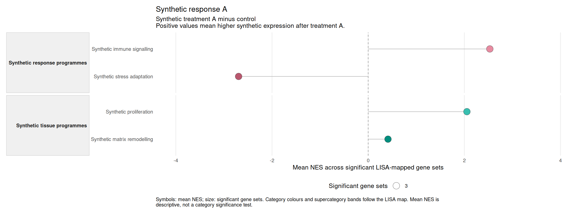
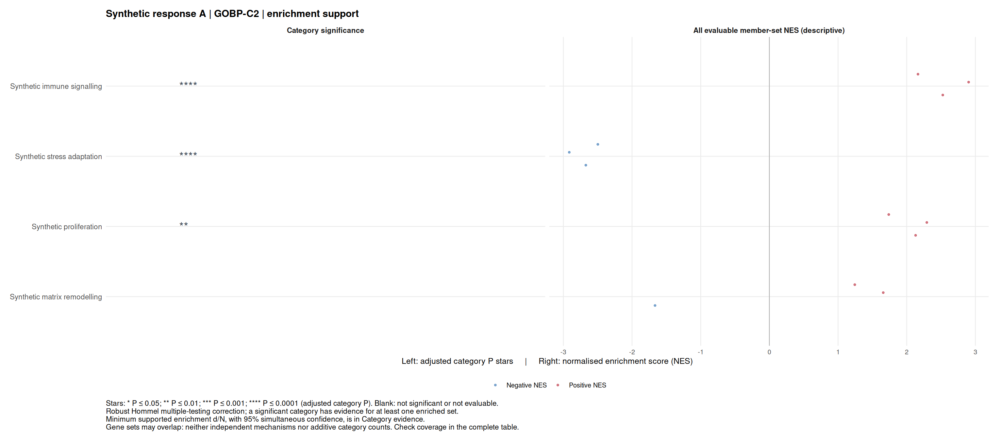

## Install lisaR {#installation--introduction}


You need **R 4.1 or later** and internet access. RStudio is optional.
If you only want to read an existing HTML report, you do not need R.

<span id="install-the-package"></span>

### Install the package {#installation--install-the-package}

Run this once in R or the RStudio Console:

```{r install-lisar, eval=FALSE}
install.packages(c("BiocManager", "remotes"))
BiocManager::install("fgsea", update = FALSE, ask = FALSE)
# If needed, install these optional guide-build packages manually:
install.packages(c("knitr", "rmarkdown"))
BiocManager::install("edgeR", update = FALSE, ask = FALSE)
# Confirm that Pandoc is available in your own build session:
rmarkdown::pandoc_available()
remotes::install_github(
  "DBM-OlmedaLab/lisaR",
  upgrade = "never",
  build_vignettes = TRUE
)

library(lisaR)
packageVersion("lisaR")
```
Building the local guides also needs the optional R packages `knitr`,
`rmarkdown` and `edgeR`, plus Pandoc outside R (often supplied by RStudio).
If these are missing, install the R packages manually before the build, as in
this unevaluated recipe; install or select Pandoc for your own R session.
The guide build executes the offline synthetic STANDARD demonstration once.
That compact run took about 60 seconds in the pinned reference environment;
this is an observation, not a speed promise for your computer.

The installation recipe builds the eight guides for local `vignette()`/
`browseVignettes()` access. To skip the build, choose `build_vignettes = FALSE`
and use the [online Getting started reader](https://olmedalab.org/lisaR/reader/start-with-lisar.html?lang=en);
that choice does not install the guides locally. Both choices can run analyses.


The installer brings in the required dependencies, including `hommel`.
lisaR includes its LISA dictionaries and category hierarchy. There is no
second source-file installation.

The external gene-set membership resource is prepared later in the
Riaz example, alongside its data. You do not need to locate those files yourself.

<span id="if-installation-fails"></span>

### If installation fails {#installation--if-installation-fails}

Restart R if an older lisaR version is already loaded. For a missing dependency,
compiler requirement or library-path problem, see
[Installation details](configuration-resources-and-execution.html#advanced-installation--introduction).

The guides are available online; building HTML vignettes is not required to
run an analysis. Source `.Rmd` files remain in the repository's `vignettes/`
directory.

**Next: [Create your first offline synthetic report](#quick-start--introduction).**
For a prepared real-data example, continue afterwards to
[Riaz ON](worked-examples.html#riaz-on-quick-start--introduction).

## Quick Start: create and open a synthetic lisaR report {#quick-start--introduction}


This is the offline synthetic demonstration. For a first real-data analysis,
follow [Riaz ON](worked-examples.html#riaz-on-quick-start--introduction).

This guide creates a complete report from the synthetic sample project
included with lisaR. You will copy the project, check its configuration, run it
and open the result in a browser. No study data or resource download is needed
after lisaR is installed.

The example contains 40 synthetic genes, two differential-expression analyses
and one descriptive comparison of their LISA profiles. It demonstrates the
workflow, not a biological finding.

Install lisaR and its dependencies first. See
[Install lisaR](start-with-lisar.html#installation--introduction). Then run the following sections in order in
R or RStudio.

<span id="create-a-fresh-sample-project"></span>

### 1. Create a fresh sample project {#quick-start--create-a-fresh-sample-project}

`lisa_init_project()` copies the sample input files into a new directory. It will
not overwrite a directory that already exists.

```{r initialise, eval=TRUE}
library(lisaR)

root <- tempfile("lisa-offline-")
dir.create(root)
project <- lisa_init_project(file.path(root, "sample"))
```

The evaluated example uses a temporary directory. For a permanent project,
set `root <- if (.Platform$OS.type == "windows") "D:/lisa" else "~/lisa"`
and create that directory before initialising the project.

If you have already used that name, choose a new one, such as
`"sample-2"`. Do not delete or overwrite an earlier project just
to repeat this guide.

The copied `study.yml` selects a standard report. It contains two synthetic
analyses:

- **Synthetic response A:** treatment A minus control, with positive values
  meaning higher synthetic expression after treatment A.
- **Synthetic response B:** treatment B minus control, with positive values
  meaning higher synthetic expression after treatment B.

It also compares the completed response A and response B profiles. A positive
value in that comparison means a larger mean NES in response A. This is a
descriptive profile comparison, not another differential-expression test.

For this first run, use one worker and the compact STANDARD profile below.
It keeps GOBP-C2 and the clean category plot, while retaining the category
inference and evidence views. Save the adjusted configuration beside
`study.yml`, where its relative input paths remain valid.

```{r configure, eval=TRUE}
study <- yaml::read_yaml(file.path(project, "study.yml"))
study$pipeline$workers <- 1L
study$collections <- list("GOBP-C2")
study$report$category_nes_variants <- list("clean")
study$report$source_data <- FALSE
config <- file.path(project, "run.yml")
yaml::write_yaml(study, config)
```

The sample also provides `GOMF`, `GOCC` and `PATHWAYS`; this compact run selects
only `GOBP-C2`. Its sample resources are included in the project. To run all
four collections, leave `study$collections` unchanged; that is a larger run.

<span id="check-the-configuration"></span>

### 2. Check the configuration {#quick-start--check-the-configuration}

Validate the files and resources before starting the enrichment:

```{r validate, eval=TRUE}
validation <- validate_lisa_config(config, check_files = TRUE)
validation$execution_ready
stopifnot(validation$execution_ready)
```

Continue only when this prints `TRUE`. If it prints `FALSE`, inspect the
readiness summary and the relevant input, dependency or resource table:

```{r diagnose, eval=TRUE}
validation$readiness
validation$inputs
validation$dependencies
validation$resources
```

The 40-gene universe is intentionally small, so the sample configuration
records why the usual sufficiency warning is ignored. Do not copy that setting
into a real study without a study-specific reason.

You can also inspect what lisaR plans to produce. Planning does not run the
enrichment.

```{r plan, eval=TRUE}
plan <- plan_lisa_outputs(config)
plan$summary
plan$products
```

<span id="run-and-verify-the-report"></span>

### 3. Run and verify the report {#quick-start--run-and-verify-the-report}

```{r run, eval=TRUE}
result <- run_lisa(config)
result$gate
```

Continue when the result is `"PASS"`. If the command stops or returns a different
status, keep the error message and output folder and follow the
[troubleshooting guide](reports-and-exploration.html#troubleshooting--introduction) before continuing.

Now check the saved report and its files:

```{r verify, eval=TRUE}
check <- verify_lisa_run(result$output_dir)
check[c("gate", "artifact_type")]
stopifnot(identical(check$gate, "PASS"),
          identical(check$artifact_type, "scientific_run"))

# Read this evaluated run, not the earlier PNG snapshot, for the live numbers.
inference_path <- file.path(result$output_dir, "outputs", "single_de", "response_a",
  "collection_GOBP-C2", "lisa_tables", "response_a_LISA_category_inference.tsv")
inference <- utils::read.delim(inference_path, check.names = FALSE)
snapshot <- utils::read.delim("figures/quick-start-snapshot-inference.tsv",
  check.names = FALSE)
idx <- match(inference$category_id, snapshot$category_id)
stopifnot(!anyNA(idx), nrow(inference) == nrow(snapshot))
inference_display <- data.frame(
  Category = inference$category_display_name,
  Adjusted_P = format(signif(inference$category_p_adjusted, 5),
    scientific = TRUE, trim = TRUE),
  Minimum_d_N = paste0(inference$minimum_enriched_sets, "/", inference$n_sets_total),
  Evaluable_mapped = paste0(inference$n_sets_evaluable, "/", inference$n_sets_total),
  Status = inference$status)
knitr::kable(inference_display, caption = "This evaluated run: rounded adjusted P and supported d/N")
inference_comparison <- data.frame(
  Category = inference$category_display_name,
  same_rounded_P = signif(inference$category_p_adjusted, 5) ==
    signif(snapshot$category_p_adjusted[idx], 5),
  same_supported_count = inference$minimum_enriched_sets == snapshot$minimum_enriched_sets[idx] &
    inference$n_sets_total == snapshot$n_sets_total[idx])
knitr::kable(inference_comparison, caption = "Comparison with the earlier saved figure snapshot")
```

The expected values are `"PASS"` and `"scientific_run"`. If they differ, inspect
`check$findings` and resolve the reported problem before opening or sharing the
report. Keep the generated tables unchanged while investigating.

<span id="open-and-recognise-the-result"></span>

### 4. Open and recognise the result {#quick-start--open-and-recognise-the-result}

```{r open, eval=FALSE}
browseURL(file.path(result$output_dir, "report_index.html"))
```

Open **Synthetic response A**, then the **GOBP-C2** category plot.



*Each point is the mean NES of the significant member gene sets assigned to a
category. Point size shows how many significant gene sets contribute. Positive
values mean enrichment towards synthetic treatment A relative to control.
Category colours and supercategory bands organise related biological themes.
The mean is descriptive, not a category-level significance test. This saved
illustration shows the descriptive plot; it is not a four-star inference figure.*



*The significance panel uses robust Hommel closed testing. `****` means an
adjusted category P ≤0.0001, not a large effect or four independent findings.
The right-hand panel shows individual member-set NES, not a category test.
Both saved figures above were generated together in an earlier pre-release
run of this synthetic example with lisaR 0.99.0, not by this newly evaluated
vignette run. They are analysis outputs, not browser screenshots. Matching
rounded P and d/N values does not make these PNGs products of the new run.*

Read the byte-exact original [descriptive plot source](figures/quick-start-category_source.tsv)
and [plot settings](figures/quick-start-category_settings.json), or the
[inference plot source](figures/quick-start-category-inference_source.tsv) and
[original inference method](figures/quick-start-category-inference_method.json).
The [figure provenance record](figures/quick-start-figure-provenance.json) binds
these shipped files and both PNGs to the earlier version/source snapshot.
The [earlier inference table](figures/quick-start-snapshot-inference.tsv) is the
snapshot used for the evaluated comparison above.

In the generated report, the separate **Category significance** view shows
adjusted-P stars when inference is evaluable, with `****` reserved for
P ≤0.0001. Its category card shows the exact adjusted P, minimum supported
count d/N and coverage. An unmarked category is not necessarily a negative
finding; inspect its status. The A/B profile comparison remains descriptive.

For the saved synthetic response A run shown above, the category evidence
contains these values (adjusted P values are rounded here, not in the saved
tables):

| Category | Adjusted category P | Minimum supported d/N | Evaluable / mapped sets | Status |
|---|---:|---:|---:|---|
| Synthetic immune signalling | 5.1361 × 10^-9^ | 3/3 | 3/3 | Significant |
| Synthetic stress adaptation | 2.3164 × 10^-8^ | 3/3 | 3/3 | Significant |
| Synthetic proliferation | 0.0011596 | 2/3 | 3/3 | Significant |
| Synthetic matrix remodelling | 0.092649 | 0/3 | 3/3 | Not significant |

Here d/N is a lower bound with 95% simultaneous confidence, not the observed
number of significant sets or a proportion of genes. All three mapped sets
in each category were evaluable. Open the category card and its Hommel help
in your generated report to read the scope, missing-value status and exact
values. These synthetic numbers demonstrate the interface, not a biological
conclusion.

Use the **Section** selector to open **Category evidence**, then choose
**Synthetic immune signalling** in the **Category** selector. This page lists
the member gene sets and their leading-edge evidence. Follow its gene-evidence
links to the corresponding differential-expression and membership records. The
[static report guide](reports-and-exploration.html#scientific-report--introduction) explains the views, downloads and
portable report folder. The separate [Shiny guide](reports-and-exploration.html#shiny-app--introduction)
shows how to request selected figures from a saved analysis without rerunning
differential expression, GSEA or ORA.

For a prepared scientific example, continue to the
[Riaz RNA-seq guide](worked-examples.html#riaz-gse91061-worked-example--introduction).

To use your own data, prepare your differential-expression results and configuration files following the [input preparation guide](preparing-and-analysing-your-data.html#preparing-de-inputs--introduction).

## Read your first report {#read-your-report--introduction}


Open `report_index.html` in the output folder. The report can be read in a
browser without R. For the synthetic Quick Start above, select
**Synthetic response A** and open **GOBP-C2**.
For the separate [Riaz ON example](worked-examples.html#riaz-on-quick-start--introduction), select
**responders_vs_pd_on** and open a LISA plot such as **GOBP-C2**.

<span id="start-with-a-category"></span>

### Start with a category {#read-your-report--start-with-a-category}

Each row represents a biological category. Its mean NES summarises the
individually significant gene sets assigned to it. In this synthetic response
A, a positive NES points towards treatment A relative to control. For Riaz ON,
a positive NES points towards CR/PR responders and a negative NES towards PD;
read the contrast label of the analysis you actually opened.

The category mean is descriptive. It is not a measure of pathway activity,
and the number of contributing gene sets is not the number of patients.

Select the category to open its evidence page. Look at the individual gene
sets and their genes before interpreting the category label. Related sets
often overlap, so several sets need not represent independent findings.

<span id="read-statistical-support-separately"></span>

### Read statistical support separately {#read-your-report--read-statistical-support-separately}

The category-significance view shows stars for adjusted category P values.
Stars indicate evidence that at least one member set is enriched, not the
size or direction of an effect.

The category card also reports **d/N**: at the default confidence level, at
least d of N evaluable member sets are supported as enriched with 95%
simultaneous confidence. This is a lower bound, not the exact count.
An unmarked category can be nonsignificant or not evaluable; the card
distinguishes the two.

The [statistical analysis guide](how-lisar-works.html#statistical-analysis--introduction) explains how these
quantities are calculated and which hypotheses are assessed together.

<span id="save-or-share-a-figure"></span>

### Save or share a figure {#read-your-report--save-or-share-a-figure}

Use the download links beside the selected plot to obtain its PNG or SVG.
Source tables and R recipes record the values and settings behind the figure.
PDF links appear when PDF output was requested.

To share the interactive report, copy the entire output folder and keep its
relative paths intact. Opening a saved report does not repeat the analysis.

You have completed the basic route. Continue to the
[advanced guides](configuration-resources-and-execution.html#advanced--introduction) when you need additional analyses, figures
or configuration options.

## lisaR documentation {#documentation--introduction}


If you are new to lisaR, start with the four steps below. For your own analysis,
you need a complete
differential-expression table; lisaR calculates enrichment from that table,
not differential expression from sequencing reads.

<span id="get-started"></span>

### Get started {#documentation--get-started}

1. **[Install lisaR](start-with-lisar.html#installation--introduction)** in R or RStudio.
2. **[Run the offline synthetic Quick Start](#quick-start--introduction)** to
   make your first report without downloading study data.
3. **[Use your own DE](preparing-and-analysing-your-data.html#use-your-own-de--introduction)** by replacing the input table and
   stating the direction of your comparison.
4. **[Read your report](start-with-lisar.html#read-your-report--introduction)** and inspect the gene sets
   behind a category.

You can follow this route without writing YAML or choosing advanced options.
The separate [Riaz example](worked-examples.html#riaz-on-quick-start--introduction) downloads its prepared public
data and gene-set resource; it is not required for the offline route above.

<span id="go-further"></span>

### Go further {#documentation--go-further}

[Advanced guides](configuration-resources-and-execution.html#advanced--introduction) cover statistical analysis, multiple analyses,
custom resources and additional report products. You do not need them to
complete the first run.

For a specific argument or error, consult the
[function reference](functions-and-workflows.html#function-reference--introduction),
[configuration reference](configuration-resources-and-execution.html#configuration-reference--introduction) or
[troubleshooting guide](reports-and-exploration.html#troubleshooting--introduction).

[Licence and citation](start-with-lisar.html#licence-and-citation--introduction) explains software attribution
and the terms that apply to external resources.

### Find a guide from an earlier release {#installed-guide-equivalences}

The 0.99.0 candidate groups the earlier guides into eight installed vignettes.
Use the name in the left column with `vignette(name, package = "lisaR")`, or
follow its HTML link. These names work with the installed documentation;
the retired names in the right column are a lookup table, not extra R aliases.

| Installed guide name | Earlier guide names whose content is included |
|---|---|
| [start-with-lisar](start-with-lisar.html) | documentation, installation, quick-start, read-your-report, licence-and-citation |
| [preparing-and-analysing-your-data](preparing-and-analysing-your-data.html) | preparing-de-inputs, use-your-own-de, getting-started |
| [functions-and-workflows](functions-and-workflows.html) | function-reference |
| [configuration-resources-and-execution](configuration-resources-and-execution.html) | advanced-installation, advanced, configuration-reference, resources-and-provenance, parallel-execution |
| [how-lisar-works](how-lisar-works.html) | how-lisar-works, dictionary-construction, statistical-analysis, semantic-category-guide |
| [custom-dictionaries-and-supercategories](custom-dictionaries-and-supercategories.html) | custom-dictionaries-and-supercategories |
| [reports-and-exploration](reports-and-exploration.html) | scientific-report, shiny-app, troubleshooting |
| [worked-examples](worked-examples.html) | riaz-on-quick-start, riaz-gse91061-worked-example, cptac-ccrcc-proteomics |

The historical `getting-started` guide covered preparing and running analyses;
its content is now in `preparing-and-analysing-your-data`. The first-run guide
is named `start-with-lisar`, so the two routes remain distinct.

## Licence, attribution and citation {#licence-and-citation--introduction}


Before sharing lisaR, a resource or a report, identify which material you are
sharing. The software licence, fixed LISA annotations, third-party scientific
resources and your own study material have different notices and conditions.
One licence does not replace the others.

Where a report presents category-level adjusted P and minimum supported d/N,
its methods use robust Hommel closed testing. Cite Goeman et al. (2019),
*Biometrika* 106, 841–856,
[doi:10.1093/biomet/asz041](https://doi.org/10.1093/biomet/asz041), alongside
the study's data and gene-set resource sources. This method attribution does
not replace provider licences or justify biological claims beyond the saved
analysis.

<span id="identify-the-material"></span>

### Identify the material {#licence-and-citation--identify-the-material}

| Material | Where its conditions come from | What to keep with it |
|---|---|---|
| lisaR code, documentation and synthetic fixtures | `DESCRIPTION` and `inst/COPYING` | Package name and version, GPL-3.0-or-later notice, copyright holder, author and corresponding source obligations when distributing covered copies. |
| Fixed LISA dictionaries and category map in this candidate | Installed resource manifest, provenance and third-party notices | Exact resource IDs, SHA-256 records, LISA/CSIC notice and applicable MSigDB, KEGG or BioCarta attribution. |
| External TERM2GENE memberships and native pathway material | The provider's current terms and the recipient's authorised acquisition route | Provider attribution, exact release or snapshot identity and any collection-specific notices. |
| R package dependencies | Each dependency's own licence | The notices and sources required for the form in which you distribute them. |
| Your input data and generated report | Your data source, consent/governance, study agreements and incorporated resources | Study citations, data provenance, resource inventory and any provider notices that apply to included material. |

This guide reports the notices installed with lisaR. It does not create a new
permission or settle whether a particular dataset or report may be distributed.

<span id="share-the-lisar-software-under-its-licence"></span>

### Share the lisaR software under its licence {#licence-and-citation--share-the-lisar-software-under-its-licence}

`DESCRIPTION` records `License: GPL (>= 3)`, corresponding to
GPL-3.0-or-later. The copyright holder is the Agencia Estatal Consejo Superior
de Investigaciones Científicas (CSIC), and the author is David Olmeda Casadomé.
The complete GPL text is installed as `COPYING`.

The licence covers lisaR code, documentation and original synthetic fixtures.
When you distribute a covered copy or modification, retain the licence and
copyright notice and meet the corresponding-source obligations for that form
of distribution. The GPL does not grant rights in external scientific
resources.

Source and issue access are identified in the package metadata:
[DBM-OlmedaLab/lisaR](https://github.com/DBM-OlmedaLab/lisaR).

<span id="retain-the-fixed-annotation-notices"></span>

### Retain the fixed-annotation notices {#licence-and-citation--retain-the-fixed-annotation-notices}

lisaR includes the exact
`lisa_dictionary_core@1.0.0`,
`lisa_dictionary_expanded@1.0.0` and
`lisa_category_map@1.0.0` resources. They record fixed
gene-set-to-category assignments and category organisation, not external gene
memberships.

The installed provenance records the CSIC/LISA annotations and retains
MSigDB, KEGG and BioCarta attribution where their identifiers occur.
The resource manifest identifies the bundled annotations and their
source-specific conditions. Do not treat `GPL-3.0-or-later` as permission to
redistribute third-party memberships or diagrams.

The installed third-party notice records that MSigDB identifies KEGG MEDICUS
content as CC BY-SA 4.0 and describes one-way compatibility from CC BY-SA 4.0
to GPLv3 for adapted material. That compatibility does not remove MSigDB or
KEGG attribution and does not replace collection-specific conditions.

The current technical reconstruction is tied to MSigDB 2026.1 through
`msigdbr` 26.1.0. The original historical model-assisted annotation retrieval
release is unrecorded. These are separate provenance facts. See
[How LISA dictionaries were built](how-lisar-works.html#dictionary-construction--introduction) for the
source-backed history and its limits.

<span id="keep-external-resources-under-their-own-terms"></span>

### Keep external resources under their own terms {#licence-and-citation--keep-external-resources-under-their-own-terms}

| External material | Installed notice |
|---|---|
| MSigDB identifiers or TERM2GENE memberships | Retain Molecular Signatures Database attribution and the applicable collection-specific conditions. Review the [MSigDB licence terms](https://www.gsea-msigdb.org/gsea/msigdb_license_terms.jsp). |
| KEGG MEDICUS or KEGG LEGACY identifiers, KGML or pathway images | Retain MSigDB and KEGG attribution where applicable and review the [KEGG copyright and licence information](https://www.kegg.jp/kegg/legal.html). A user-authorised cache snapshot is not part of the lisaR software licence. |
| BioCarta identifiers or memberships | Retain MSigDB and BioCarta acknowledgement and disclaimer conditions linked from the MSigDB terms. |

The MSigDB preparation helper asks a recipient to assert acceptance only before
the supported public acquisition. That assertion permits the call; it does not
grant a licence, accept terms for another person or confer redistribution
rights. A recorded resource ID or SHA-256 likewise proves identity, not
permission.

Dependencies retain their own licences. If you redistribute an installed
library, container or other combined form, review the actual dependency set and
the notices required for that distribution. Installing a dependency does not
replace the terms for scientific content retrieved through it.

<span id="share-a-report-without-changing-its-rights"></span>

### Share a report without changing its rights {#licence-and-citation--share-a-report-without-changing-its-rights}

Before sending or publishing a lisaR report:

1. Keep the report's configuration, input provenance,
   `resource_inventory.tsv`, `config/resource_resolution.tsv` and manifest.
2. Identify the lisaR package version and the source commit or archive used.
3. Retain the study and dataset citations required by their sources.
4. Retain the MSigDB, KEGG, BioCarta or other provider attribution that applies
   to memberships, identifiers, maps or derived figures in the report.
5. Check whether your agreements permit you to distribute the underlying data,
   external resources and generated material to the intended recipients.

lisaR does not place a new licence on a user's input data merely by processing
it. Conversely, generating an HTML page or figure does not remove conditions
attached to incorporated data or third-party resources.

<span id="cite-the-installed-software-and-scientific-sources"></span>

### Cite the installed software and scientific sources {#licence-and-citation--cite-the-installed-software-and-scientific-sources}

Inspect the citation generated from the exact installed package metadata:

```{r cite-lisar, eval=TRUE}
citation("lisaR")
packageDescription("lisaR")[
  c("Package", "Version", "Date", "URL", "Author")
]
```

Cite the version used in your analysis. For this release, R derives the software
citation from the installed package metadata.

Cite the study data and analytical methods used in your work. For external
gene-set resources, follow the provider's current citation instructions and
record the exact release used. The installed resource provenance names
Molecular Signatures Database, Liberzon et al. and Subramanian et al.; consult
the provider material for the complete citations appropriate to your selected
release and collections.

<span id="locate-the-exact-installed-notices"></span>

### Locate the exact installed notices {#licence-and-citation--locate-the-exact-installed-notices}

Use the installed paths rather than copying notices from another lisaR version:

```{r locate-licence-notices, eval=TRUE}
system.file("COPYING", package = "lisaR")
system.file("THIRD_PARTY_NOTICES.md", package = "lisaR")
system.file(
  "extdata", "dictionaries", "RESOURCE_PROVENANCE.tsv",
  package = "lisaR"
)
```

Read those files before redistribution. If the status or terms of material you
intend to share remain ambiguous, keep that material private until the relevant
rights holder or institutional process resolves the question.

## Session information

The evaluated examples use the R session recorded here. Manual network,
archive and GUI templates are not claimed as executed by this record.

```{r documentation-session-info, eval=TRUE}
sessionInfo()
```
