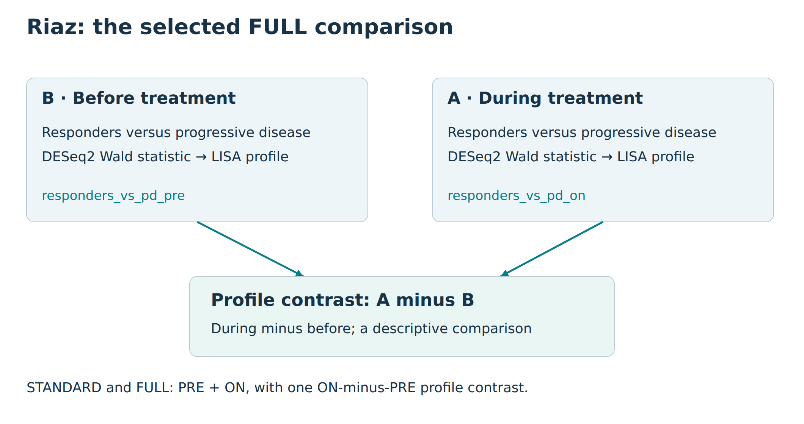
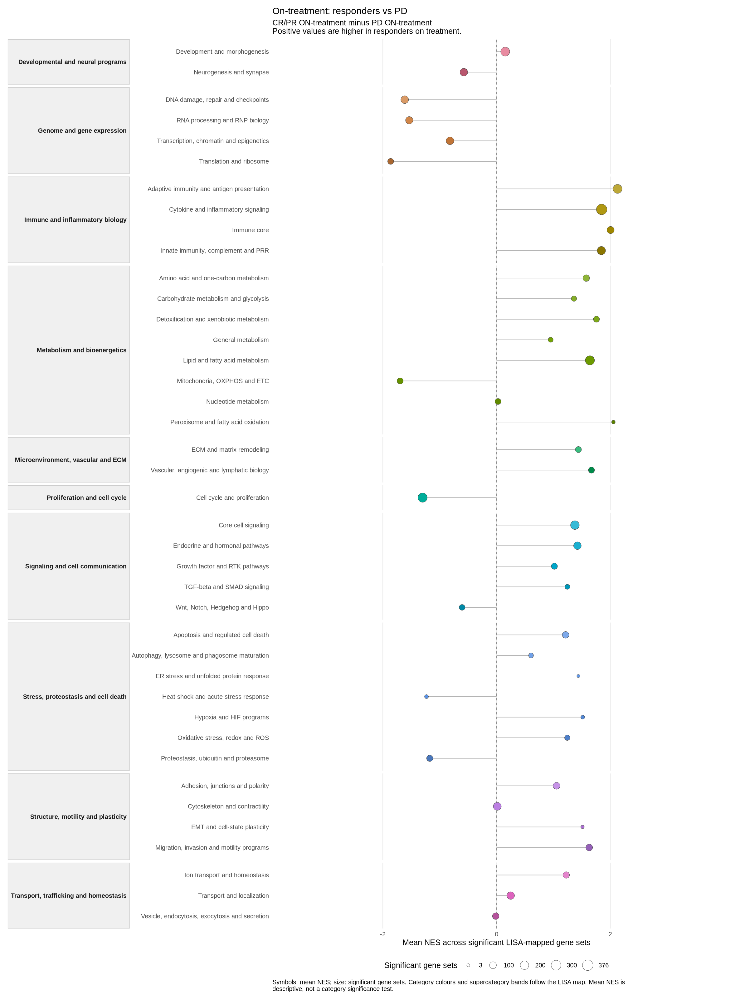
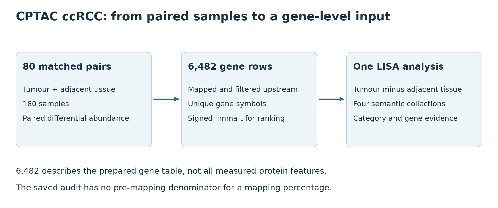
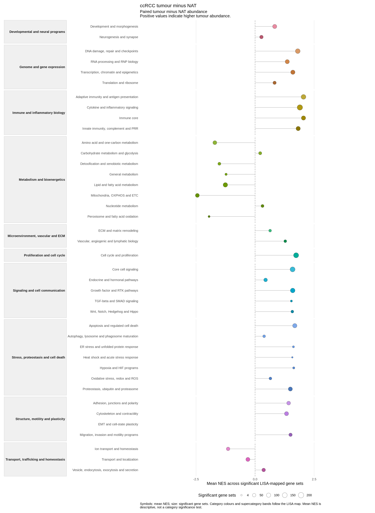

## Run your first analysis: Riaz ON {#riaz-on-quick-start--introduction}


This example uses melanoma biopsies collected during nivolumab treatment in
[Riaz et al. (2017)](https://doi.org/10.1016/j.cell.2017.09.028). It compares
complete or partial responders (CR/PR) with patients with progressive disease
(PD). Positive values are higher in responders.

<span id="run-the-example"></span>

### Run the example {#riaz-on-quick-start--run-the-example}

[Install lisaR](start-with-lisar.html#installation--introduction) first, then copy the following block into R
or RStudio. It prepares the human gene-set resource, downloads the previously
computed DE table and runs one STANDARD analysis. It does not fit DESeq2 again
or run PRE and ON together.

Use a short writable path. The `riaz-data` and `riaz-on` directories must not
already exist; choose another root if you have run this example before.
The resource is downloaded once and reused on later runs. The
`accept_terms = TRUE` argument records acceptance of the
[applicable resource terms](configuration-resources-and-execution.html#resources-and-provenance--introduction).

<!-- BEGIN RIAZ ON EXAMPLE -->
```{r riaz-on, eval=FALSE}
library(lisaR)

# Use a short, writable path. Change C:/lisa if needed.
root <- if (.Platform$OS.type == "windows") "C:/lisa" else "~/lisa"
root <- path.expand(root)
dir.create(root, recursive = TRUE, showWarnings = FALSE)

# Prepare the human gene-set membership resource once.
prepare_lisa_msigdb_resource(accept_terms = TRUE)

# Download the prepared Riaz data to a new directory.
riaz <- install_lisa_example_bundle(
  "riaz-gse91061",
  destination = file.path(root, "riaz-data")
)

# Analyse ON only: CR/PR responders versus PD during treatment.
result <- run_lisa(
  de = list(responders_vs_pd_on = file.path(
    riaz$bundle, "outputs", "lisa_inputs", "responders_vs_pd_on.tsv"
  )),
  output_dir = file.path(root, "riaz-on"),
  species = "Homo sapiens",
  method = "DESeq2",
  positive_direction =
    "Higher in CR/PR responders than in PD during treatment",
  mode = "standard"
)

stopifnot(identical(result$gate, "PASS"))
browseURL(result$report_index)
```
<!-- END RIAZ ON EXAMPLE -->

The script is also installed at
`system.file("examples", "riaz-on-quick-start.R", package = "lisaR")`.

<span id="what-to-expect"></span>

### What to expect {#riaz-on-quick-start--what-to-expect}

The report opens when the run finishes. Enrichment and figure generation can
take time; this is a real-data analysis, not an instant demonstration.
If R reports an error, resolve it before opening a partial report.

Open **responders_vs_pd_on**, then its **GOBP-C2** LISA plot. Select a category
to inspect its member gene sets. PNG and SVG figures, source tables and
figure recipes are included. PDF is optional.

Keep the whole `riaz-on` folder if you move or share the report, not just
`report_index.html`.

**Next: [Use your own DE](preparing-and-analysing-your-data.html#use-your-own-de--introduction).**
To explore the example output first, [read your report](start-with-lisar.html#read-your-report--introduction).

## Riaz GSE91061: paired melanoma biopsies {#riaz-gse91061-worked-example--introduction}


For one DE without a study file, start with [Riaz ON](worked-examples.html#riaz-on-quick-start--introduction).
This guide covers the full prepared PRE/ON study.

This example asks how transcriptional programmes differ before and during
nivolumab, both within response groups and between patients with complete or
partial response (CR/PR) and patients with progressive disease (PD). It starts
from reviewed, already fitted RNA-seq results. You can therefore create, plan,
run and recognise the lisaR project without downloading the original study
files or fitting DESeq2 again.

  
*Riaz GSE91061 design. The diagram records the before/during and response-group
structure used by this example; it does not display a result or a biological
measurement.*

The prepared design has 26 complete patient pairs: eight CR/PR and 18 PD. One
before-treatment and one on-treatment sample are retained for each patient.
The accompanying study is Riaz N, Havel JJ, Makarov V, et al. *Tumor and
Microenvironment Evolution during Immunotherapy with Nivolumab*. Cell
2017;171:934-949, [GEO GSE91061](https://www.ncbi.nlm.nih.gov/geo/query/acc.cgi?acc=GSE91061).

<span id="know-which-comparison-you-are-running"></span>

### Know which comparison you are running {#riaz-gse91061-worked-example--know-which-comparison-you-are-running}

The prepared tutorial executes two differential expression analyses and one
LISA profile contrast across `GOBP-C2`, `GOMF`, `GOCC` and `PATHWAYS`.

| DE input | Comparison | Upstream model |
|---|---|---|
| `responders_vs_pd_pre` | CR/PR minus PD before treatment | Cross-sectional comparison adjusted for prior ipilimumab |
| `responders_vs_pd_on` | CR/PR minus PD during treatment | Cross-sectional comparison adjusted for prior ipilimumab |

The contrast `response_separation_by_time` compares ON (A) minus PRE (B).
A positive difference means a higher plotted category mean NES during treatment.
This is a descriptive comparison of enrichment profiles, not a fitted
interaction test. Both STANDARD and FULL use these same two analyses and this
one contrast. No other DE analysis must run first. The original bundle retains
additional upstream study results as provenance; the tutorial does not run them.

Use a short writable project root. The examples below use `D:/lisa` on
Windows; change the drive if needed. Avoid nesting the project under several
long folder names. Preparation creates `study.yml`, short inputs under `data/`
and a `provenance/path_map.tsv` linking them to their original names and hashes.
Results go to `out/`. Scientific comparison names and directions are unchanged.

<span id="obtain-the-reviewed-prepared-bundle"></span>

### 1. Obtain the reviewed prepared bundle {#riaz-gse91061-worked-example--obtain-the-reviewed-prepared-bundle}

Install lisaR as described in [Installation](start-with-lisar.html#installation--introduction), and prepare
the external membership resource as described in
[Resources and provenance](configuration-resources-and-execution.html#resources-and-provenance--introduction). Then obtain the
reviewed Riaz bundle in a new destination:

```{r obtain-riaz-bundle, eval=FALSE}
library(lisaR)
root <- if (.Platform$OS.type == "windows") "D:/lisa" else "~/lisa"
root <- path.expand(root)
dir.create(file.path(root, "bundles"), recursive = TRUE, showWarnings = FALSE)

bundle <- install_lisa_example_bundle(
  "riaz-gse91061",
  destination = file.path(root, "bundles", "riaz")
)
bundle$next_command
```

The default source is a versioned public release in
`DBM-OlmedaLab/lisaR-example-data`. The installer verifies its pinned archive and
member checksums before promoting the bundle. A verified cached archive can be
reused offline. This acquisition step does not fit a model or run enrichment.

`bundle$next_command` is a complete POSIX shell command. If you are working in
RStudio, the following R equivalent uses the same active R installation.

<span id="create-the-prepared-project"></span>

### 2. Create the prepared project {#riaz-gse91061-worked-example--create-the-prepared-project}

```{r prepare-riaz-project, eval=FALSE}
project <- normalizePath(file.path(root, "riaz"),
                         winslash = "/", mustWork = FALSE)
Sys.setenv(
  LISAR_RIAZ_PREPARED_BUNDLE = bundle$bundle,
  LISAR_RIAZ_PROJECT_DIR = project
)
example_dir <- system.file("examples", "riaz-gse91061", package = "lisaR")
rscript <- file.path(R.home("bin"), "Rscript")
prepare_script <- file.path(example_dir, "scripts", "11_prepare_prepared_project.R")
stopifnot(system2(rscript, c("--vanilla", shQuote(prepare_script))) == 0L)
```

Preparation writes the study files and validates their resources without
running GSEA. It reports `RIAZ_PREPARED_PROJECT=PASS`. A new project directory
is required. The installed standard configuration uses `lisa_dictionary_core@1.0.0`,
`msigdb_term2gene@2026.1` and `lisa_category_map@1.0.0`. Older prepared
configurations may retain historical pinned dictionary versions; lisaR reads
those original resources rather than silently replacing them. This is still a
prepared project, not a completed scientific result.

<span id="inspect-the-study-and-its-output-plan"></span>

### 3. Inspect the study and its output plan {#riaz-gse91061-worked-example--inspect-the-study-and-its-output-plan}

After preparation, the study file is `study.yml` within
`project`. It requests STANDARD and the four semantic collections, with
Hallmarks and native maps disabled. Inspect the comparisons, readiness and
estimated output before you decide to execute it:

```{r check-riaz-study, eval=FALSE}
config <- file.path(project, "study.yml")
study <- yaml::read_yaml(config)
print(data.frame(
  analysis = vapply(study$single_de, `[[`, character(1), "analysis_id"),
  comparison = vapply(study$single_de, `[[`, character(1), "comparison"),
  positive_direction = vapply(study$single_de, `[[`, character(1),
                              "positive_direction")
))
print(study$collections)
print(study$report)

validation <- validate_lisa_config(config, check_files = TRUE)
stopifnot(validation$execution_ready)
output_plan <- plan_lisa_outputs(config)
print(output_plan$summary)
```

`plan_lisa_outputs()` estimates the intended products. It does not execute the
analysis. The installed stage-09 runner then creates a separate dry-run
configuration, checks that plan, revalidates the unchanged execution
configuration, computes enrichment and verifies the result. It does not refit
DESeq2.

<span id="run-and-recognise-standard"></span>

### 4. Run and recognise STANDARD {#riaz-gse91061-worked-example--run-and-recognise-standard}

```{r run-riaz-standard, eval=FALSE}
run_script <- file.path(example_dir, "scripts", "09_run_lisa_example.R")
stopifnot(system2(rscript, c("--vanilla", shQuote(run_script))) == 0L)
browseURL(file.path(project, "out", "report_index.html"))
```

The runner prints `LISA_PLAN_GATE=PASS` after recognising the dry-run directory
as a planning artefact rather than a scientific result. It prints
`LISA_STANDARD_GATE=PASS` only after the scientific run at
`project/out` verifies as a `scientific_run`. Keep that
directory and its saved configuration together.

You should see the PRE and ON analysis identifiers and their single contrast in the
STANDARD report. The category plot below is the saved on-treatment
`responders_vs_pd_on` result for `GOBP-C2`, not the upstream interaction and not
the later A-minus-B profile contrast.

<span id="assemble-the-selected-integrated-full-report"></span>

### 5. Assemble the selected integrated FULL report {#riaz-gse91061-worked-example--assemble-the-selected-integrated-full-report}

After a verified standard run is available, the installed selected-report
script creates a new integrated report from saved results. See
[Scientific report](reports-and-exploration.html#scientific-report--assemble-an-integrated-selected-full-report)
for the general saved-result builder. This is distinct
from running `run_lisa()` with a full report mode. The selected-report script
does not refit DE or rerun GSEA. With `--complete-missing true`, it reuses
saved figures and creates only missing presentation products.

```{r build-selected-riaz-full, eval=FALSE}
source_dir <- file.path(project, "out")
output_dir <- file.path(project, "extra")
stopifnot(dir.exists(source_dir), !file.exists(output_dir))
script <- system.file("scripts", "build_selected_LISA_report.R", package = "lisaR")

status <- system2(file.path(R.home("bin"), "Rscript"), c(
  "--vanilla", shQuote(script),
  "--source-dir", shQuote(source_dir),
  "--output-dir", shQuote(output_dir),
  "--analyses", "responders_vs_pd_pre,responders_vs_pd_on",
  "--contrasts", "response_separation_by_time",
  "--complete-missing", "true",
  "--title", shQuote("Response-group separation during and before nivolumab")
))
stopifnot(status == 0L)
browseURL(file.path(output_dir, "report_index.html"))
```

`source_dir` must be the verified standard-result directory and `output_dir`
must be a new directory outside it. The script checks that the selected
contrast refers only to the two selected analyses, retains the saved source
identity, and verifies that the integrated navigation contains exactly the
two named analyses and the `response_separation_by_time` contrast. In that
contrast, the saved during-treatment profile is A and the saved baseline
profile is B. It is not a fresh time-by-response interaction test. Optional
native KEGG maps require their own
authorised local snapshot and are not enabled by this command.

  
*A saved selected-FULL category overview for the on-treatment comparison.
Each point is the mean NES of significant unique member gene sets (GSEA
adjusted P at or below 0.25), with point size showing their count. Positive
NES follows CR/PR minus PD during treatment. Colours and bands organise
categories and supercategories; they do not define a new significance test.*

This archived selected-FULL illustration is descriptive. Its screenshot and
source table do not establish exact identity with the saved category-inference
rows used by a newer STANDARD report, so no adjusted-P stars are overlaid on
this image. In a current verified run, use its own **Category significance**
view and card to read the four-star threshold, exact P and d/N; never infer a
category P from this figure's mean NES or member-set FDR.

[Full-size PNG](figures/riaz-category.png),
[source table](figures/riaz-category_source.tsv) and
[figure settings](figures/riaz-category_settings.json).

### Optional upstream reconstruction {#riaz-gse91061-worked-example--optional-upstream-reconstruction}

The prepared route is the recommended route when the reviewed bundle is
available. Reconstruction is separate: the installed scripts `00` through
`05` obtain and verify the required original study files, rebuild the paired
cohort and upstream DE outputs, and then feed the ordinary preparation stages.
Stage 00 downloads four GEO files and verifies six publisher supplements
that you obtain separately from [the article](https://doi.org/10.1016/j.cell.2017.09.028); it is not
an alternative source for the prepared bundle and it is not a lightweight
first run.

Use the installed example directory to inspect the reconstruction scripts and
their input contract:

```{r locate-riaz-reconstruction, eval=TRUE}
example_dir <- system.file("examples", "riaz-gse91061", package = "lisaR")
list.files(file.path(example_dir, "scripts"), pattern = "^0[0-5]_", full.names = TRUE)
```

The prepared and reconstruction routes preserve different provenance. Neither
route changes the declared response groups, comparison directions, selected
collections or saved FULL product scope.

## CPTAC ccRCC: paired global proteomics {#cptac-ccrcc-proteomics--introduction}


This example asks which programmes are enriched in clear cell renal cell
carcinoma (ccRCC) relative to adjacent renal tissue. It starts from a frozen,
paired global-proteomic differential-abundance table for **80 matched pairs**:
one tumour and one adjacent non-tumoral renal-tissue sample per patient, 160
samples in total. NAT means adjacent non-tumour tissue here. It does not mean
healthy donor kidney.

The source study is Clark DJ, Dhanasekaran SM, Petralia F, et al. *Integrated
Proteogenomic Characterization of Clear Cell Renal Cell Carcinoma*. Cell
2019;179:964-983, CPTAC ccRCC (PDC000127). The reviewed example bundle contains
derived inputs and audit records, not the original abundance matrix.

<span id="know-what-was-prepared-upstream"></span>

### Know what was prepared upstream {#cptac-ccrcc-proteomics--know-what-was-prepared-upstream}

  
*Input scope of the prepared CPTAC example. Protein-to-gene mapping, filtering
and paired modelling take place upstream of lisaR.*

The supplied primary table has 6,482 usable, unique gene-symbol rows for the
80-pair comparison. Its declared effect is `tumor_minus_nat`, so a positive
value means higher tumour abundance. The ranking column is the moderated
limma `t` from the upstream paired model. `p_value` and
`fdr_bh_all_genes` remain in the table. lisaR uses the full ranked table and
does not refit limma or pre-filter genes by significance for this route.

Protein measurements were mapped to gene identifiers and filtered before this
input was exported. The useful coverage for this example is therefore the
number of usable mapped gene rows, not a count of all originally measured
protein features. The frozen input audit records zero duplicate Entrez IDs,
zero missing Entrez IDs and zero non-finite values in the required numeric
columns. It does not establish the total number of protein features before
mapping, how many-to-one mappings were resolved or how many features were
discarded at each filter. A mapping percentage or protein-level coverage claim
cannot be recovered from 6,482 gene rows alone.

The `global proteomic` profile configures warnings below 500 usable features
and below 1,500 usable features. These are operational warning thresholds,
not validated scientific minima. A targeted panel has a limited feature
universe and needs its own coverage assessment; it is not represented by this
global-proteomic example. Tumour tissue and adjacent tissue also differ in
cellular composition, which this prepared differential-abundance table does
not resolve.

Use a short writable project root. The examples below use `D:/lisa` on
Windows; change the drive if needed. Avoid nesting the project under several
long folder names. Preparation creates `study.yml`, short inputs under `data/`
and a `provenance/path_map.tsv` linking them to their original names and hashes.
Results go to `out/`. Scientific comparison names and directions are unchanged.

<span id="obtain-the-reviewed-bundle"></span>

### 1. Obtain the reviewed bundle {#cptac-ccrcc-proteomics--obtain-the-reviewed-bundle}

Install lisaR first with [Installation](start-with-lisar.html#installation--introduction), then make the
external membership resource available through
[Resources and provenance](configuration-resources-and-execution.html#resources-and-provenance--introduction). Obtain the
reviewed input bundle in a new destination:

```{r obtain-cptac-bundle, eval=FALSE}
library(lisaR)
root <- if (.Platform$OS.type == "windows") "D:/lisa" else "~/lisa"
root <- path.expand(root)
dir.create(file.path(root, "bundles"), recursive = TRUE, showWarnings = FALSE)

bundle <- install_lisa_example_bundle(
  "cptac-ccrcc",
  destination = file.path(root, "bundles", "cptac")
)
bundle$next_command
```

The default source is a versioned public release in
`DBM-OlmedaLab/lisaR-example-data`. The installer verifies the pinned archive and
the six-file member manifest before promoting it. A verified cached archive
can be reused offline. The bundle contains the primary table and five audit
files, but acquiring it does not run lisaR.

`bundle$next_command` is a complete POSIX shell command with prepare-only mode
enabled. To prepare from R or RStudio using the current R installation:

<span id="create-and-check-the-prepared-project"></span>

### 2. Create and check the prepared project {#cptac-ccrcc-proteomics--create-and-check-the-prepared-project}

```{r prepare-cptac-project, eval=FALSE}
project <- normalizePath(file.path(root, "cptac"),
                         winslash = "/", mustWork = FALSE)
Sys.setenv(
  LISAR_CPTAC_CCRCC_BUNDLE = bundle$bundle,
  LISAR_CPTAC_CCRCC_PROJECT_DIR = project,
  LISAR_CPTAC_CCRCC_PREPARE_ONLY = "1"
)
prepare_script <- system.file("examples", "cptac-ccrcc",
  "prepare_and_run_cptac_ccrcc.R", package = "lisaR")
status <- system2(file.path(R.home("bin"), "Rscript"),
                  c("--vanilla", shQuote(prepare_script)))
Sys.unsetenv("LISAR_CPTAC_CCRCC_PREPARE_ONLY")
stopifnot(status == 0L)
```

Preparation verifies and copies the inputs, resolves resources, validates and
plans the project, then reports `CPTAC_CCRCC_LOCAL_ROUTE=PREPARE_ONLY_PASS`.
It performs no new differential-abundance fit and does not call `run_lisa()`.
The promoted directory is an execution-ready prepared project, not a completed
scientific result.

<span id="inspect-the-configuration-and-its-output-plan"></span>

### 3. Inspect the configuration and its output plan {#cptac-ccrcc-proteomics--inspect-the-configuration-and-its-output-plan}

```{r inspect-cptac-example, eval=FALSE}
config <- file.path(project, "study.yml")
study <- yaml::read_yaml(config)
print(study$pipeline)
print(data.frame(
  analysis = study$single_de[[1]]$analysis_id,
  comparison = study$single_de[[1]]$comparison,
  positive_direction = study$single_de[[1]]$positive_direction,
  rank_column = study$single_de[[1]]$rank_col
))
validation <- validate_lisa_config(config, check_files = TRUE)
stopifnot(validation$execution_ready)
output_plan <- plan_lisa_outputs(config)
print(output_plan$summary)
```

This inspection and `plan_lisa_outputs()` describe the intended products. They
do not execute GSEA. Check that the analysis is
`cptac_ccrcc_tumor_minus_nat`, the effect direction is tumour minus NAT and the
ranking column is `t` before proceeding.

<span id="run-verify-and-recognise-the-result"></span>

### 4. Run, verify and recognise the result {#cptac-ccrcc-proteomics--run-verify-and-recognise-the-result}

```{r run-cptac-example, eval=FALSE}
result <- run_lisa(config)
check <- verify_lisa_run(result$output_dir)
stopifnot(identical(result$gate, "PASS"), identical(check$gate, "PASS"))
print(result$output_dir)
browseURL(file.path(result$output_dir, "report_index.html"))
```

The generated configuration has one DE analysis,
`cptac_ccrcc_tumor_minus_nat`, and **no LISA profile contrast in this example**.
It uses `global proteomic`, one worker, the four semantic collections and the
resource identities `lisa_dictionary_core@1.0.0`, `msigdb_term2gene@2026.1` and
`lisa_category_map@1.0.0`. Hallmarks, ORA and native KEGG maps are disabled.
This is a choice for the example, not a restriction on proteomic studies in
lisaR.

A successful run is written to
`project/out`. Verification must report
gate `PASS`. In the report, positive NES follows the prepared tumour-minus-NAT
ranking. No responder grouping, healthy-donor comparison or protein-level
model has been added by lisaR.

STANDARD provides category plots and linked gene-set/gene evidence. The
[report guide](reports-and-exploration.html#scientific-report--introduction) shows how to add selected presentation
products to a completed run without repeating enrichment.

  
*A saved CPTAC category overview. Each point shows the mean NES of significant
unique member gene sets (GSEA adjusted P at or below 0.25); its size records
their count. Positive NES follows tumour minus adjacent tissue. Colours and
bands organise categories and supercategories. These are descriptive category
summaries, not category-level significance tests.*

[Full-size PNG](figures/cptac-category.png),
[source table](figures/cptac-category_source.tsv) and
[figure settings](figures/cptac-category_settings.json).

### Optional upstream reconstruction {#cptac-ccrcc-proteomics--optional-upstream-reconstruction}

The prepared example bundle includes the DE table, not an executable
reconstruction from raw mass spectra. A defensible upstream rebuild starts
from an authorised processed abundance matrix and sample annotations from
[CPTAC/PDC](https://pdc.cancer.gov/pdc/study/PDC000127). Reproduce the 80-pair
selection, specify the paired limma design and preserve the protein-to-gene
mapping, collision handling, filtering and missing-value decisions before
exporting a complete ranked table. The supplied audit files identify the
prepared input, but do not replace those source materials. This separate task
is not run by the example preparer, and the guide does not claim a route from
raw mass spectra.

<span id="what-the-five-audit-files-document"></span>

### What the five audit files document {#cptac-ccrcc-proteomics--what-the-five-audit-files-document}

The prepared project carries the primary DE table with five audit records:
the matched-pair sample receipt, primary QC, data-quality summary, input
provenance and the 80-pair list. They establish the input contract for this
example. They do not substitute for access conditions, clinical context,
sample processing information or an independent reanalysis of the source
proteomics.

For another proteomic study, preserve the upstream mapping record, the number
of measured features, the number retained after mapping and filtering, the
duplicate policy, and missing-value handling with the prepared DE result. The
[Preparing DE inputs](preparing-and-analysing-your-data.html#preparing-de-inputs--introduction) guide describes the general
prepared-input contract.

## Inspect the saved examples offline

The figures above have saved source tables beside them. Reading those tables
does not download either archive, fit DE, or claim that an archive workflow ran
during the build. They retain the original plotted values and column names.

```{r inspect-saved-example-values, eval=TRUE}
read_saved_example <- function(name) utils::read.delim(
  file.path("figures", name), sep = "\t", check.names = FALSE
)
riaz_saved <- read_saved_example("riaz-category_source.tsv")
cptac_saved <- read_saved_example("cptac-category_source.tsv")
stopifnot(nrow(riaz_saved) > 0L, nrow(cptac_saved) > 0L)
print(utils::head(riaz_saved))
print(utils::head(cptac_saved))
data.frame(example = c("Riaz", "CPTAC"),
           saved_rows = c(nrow(riaz_saved), nrow(cptac_saved)),
           saved_columns = c(ncol(riaz_saved), ncol(cptac_saved)))
```

## Session information

The evaluated examples use the R session recorded here. Manual network,
archive and GUI templates are not claimed as executed by this record.

```{r documentation-session-info, eval=TRUE}
sessionInfo()
```
